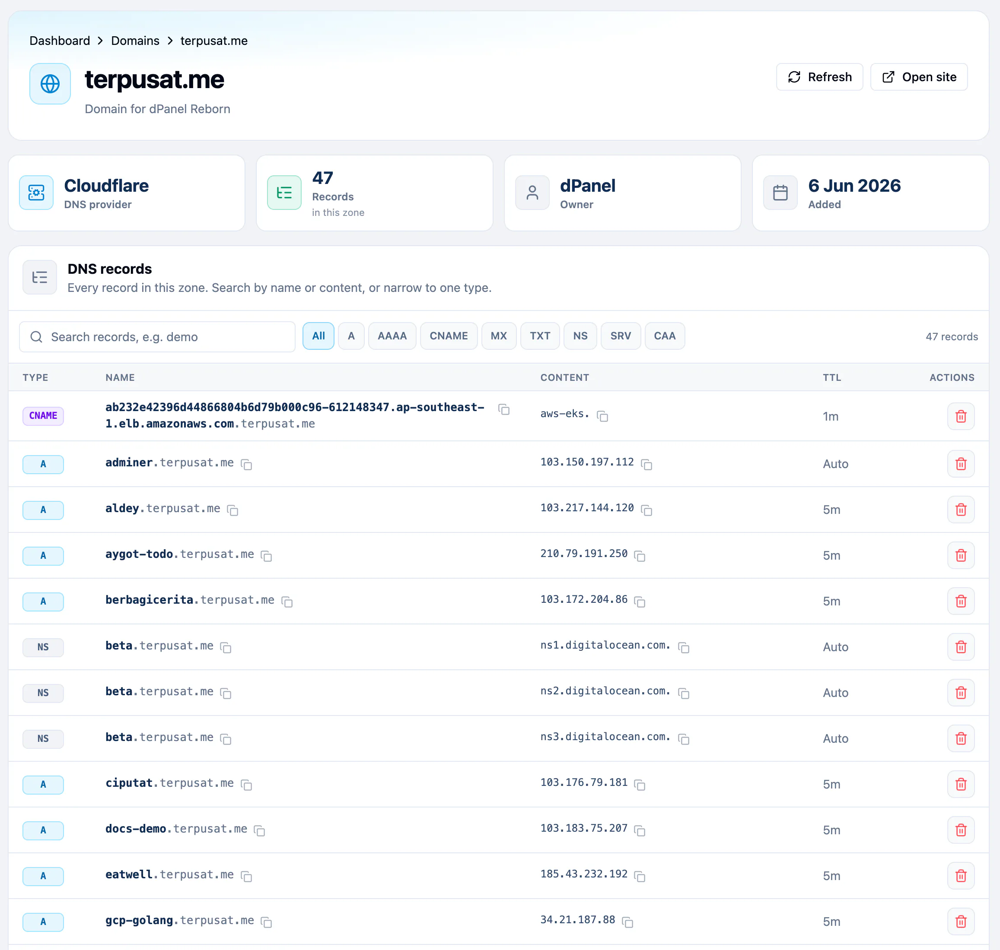

Setiap domain di dPanel punya halaman sendiri yang menampilkan semua record DNS-nya (entri yang mengarahkan sebuah nama ke sebuah alamat), dibaca langsung dari Cloudflare atau DigitalOcean. Anda bisa mencari record berdasarkan nama atau isi, menyaringnya ke satu jenis record, menyalin nama atau nilainya, dan menghapus record, tanpa membuka konsol penyedia DNS Anda.

## Membuka record sebuah domain

1. Buka **Domain & DNS** di sidebar.
2. Pilih domainnya, atau tekan **Detil** di barisnya.
3. Gulir ke **Record DNS**. Angka di samping kotak pencarian, misalnya **47 record**, adalah ukuran zona itu.

Setiap baris menampilkan **Jenis**, **Nama**, **Isi**, dan **TTL** record itu (time to live: berapa lama komputer lain boleh mengingat jawabannya sebelum bertanya lagi). Nama di apex zona tertulis **root**, dan TTL Cloudflare 1 detik tertulis **Otomatis**. Record ditampilkan 20 per halaman; pakai tombol halaman di bawah tabel untuk melihat lebih banyak.

## Menemukan record

1. Ketik sebagian nama atau nilai di **Cari record, mis. demo**. Daftarnya diperbarui saat Anda mengetik, huruf besar dan kecil tidak dibedakan, dan teks yang cocok disorot.
2. Untuk menyaring daftar ke satu jenis record, tekan sebuah chip: **A**, **AAAA**, **CNAME**, **MX**, **TXT**, **NS**, **SRV**, atau **CAA**. Tekan lagi, atau tekan **Semua**, untuk melihat semua jenis.
3. Angkanya berubah menjadi jumlah yang cocok, misalnya **2 cocok**.

Jika tidak ada yang cocok, tabel memberi tahu, misalnya **Tidak ada record A yang cocok dengan “demo”.**, dan **Hapus pencarian dan filter** menampilkan semua record lagi.

## Menyalin nama atau nilai

Di baris record, tekan **Salin nama** atau **Salin isi**. dPanel mengonfirmasinya dengan nilai yang disalin, misalnya **app.example.com disalin**. Gunakan untuk menempelkan record ke tiket bantuan, atau untuk memeriksa ke mana sebuah nama lama dulu mengarah.

## Menghapus record

1. Di baris record, tekan **Hapus**.
2. Konfirmasi **Hapus Catatan Domain**.

:::warning[Langsung berlaku]
Menghapus record langsung menghapusnya di penyedia DNS Anda. Apa pun yang masih memakai nama itu tidak akan bisa diakses lagi.
:::

Tidak ada formulir untuk menambah record secara manual. dPanel membuat record `A` sendiri ketika sebuah [load balancer](./load-balancers.md) memakai domain **Terkelola**.

## Pertanyaan yang sering diajukan

### Bisakah saya mencari record DNS berdasarkan alamat IP?

Bisa. Pencarian mencocokkan isi record selain namanya, jadi mengetik alamat IP akan menemukan setiap record yang mengarah ke alamat itu.

### Mengapa sebuah record menampilkan TTL Otomatis?

Cloudflare memakai TTL 1 detik untuk berarti "otomatis", dan membiarkan Cloudflare memilih nilai sebenarnya. dPanel menampilkannya sebagai **Otomatis**.

### Apakah record-nya selalu terbaru?

Ya. dPanel membaca zona dari penyedia DNS Anda setiap kali Anda membuka halaman, mencari, atau menekan **Muat ulang** di bagian atas halaman.

### Apa yang perlu dibersihkan setelah menghapus load balancer?

Periksa apakah record `A`-nya masih ada di zona. Cari nama host-nya, lalu hapus record itu jika namanya sudah tidak Anda pakai.

### Apakah pencariannya membedakan huruf besar dan kecil?

Tidak. `Demo`, `DEMO`, dan `demo` menemukan record yang sama.
