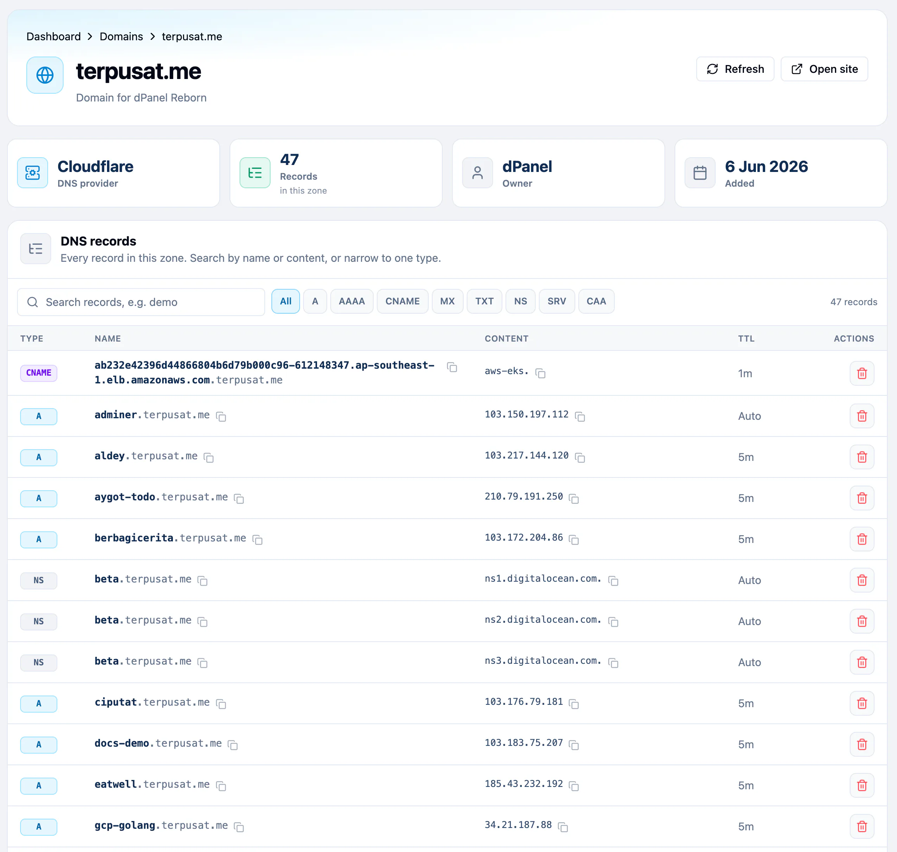

dPanel mengelola DNS untuk domain yang sudah Anda miliki. Tambahkan domain yang di-host di Cloudflare atau DigitalOcean dengan token API, lalu dPanel membaca record-nya, memungkinkan Anda mencarinya, dan membuat record `A` yang mengarahkan sebuah nama ke server Anda ketika load balancer memakai domain itu.

dPanel tidak menjual atau memindahkan domain, dan tidak pernah mengubah registrar Anda. Anda tetap membeli domain di tempat biasa. Yang dibutuhkan dPanel hanyalah akses ke penyedia yang menjawab DNS domain itu.

## Yang perlu disiapkan

- Domain yang DNS-nya di-host di **Cloudflare** atau **DigitalOcean**.
- Token API dari penyedia tersebut yang boleh membaca dan mengubah record DNS zona itu.

:::tip
Gunakan token dengan cakupan terbatas. Di Cloudflare, token khusus "DNS edit" untuk satu zona itu sudah cukup.
:::

## Menambahkan domain

1. Buka **Domain & DNS** di sidebar.
2. Tekan **Tambah domain**.
3. **Domain**: zona yang ingin dikelola dPanel, misalnya `example.com`. Subdomain juga bisa.
4. **Deskripsi**: opsional. Catatan untuk rekan setim, misalnya "Domain marketing produksi".
5. **Provider**: pilih tempat zona itu di-host.
6. **Token API**: tempel token dari penyedia.
7. Ketika ringkasan menunjukkan **Siap ditambahkan**, tekan **Tambah domain**.

## Langkah berikutnya

dPanel membaca zona itu terlebih dahulu dan menampilkan record yang sudah ada. Tidak ada yang diubah sampai domain itu dipakai, misalnya sebagai domain **Terkelola** pada load balancer.

## Halaman domain

Pilih domain di daftar, atau tekan **Detil** di barisnya, untuk membuka halamannya sendiri. Halaman ini menampilkan:

- **Penyedia DNS**, jumlah **Record** di zona itu, workspace **Pemilik**, dan kapan domain itu **Ditambahkan**.
- **Muat ulang**, yang membaca zona itu lagi, dan **Buka situs**, yang membuka `https://` beserta domainnya di tab baru.
- **Record DNS**: setiap record di zona itu, yang bisa Anda cari, saring berdasarkan jenis, dan hapus. Lihat [Record DNS](./dns-records.md).

## Memakai domain di load balancer

Di load balancer, pilih **Terkelola** pada **Nama Domain**, ketik **Subdomain**, lalu pilih domainnya. dPanel membuat record `A` dari nama itu ke alamat publik server gateway. dPanel menolak nama yang sudah punya record, jadi record yang ada tetap aman. Lihat [Load balancer dan HTTPS](./load-balancers.md).

## Membagikan atau menghapus domain

- Domain yang ditambahkan di workspace tim otomatis dibagikan ke tim itu. Domain tetap berada di workspace tempat ia ditambahkan; domain tidak bisa dipindahkan ke workspace lain.
- Untuk mengeluarkan domain dari dPanel, buka menu **Lebih** (⋯) di barisnya, pilih **Hapus**, lalu konfirmasi **Hapus Domain**. Ini hanya mengeluarkannya dari dPanel; zona dan record-nya tetap ada di penyedia DNS Anda.

## Pertanyaan yang sering diajukan

### Penyedia DNS apa saja yang didukung dPanel?

Cloudflare dan DigitalOcean. Domain Anda boleh didaftarkan di mana saja, asalkan DNS-nya di-host di salah satu penyedia itu.

### Apakah saya harus memindahkan domain ke dPanel?

Tidak. dPanel tidak pernah menjual, mendaftarkan, atau memindahkan domain. dPanel hanya memakai token API untuk membaca dan menulis record DNS di penyedia DNS Anda.

### Bisakah saya menambah record DNS secara manual di dPanel?

Belum. dPanel membuat record sendiri ketika sebuah load balancer memakai domain itu. Anda bisa mencari, menyalin, dan menghapus record di halaman domain.

### Apakah token API DNS saya aman?

Token hanya dikirim sekali, saat Anda menambahkan domain, dan tidak pernah ditampilkan lagi. Ringkasan tidak pernah menampilkannya, dan dPanel menampilkan **Disimpan aman** sebagai gantinya.
