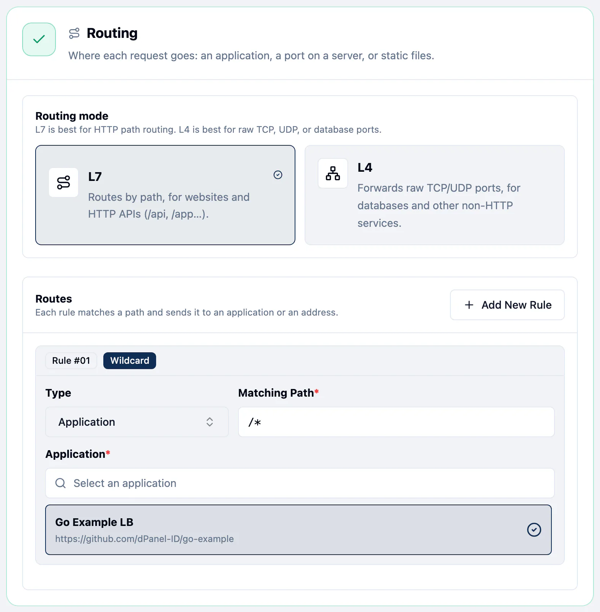

Load balancer di dPanel memublikasikan aplikasi Anda di sebuah domain dengan HTTPS. Load balancer menerima lalu lintas yang datang ke domain itu, mendapatkan dan memperpanjang sertifikat SSL Let's Encrypt gratis, lalu meneruskan setiap request ke aplikasi atau ke port di sebuah server. Dengan domain yang dikelola di dPanel, record DNS-nya juga dibuatkan untuk Anda.

dPanel membangun load balancer di salah satu server Anda sendiri, yaitu **gateway**, dan menjalankan mesin web server di sana: Caddy, Apache APISIX, atau HAProxy. Tidak ada yang berjalan di luar server Anda.

## Yang perlu disiapkan

- **Server yang sudah siap** sebagai gateway, dengan port 80 dan 443 bisa dijangkau dari internet. Server yang diluncurkan dPanel sudah membukanya. Lihat [Server](../servers/overview.md).
- **Domain.** Tambahkan zonanya ke dPanel di **Domain & DNS** agar dPanel bisa membuat record-nya ([Domain dan DNS](./domains-and-dns.md)), atau pakai hostname yang Anda kelola sendiri.
- **Tujuan lalu lintas**: [aplikasi](../applications/overview.md) dPanel, atau layanan yang mendengarkan sebuah port.

:::warning[Pakai nama yang belum dipakai]
Dengan domain terkelola, dPanel membuat record DNS baru. dPanel menolak subdomain yang sudah punya record, jadi record yang ada tidak pernah tertimpa. Pakai nama baru, misalnya `app`.
:::

## Engine

Setiap engine melayani load balancer yang sama: HTTPS dengan sertifikat gratis, routing path, proxy Cloudflare, dan header `server: dPanel`. Pilih yang Anda kenal atau sukai.

| Engine            | Apa itu                                               | L4 TCP | L4 UDP | Berkas statis dan PHP |
| ----------------- | ----------------------------------------------------- | ------ | ------ | --------------------- |
| **Caddy**         | Bawaan. dPanel Router, build Caddy dengan versi tetap | Ya     | Ya     | Ya                    |
| **Apache APISIX** | API gateway, versi tetap                              | Ya     | Ya     | Tidak                 |
| **HAProxy**       | HAProxy 3.2 LTS, versi tetap                          | Ya     | Tidak  | Tidak                 |

- **Satu engine per server.** Setiap engine menjawab di port 80 dan 443, jadi sebuah gateway menjalankan satu engine. Semua load balancer di server itu memakainya.
- **Yang tidak bisa dilakukan engine, ditolak.** Aturan berkas statis dan PHP (FastCGI) hanya berjalan di Caddy, dan UDP tidak berjalan di HAProxy. Engine lain menolaknya dengan pesan yang jelas, bukan diam-diam diabaikan.

## Membuat load balancer

Anda juga bisa meminta asisten menyiapkannya, misalnya "Pasang aplikasi saya di app.example.com dengan HTTPS"; lihat [Kumpulan contoh perintah](../ai/prompt-cookbook.md). Untuk membuatnya sendiri, buka **Load Balancer** di sidebar, lalu tekan **Buat load balancer**. Formulirnya punya empat langkah: **Gateway**, **Domain**, **Routing**, dan **Tinjau**. Panel tinjauan **Load balancer** di kanan bertuliskan **Mulai dengan server gateway** sampai Anda memilih server, lalu menghitung apa yang masih kurang.

### Langkah 1: Gateway

1. Di **Server gateway**, pilih server yang akan menjawab lalu lintas publik. Setiap baris menampilkan nama, status, alamat, dan sistem operasi server. Hanya server yang siap yang bisa dipilih; baris lainnya bertuliskan **Hanya server yang siap yang bisa menjalankan load balancer.**
2. Di **Engine web server**, pilih Caddy, Apache APISIX, atau HAProxy. Engine yang sudah ada di server muncul di **Dilaporkan di gateway terpilih** sebagai **Terpasang**. Kalau server belum punya, cari di **Instal engine** lalu tekan **Instal**. Anda bisa lanjut setelah engine terpasang.


### Langkah 2: Domain

1. Di **Nama Domain**, pilih modenya:
   - **Terkelola**: ketik **Subdomain**, lalu **Pilih domain** dari domain Anda di **Domain & DNS**. dPanel membuat record DNS-nya untuk Anda.
   - **Eksternal**: ketik hostname yang Anda kelola sendiri.
2. Periksa record DNS di bawah domain. Isinya record `A` dari host Anda ke alamat gateway:
   - Dengan **Terkelola**, kotaknya bertuliskan **Record yang dibuat dNocs di** penyedia DNS Anda, misalnya Cloudflare.
   - Dengan **Eksternal**, kotaknya bertuliskan **Record yang perlu ditambahkan di penyedia DNS Anda**. Tambahkan record itu sebelum trafik masuk. Sertifikat diterbitkan setelah nama mengarah ke gateway.
3. Untuk domain di Cloudflare, atur **Proxy lewat Cloudflare**. Bawaannya mati.
   - **Mati** (**Hanya DNS**): pengunjung langsung menuju gateway. Sertifikat diterbitkan lewat HTTP-01.
   - **Menyala** (**Proxied**): trafik melewati Cloudflare, yang menyembunyikan alamat gateway. Sertifikat diterbitkan lewat DNS-01. Berfungsi di semua mode SSL/TLS Cloudflare; **Full (strict)** juga mengenkripsi jalur dari Cloudflare ke gateway.


### Langkah 3: Routing

1. Di **Mode routing**, pilih **L7** untuk situs dan API HTTP. L7 merutekan berdasarkan path, misalnya `/api`. **L4** meneruskan port TCP atau UDP mentah, untuk basis data dan layanan non-HTTP lainnya, tanpa melihat path. L4 berjalan di semua engine; UDP tidak tersedia di HAProxy.
2. Di **Protokol dan HTTPS**, protokolnya **HTTP / HTTPS** untuk situs dan API. Biarkan **HTTPS** menyala. dPanel meminta sertifikat dan memperpanjangnya untuk Anda. Matikan hanya untuk setup HTTP biasa.
3. Di **Rute**, atur **Aturan** pertama:
   - **Tipe**: **Aplikasi** mengirim lalu lintas ke aplikasi dPanel. **Proxy Pass** mengirimnya ke alamat dan port.
   - **Pola Jalur URL**: `/*` menangkap semua request. Path yang berakhiran `/*` diberi lencana **Wildcard**.
   - **Aplikasi**: pilih aplikasinya. dPanel memakai server dan port aplikasi itu.
4. Di **Cara gateway menjangkau aplikasi ini**, pilih cara gateway terhubung ke aplikasi. Ini penting kalau aplikasi berjalan di server lain, atau di penyedia lain:
   - **Alamat terdaftar** (bawaan): alamat server yang terdaftar di dPanel. Berlaku lintas penyedia.
   - **Jaringan privat**: IP privat server. Pakai hanya kalau gateway dan server itu satu jaringan.
   - **Target kustom**: ketik alamat IP, atau URL origin seperti `https://origin.example.com` untuk aplikasi yang sudah dilayani domain lain. Dengan URL, gateway terhubung lewat HTTPS dan meminta domain tersebut. Kosongkan port untuk memakai 443 (`https`), 80 (`http`), atau port aplikasi untuk IP.

   Aplikasi yang di-deploy di server gateway sendiri dijangkau lewat `localhost`.

5. Tekan **Tambah Aturan Baru** untuk mengirim path lain ke tujuan lain, misalnya `/api/*`.



Dengan **L4**, Anda mengatur **Layanan** (misalnya PostgreSQL atau Redis), **Port listen**, **Sumber yang diizinkan**, dan **Penyeimbangan**, lalu alamat upstream-nya. **Sumber yang diizinkan** wajib untuk basis data. HTTPS tidak dipakai: koneksi diteruskan apa adanya, jadi basis data tetap memakai TLS-nya sendiri dari ujung ke ujung.

### Langkah 4: Tinjau

Langkah **Tinjau** dan panel tinjauan menampilkan semua jawaban: server gateway, mesin, domain, HTTPS, mode routing, dan rute. Tekan **Ubah** di sebuah langkah untuk mengubahnya. Saat panel bertuliskan **Siap dibuat**, tekan **Buat load balancer**.


## Setelah itu

Anda kembali ke daftar dengan pesan **Load balancer berhasil dibuat.** Barisnya berstatus **Dalam Proses** selama dPanel:

1. Membuat record DNS. Untuk domain terkelola, ini record `A` dari host ke alamat publik gateway.
2. Memasang engine di gateway kalau belum ada.
3. Menerbitkan rute dan meminta sertifikat HTTPS.

Prosesnya biasanya sekitar satu menit. Load balancer pertama di server baru juga memasang engine-nya, yang memakan waktu sekitar 10 menit. Barisnya lalu berstatus **Siap**, dan penghitung di atas memindahkannya ke **Melayani trafik**.


## Memastikan sudah aktif

Buka host-nya di browser, atau periksa dari terminal:

```bash
curl -sI https://app.example.com
```

Load balancer yang aktif di Caddy menjawab seperti ini:

```text
HTTP/2 200
alt-svc: h3=":443"; ma=2592000
content-type: text/html; charset=utf-8
server: dPanel
```

Tanda load balancer yang sehat:

| Pemeriksaan | Yang seharusnya terlihat                                                          |
| ----------- | --------------------------------------------------------------------------------- |
| DNS         | Host mengarah ke alamat publik server gateway                                     |
| HTTP biasa  | Redirect permanen ke alamat `https://`                                            |
| HTTPS       | `HTTP/2 200`, dilayani oleh aplikasi Anda, dengan `server: dPanel`                |
| Sertifikat  | Diterbitkan Let's Encrypt untuk host Anda, berlaku 90 hari, diperpanjang otomatis |
| Protokol    | HTTP/2. Caddy juga mengumumkan HTTP/3 (QUIC) lewat `alt-svc`                      |

:::tip[Nama baru kadang butuh semenit]
Kalau `curl` bilang host tidak ditemukan tepat setelah dibuat, resolver Anda mungkin menyimpan jawaban "tidak ada" dari sebelumnya. Tunggu beberapa menit, atau uji dengan resolver publik, misalnya `dig @1.1.1.1 app.example.com`.
:::

## Halaman detail

Pilih load balancer di daftar untuk membuka halamannya. Bagian kepalanya menampilkan domain, status, waktu pembaruan terakhir, dan **Buka situs**, lalu lima informasi: **Status**, **Rute** (beserta mode routing-nya), **Server gateway**, **Engine**, dan **Sertifikat**.

Kotak **Sertifikat** menampilkan penerbit dan sisa hari, misalnya **Let's Encrypt · sisa 85 hari**, beserta statusnya:

| Status                 | Artinya                                                                  |
| ---------------------- | ------------------------------------------------------------------------ |
| **Valid**              | Sertifikat masih berlaku. dPanel memperpanjangnya untuk Anda             |
| **Segera kedaluwarsa** | Sertifikat mendekati tanggal berakhirnya                                 |
| **Kedaluwarsa**        | Sertifikat sudah habis; pengunjung melihat peringatan                    |
| **Belum terbit**       | Belum ada sertifikat. Sertifikat terbit setelah nama mengarah ke gateway |
| **Tidak dipakai**      | Load balancer ini melayani HTTP biasa                                    |
| **Tidak tersedia**     | dPanel tidak bisa membaca sertifikat dari gateway. Coba lagi nanti       |

| Tab             | Kegunaannya                                                                                          |
| --------------- | ---------------------------------------------------------------------------------------------------- |
| **Graf**        | Mengikuti jalur request dari domain ke load balancer, gateway, rute, dan tujuannya                   |
| **Upstream**    | Melihat semua backend berurutan, dengan path, tujuan, dan port-nya. **Tambah backend** menambah satu |
| **Log**         | Membaca request yang ditangani gateway                                                               |
| **Konfigurasi** | Menyalakan atau mematikan **Aktifkan SSL** dan **Aktifkan proxy Cloudflare**                         |


Perubahan di **Upstream** dan **Konfigurasi** masih berupa draf sampai Anda menekan **Simpan perubahan**. Menyimpan memperbarui definisi routing dan menjalankan ulang setup gateway. **Reset draft** membuang drafnya.


## Log load balancer

Tab **Log** menampilkan request yang sampai ke gateway, dengan judul **Permintaan load balancer**. Request yang sama juga muncul di tab **Log** aplikasi, pada sumber **Load balancer**. Lihat [Log aplikasi](../applications/application-logs.md).


- **Rentang waktu**: bawaannya 10 menit terakhir. Pilih preset sampai **3 hari terakhir**, atau **Rentang khusus** dalam 3 hari terakhir.
- **Pengguliran**: daftar terbuka pada request terbaru, di bagian bawah. Gulir ke atas untuk memuat request yang lebih lama, sampai awal rentang waktu. Setelah menggulir ke atas, **Ke baris terbaru** membawa Anda kembali.
- **Unduh**: **Baris yang dimuat**, atau **Semua di rentang waktu ini**, sebagai berkas `.log`.
- **Segarkan** mengambil baris terbaru. **Muat ulang otomatis** mati secara bawaan; nyalakan untuk setiap 30 detik, setiap menit, atau setiap 5 menit.

Kontrol bersama ini dijelaskan di [Rentang waktu dan pembaruan](../logs/time-range-and-refresh.md) dan [Mengunduh log](../logs/download-logs.md).

Setiap baris berbunyi seperti permintaan yang dicatatnya: metode, domain dan path, status, serta waktu yang dibutuhkan, misalnya `GET app.example.com/api/info → 200 · 148 ms`. Baris dengan status 4xx ditampilkan sebagai peringatan dan 5xx sebagai error, sehingga permintaan yang gagal mudah terlihat. Pilih sebuah baris untuk melihat seluruh detail permintaannya, seperti alamat klien, ukuran respons, dan header.

### Dari terminal

Permintaan yang sama juga tersedia di [CLI dnocs](../ai/ai-in-the-terminal.md):

```bash
dnocs load-balancer log --id 31                 # 10 menit terakhir
dnocs load-balancer log --id 31 --since 24h     # hingga 72h (3 hari)
dnocs load-balancer log --id 31 --page 2 --limit 500
dnocs load-balancer log --id 31 --json          # setiap baris beserta field-nya
```

## Menghapus load balancer

1. Di daftar, buka menu **Lebih** (⋯) di baris load balancer itu, lalu pilih **Hapus**.
2. Konfirmasi di dialog **Hapus Load Balancer**.

dPanel mencabut rute dari gateway, dan barisnya berstatus **Terhapus**. Aplikasi dan server gateway tetap berjalan. Load balancer tetap berada di workspace tempat ia dibuat; load balancer tidak bisa dipindahkan ke workspace lain.

:::warning[Periksa record DNS-nya]
Periksa di penyedia DNS apakah record buatan dPanel masih ada setelah penghapusan, lalu hapus dari [record DNS](./dns-records.md) domain itu kalau namanya sudah tidak dipakai.
:::

:::note
Server yang masih menjadi gateway load balancer tidak bisa dihapus. Hapus load balancer-nya lebih dulu.
:::

## Pertanyaan yang sering diajukan

### Apakah sertifikat SSL-nya gratis?

Ya. dPanel mendapatkan sertifikat Let's Encrypt untuk host Anda dan memperpanjangnya sebelum kedaluwarsa, tanpa biaya. Setiap sertifikat berlaku 90 hari.

### Apakah saya butuh Cloudflare?

Tidak. dPanel bisa membuat record DNS di Cloudflare atau DigitalOcean, atau Anda bisa mengarahkan hostname apa pun ke gateway sendiri dengan **Eksternal**. **Proxy lewat Cloudflare** di langkah **Domain** dan **Aktifkan proxy Cloudflare** di tab **Konfigurasi** hanya untuk domain yang di-host di Cloudflare.

### Bisakah satu load balancer melayani beberapa aplikasi?

Bisa. Tambahkan satu rute per path, misalnya `/*` untuk situs dan `/api/*` untuk API, masing-masing mengirim lalu lintas ke aplikasi atau alamat yang berbeda.

### Web server apa yang dipakai dPanel?

Engine yang Anda pilih di gateway: Caddy (bawaan), Apache APISIX, atau HAProxy. dPanel memasangnya di server gateway pada kali pertama. Di semua engine, header respons bertuliskan `server: dPanel`.

### Bisakah aplikasinya berjalan di server atau penyedia lain?

Bisa. Di langkah **Routing**, pada **Cara gateway menjangkau aplikasi ini**, pilih **Alamat terdaftar**, **Jaringan privat**, atau **Target kustom**. Target kustom bisa berupa alamat IP atau URL origin yang sudah melayani aplikasinya.

### Mengapa server saya tidak bisa dipilih sebagai gateway?

Hanya server yang siap yang bisa menjalankan load balancer. Server yang masih disiapkan, atau yang gagal disiapkan, tetap ditampilkan tetapi tidak bisa dipilih.
