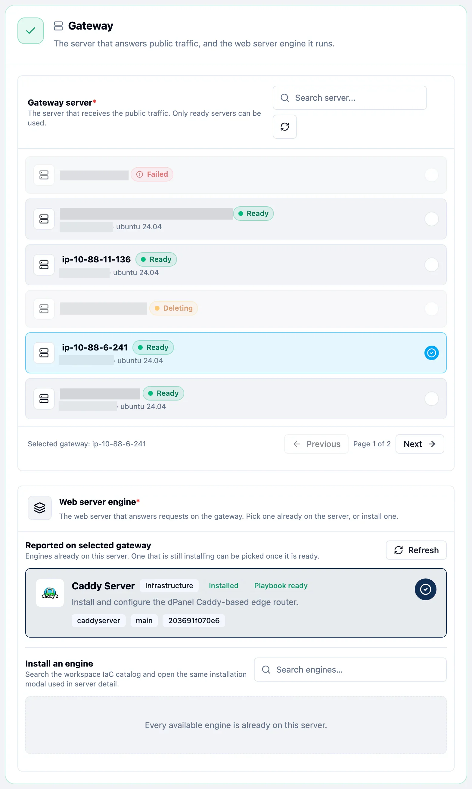
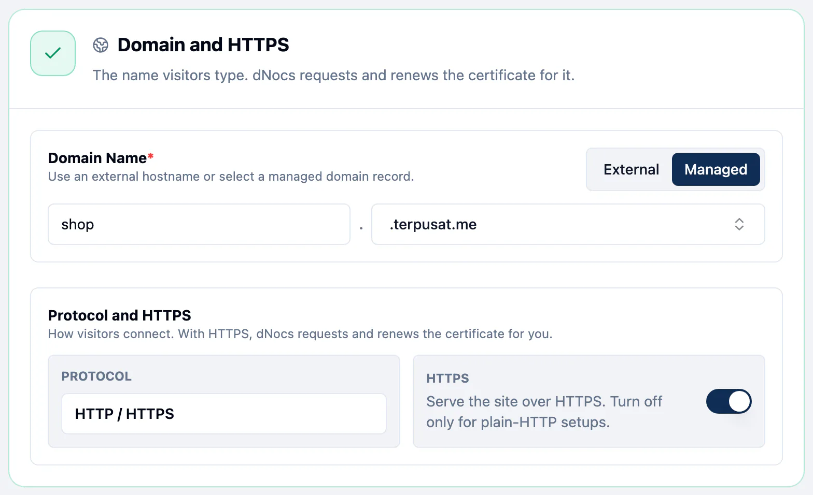
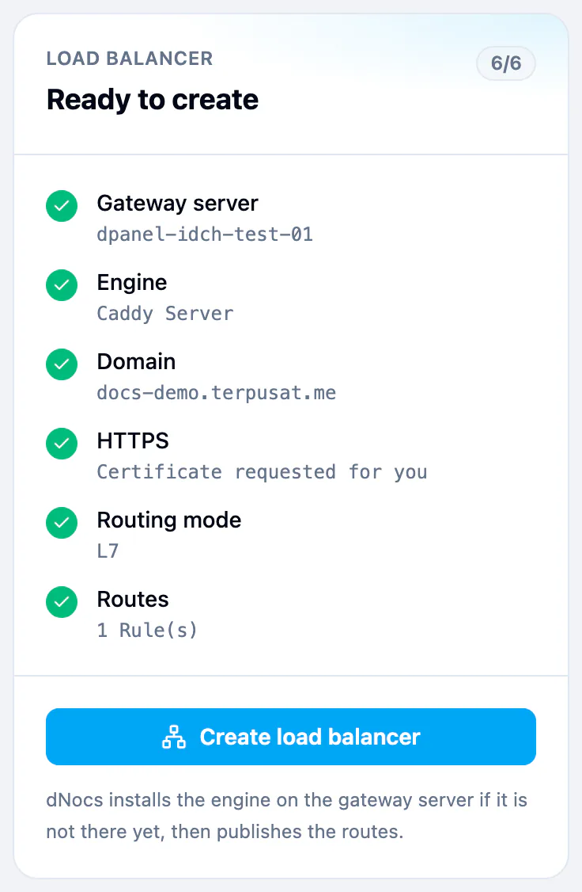
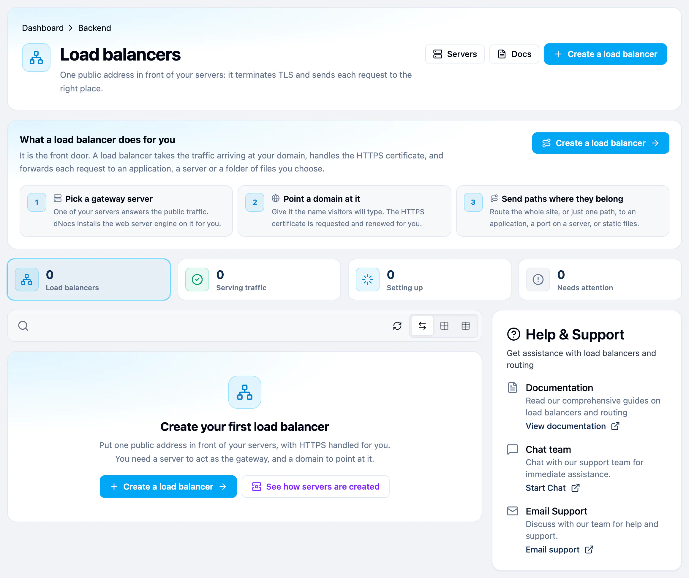
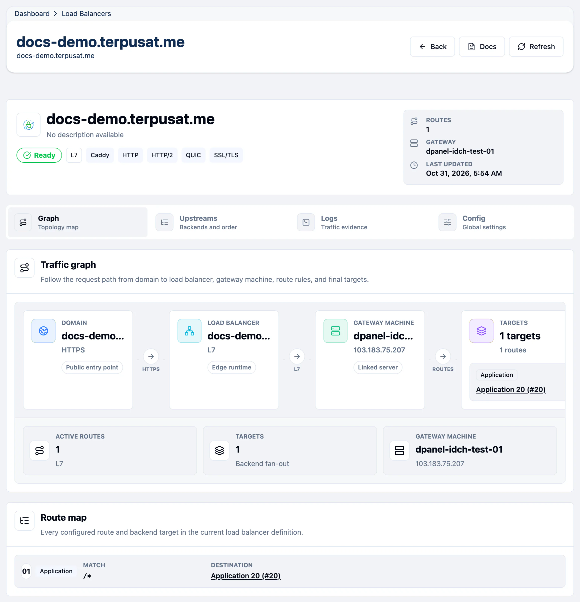
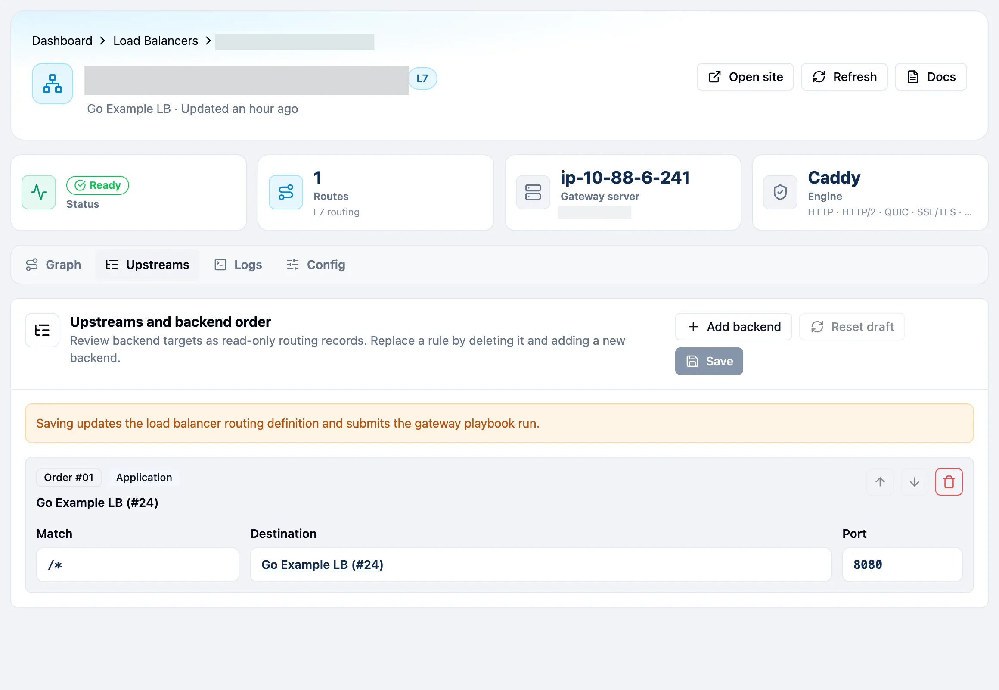
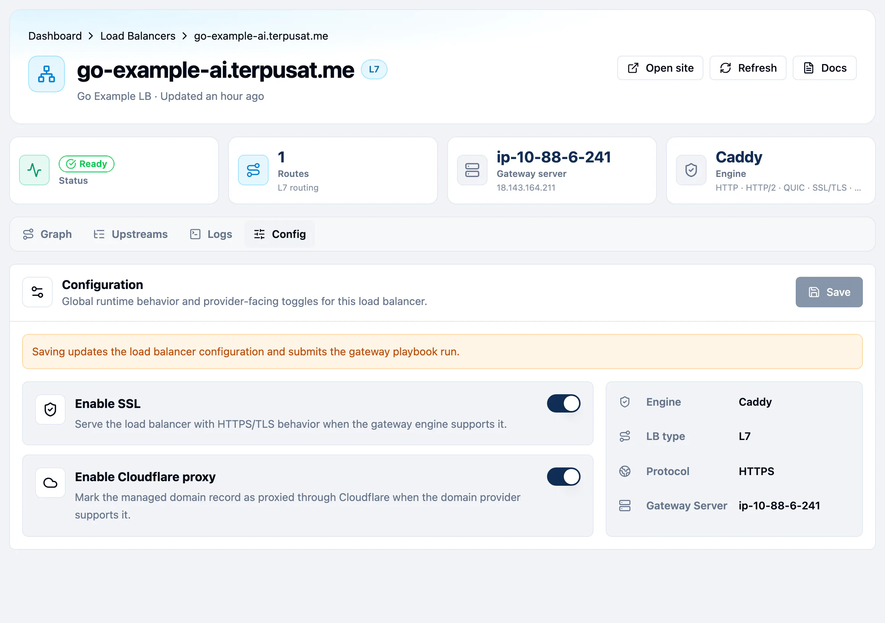
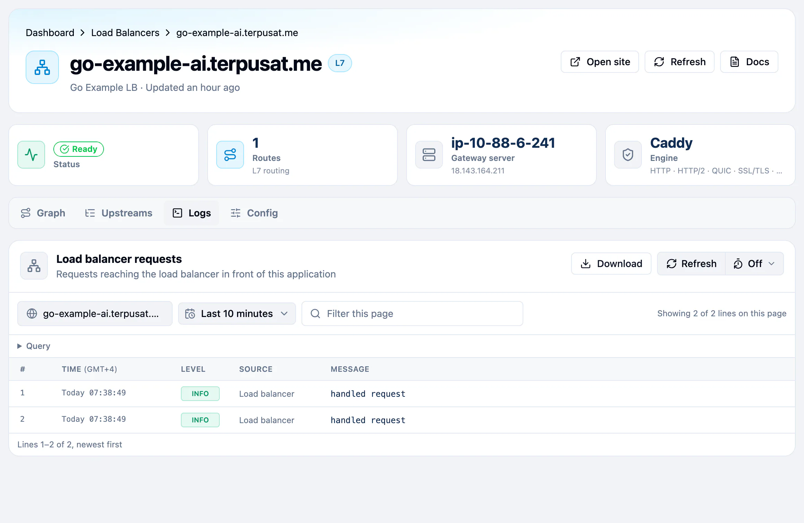

Load balancer di dPanel memublikasikan aplikasi Anda di sebuah domain dengan HTTPS. Load balancer menerima lalu lintas yang datang ke domain itu, mendapatkan dan memperpanjang sertifikat SSL Let's Encrypt gratis, lalu meneruskan setiap request ke aplikasi atau ke port di sebuah server. Dengan domain yang dikelola di dPanel, record DNS-nya juga dibuatkan untuk Anda.

dPanel membangun load balancer di salah satu server Anda sendiri, yaitu **gateway**, dan menjalankan mesin web server (Caddy) di sana. Tidak ada yang berjalan di luar server Anda.

## Yang perlu disiapkan

- **Server yang sudah siap** sebagai gateway, dengan port 80 dan 443 bisa dijangkau dari internet. Server yang diluncurkan dPanel sudah membukanya. Lihat [Server](../servers/overview.md).
- **Domain.** Tambahkan zonanya ke dPanel di **Domain & DNS** agar dPanel bisa membuat record-nya ([Domain dan DNS](./domains-and-dns.md)), atau pakai hostname yang Anda kelola sendiri.
- **Tujuan lalu lintas**: [aplikasi](../applications/overview.md) dPanel, atau layanan yang mendengarkan sebuah port.

:::warning[Pakai nama yang belum dipakai]
Dengan domain terkelola, dPanel membuat record DNS baru. dPanel menolak subdomain yang sudah punya record, jadi record yang ada tidak pernah tertimpa. Pakai nama baru, misalnya `app`.
:::

## Membuat load balancer

Buka **Load Balancer** di sidebar, lalu tekan **Buat load balancer**. Formulirnya punya tiga langkah bernomor. Panel tinjauan **Load balancer** di kanan bertuliskan **Mulai dengan server gateway** sampai Anda memilih server, lalu menghitung apa yang masih kurang.

### Langkah 1: Gateway

1. Di **Server gateway**, pilih server yang akan menjawab lalu lintas publik. Setiap baris menampilkan nama, status, alamat, dan sistem operasi server. Hanya server yang siap yang bisa dipilih; baris lainnya bertuliskan **Hanya server yang siap yang bisa menjalankan load balancer.**
2. Di **Engine web server**, pilih **Caddy Server**. Kalau sudah ada di server, engine itu muncul di **Dilaporkan di gateway terpilih** sebagai **Terpasang**. Kalau belum, cari di **Instal engine** lalu tekan **Instal**.



### Langkah 2: Domain dan HTTPS

1. Di **Nama Domain**, pilih modenya:
   - **Terkelola**: ketik **Subdomain**, lalu **Pilih domain** dari domain Anda di **Domain & DNS**. dPanel membuat record DNS-nya untuk Anda.
   - **Eksternal**: ketik hostname yang Anda kelola sendiri, lalu arahkan DNS-nya ke alamat publik gateway.
2. Di **Protokol dan HTTPS**, protokolnya **HTTP / HTTPS** untuk situs dan API.
3. Biarkan **HTTPS** menyala. dPanel meminta sertifikat dan memperpanjangnya untuk Anda. Matikan hanya untuk setup HTTP biasa.



### Langkah 3: Routing

1. Di **Mode routing**, pilih **L7** untuk situs dan API HTTP. L7 merutekan berdasarkan path, misalnya `/api`. **L4** meneruskan port TCP atau UDP mentah, untuk basis data dan layanan non-HTTP lainnya, tanpa melihat path.
2. Di **Rute**, atur **Aturan** pertama:
   - **Tipe**: **Aplikasi** mengirim lalu lintas ke aplikasi dPanel. **Proxy Pass** mengirimnya ke alamat dan port.
   - **Pola Jalur URL**: `/*` menangkap semua request. Path yang berakhiran `/*` diberi lencana **Wildcard**.
   - **Aplikasi**: pilih aplikasinya. dPanel memakai server dan port aplikasi itu.
3. Tekan **Tambah Aturan Baru** untuk mengirim path lain ke tujuan lain, misalnya `/api/*`.


### Buat

Saat panel tinjauan bertuliskan **Siap dibuat**, semua jawaban sudah lengkap: server gateway, mesin, domain, HTTPS, mode routing, dan rute. Tekan **Buat load balancer**.



## Setelah itu

Anda kembali ke daftar dengan pesan **Load balancer berhasil dibuat.** Barisnya berstatus **Dalam Proses** selama dPanel:

1. Membuat record DNS. Untuk domain terkelola, ini record `A` dari host ke alamat publik gateway.
2. Memasang Caddy di gateway kalau belum ada.
3. Menerbitkan rute dan meminta sertifikat HTTPS.

Prosesnya biasanya sekitar satu menit. Load balancer pertama di sebuah server juga memasang Caddy, yang memakan waktu sekitar 10 menit. Barisnya lalu berstatus **Siap**, dan penghitung di atas memindahkannya ke **Melayani trafik**.



## Memastikan sudah aktif

Buka host-nya di browser, atau periksa dari terminal:

```bash
curl -sI https://app.example.com
```

Load balancer yang aktif menjawab seperti ini:

```text
HTTP/2 200
alt-svc: h3=":443"; ma=2592000
content-type: text/html; charset=utf-8
server: dPanel
```

Tanda load balancer yang sehat:

| Pemeriksaan | Yang seharusnya terlihat                                                          |
| ----------- | --------------------------------------------------------------------------------- |
| DNS         | Host mengarah ke alamat publik server gateway                                     |
| HTTP biasa  | `308 Permanent Redirect` ke alamat `https://`                                     |
| HTTPS       | `HTTP/2 200`, dilayani oleh aplikasi Anda, dengan `server: dPanel`                |
| Sertifikat  | Diterbitkan Let's Encrypt untuk host Anda, berlaku 90 hari, diperpanjang otomatis |
| Protokol    | HTTP/2, ditambah HTTP/3 (QUIC) yang diumumkan lewat `alt-svc`                     |

:::tip[Nama baru kadang butuh semenit]
Kalau `curl` bilang host tidak ditemukan tepat setelah dibuat, resolver Anda mungkin menyimpan jawaban "tidak ada" dari sebelumnya. Tunggu beberapa menit, atau uji dengan resolver publik, misalnya `dig @1.1.1.1 app.example.com`.
:::

## Halaman detail

Pilih load balancer di daftar untuk membuka halamannya. Bagian kepalanya menampilkan domain, status, waktu pembaruan terakhir, dan **Buka situs**, lalu empat informasi: **Status**, **Rute** (beserta mode routing-nya), **Server gateway**, dan **Engine**.

| Tab             | Kegunaannya                                                                                          |
| --------------- | ---------------------------------------------------------------------------------------------------- |
| **Graf**        | Mengikuti request dari domain ke load balancer, gateway, rute, dan tujuannya                         |
| **Upstream**    | Melihat semua backend berurutan, dengan path, tujuan, dan port-nya. **Tambah backend** menambah satu |
| **Log**         | Membaca request yang ditangani gateway                                                               |
| **Konfigurasi** | Menyalakan atau mematikan **Aktifkan SSL** dan **Aktifkan proxy Cloudflare**                         |





Perubahan di **Upstream** dan **Konfigurasi** masih berupa draf sampai Anda menekan **Simpan perubahan**. Menyimpan memperbarui definisi routing dan menjalankan ulang setup gateway. **Reset draft** membuang drafnya.



## Log load balancer

Tab **Log** menampilkan request yang sampai ke gateway, dengan judul **Permintaan load balancer**. Request yang sama juga muncul di tab **Log** aplikasi, pada sumber **Load balancer**. Lihat [Log aplikasi](../applications/application-logs.md).



- **Rentang waktu**: bawaannya 10 menit terakhir. Pilih preset sampai **10 hari terakhir**, atau **Rentang khusus** dalam 10 hari terakhir.
- **Halaman**: 200 baris per halaman, terbaru lebih dulu. Bagian bawahnya bertuliskan, misalnya, **Baris 1–200 dari 201, terbaru dulu**, lengkap dengan tombol halaman.
- **Unduh**: **Halaman ini**, atau **Semua di rentang waktu ini**, sebagai berkas `.log`.
- **Segarkan** mengambil baris terbaru. **Muat ulang otomatis** mati secara bawaan; nyalakan untuk setiap 30 detik, setiap menit, atau setiap 5 menit.

Kontrol bersama ini dijelaskan di [Rentang waktu dan pembaruan](../logs/time-range-and-refresh.md) dan [Mengunduh log](../logs/download-logs.md).

## Menghapus load balancer

1. Di daftar, buka menu **Lebih** (⋯) di baris load balancer itu, lalu pilih **Hapus**.
2. Konfirmasi di dialog **Hapus Load Balancer**.

dPanel mencabut rute dari gateway, dan barisnya berstatus **Terhapus**. Aplikasi dan server gateway tetap berjalan. Load balancer tetap berada di workspace tempat ia dibuat; load balancer tidak bisa dipindahkan ke workspace lain.

:::warning[Periksa record DNS-nya]
Periksa di penyedia DNS apakah record buatan dPanel masih ada setelah penghapusan, lalu hapus dari [record DNS](./dns-records.md) domain itu kalau namanya sudah tidak dipakai.
:::

:::note
Server yang masih menjadi gateway load balancer tidak bisa dihapus. Hapus load balancer-nya lebih dulu.
:::

## Pertanyaan yang sering diajukan

### Apakah sertifikat SSL-nya gratis?

Ya. dPanel mendapatkan sertifikat Let's Encrypt untuk host Anda dan memperpanjangnya sebelum kedaluwarsa, tanpa biaya. Setiap sertifikat berlaku 90 hari.

### Apakah saya butuh Cloudflare?

Tidak. dPanel bisa membuat record DNS di Cloudflare atau DigitalOcean, atau Anda bisa mengarahkan hostname apa pun ke gateway sendiri dengan **Eksternal**. **Aktifkan proxy Cloudflare** di tab **Konfigurasi** hanya untuk domain yang di-host di Cloudflare.

### Bisakah satu load balancer melayani beberapa aplikasi?

Bisa. Tambahkan satu rute per path, misalnya `/*` untuk situs dan `/api/*` untuk API, masing-masing mengirim lalu lintas ke aplikasi atau alamat yang berbeda.

### Web server apa yang dipakai dPanel?

Caddy. dPanel memasangnya di server gateway pada kali pertama, dan header respons bertuliskan `server: dPanel`.

### Mengapa server saya tidak bisa dipilih sebagai gateway?

Hanya server yang siap yang bisa menjalankan load balancer. Server yang masih disiapkan, atau yang gagal disiapkan, tetap ditampilkan tetapi tidak bisa dipilih.
