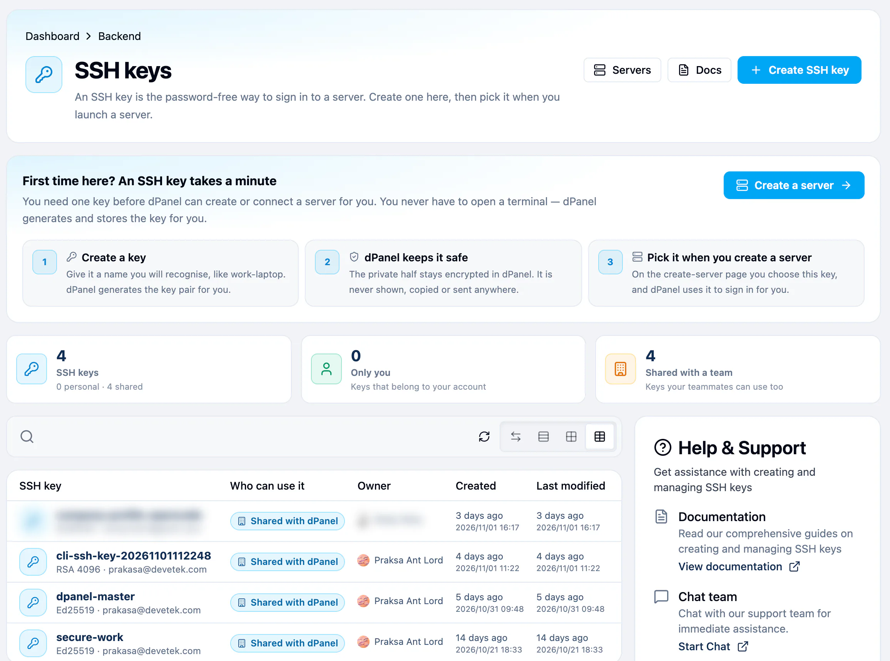

Untuk menghubungkan server yang sudah Anda punya dengan agen dPanel, Anda tidak perlu menyiapkan apa pun di dPanel: lihat [Hubungkan server dengan agen dPanel](./register-a-private-machine.md).

Dua hal lain disiapkan sekali lalu dipakai lagi untuk setiap server berikutnya: akun cloud yang terhubung, hanya jika dPanel perlu meluncurkan VPS baru untuk Anda, dan SSH key, hanya jika dPanel perlu masuk ke mesin lewat SSH, bukan lewat agen.

## SSH key

Ini hanya dibutuhkan saat dPanel terhubung ke server lewat SSH. Server yang bergabung lewat agen dPanel tidak butuh kunci.

SSH key adalah sepasang berkas pengganti kata sandi saat komputer masuk ke server. Separuhnya publik dan ditulis ke server. Separuh lainnya privat dan tidak pernah keluar dari dPanel.

Anda tidak perlu membuatnya sendiri.

1. Di sidebar, di bawah **Backend**, buka **Manajemen Kunci**. Menu ini langsung membuka halaman **Kunci SSH**.
2. Tekan **Buat kunci SSH**.
3. Beri nama yang mudah dikenali, misalnya `laptop-kerja`, lalu pilih jenis kuncinya.
4. Tekan **Buat kunci SSH** di bagian bawah formulir.

- **Untuk server saat ini** adalah pilihan yang tepat, kecuali ada server yang menolaknya. Kuncinya lebih pendek dan lebih cepat, dan semua Linux modern menerimanya.
- **Untuk server lama** adalah cadangannya, dan juga menanyakan ukuran kunci.

Separuh privatnya tidak akan ditampilkan lagi. dPanel menyimpannya terenkripsi dan memakainya untuk Anda. Halaman kunci menampilkan separuh publiknya, yang aman disalin ke mana saja, beserta fingerprint yang bisa Anda cocokkan dengan laporan server.

## Akun cloud

Akun cloud hanya dibutuhkan untuk meluncurkan mesin baru. Untuk menghubungkan server yang sudah Anda punya, pakai [agen dPanel](./register-a-private-machine.md) atau [SSH](./connect-your-own-server.md).

Akun cloud adalah penghubung dPanel ke akun Anda di penyedia cloud. Di dalamnya ada kredensial yang mengizinkan dPanel membuat mesin atas nama Anda.

1. Di sidebar, buka **Proyek Cloud**. Judul halamannya **Akun cloud**.
2. Tekan **Hubungkan akun cloud**.
3. Pilih penyedia, lalu tempel kredensial yang diberikan penyedia itu.

Cara membuat kredensial dengan hak akses seminimal mungkin, langkah demi langkah, ada di halaman masing-masing penyedia: [AWS](./cloud-providers/provider-aws.md), [Google Cloud](./cloud-providers/provider-gcp.md), [IDCloudHost](./cloud-providers/provider-idcloudhost.md), [DigitalOcean](./cloud-providers/provider-digitalocean.md), [Alibaba Cloud](./cloud-providers/provider-alibabacloud.md), dan [Tencent Cloud](./cloud-providers/provider-tencent.md). Baca [Kredensial cloud dan keamanan](./cloud-providers/cloud-credentials-security.md) sebelum menempelkan kunci.

:::info[Siapa yang membayar mesinnya]
Mesin dibuat di dalam akun cloud Anda sendiri, jadi tagihannya langsung dari penyedia. dPanel tidak menjual ulang mesin.
:::

## Langkah berikutnya

Lanjut ke [Membuat server cloud](./cloud-providers/create-a-cloud-server.md). Penjelasan lebih lengkap soal kunci dan akun, termasuk berbagi dengan tim, ada di [SSH key dan akun cloud](../getting-started/ssh-keys-and-cloud-projects.md).

## Pertanyaan yang sering diajukan

### Bisakah saya memakai SSH key yang sudah saya punya?

dPanel membuatkan pasangan kuncinya supaya bagian privatnya tidak pernah keluar dari dPanel. Kalau ingin masuk juga dari komputer sendiri, tambahkan kunci publik Anda ke server; lihat [Terhubung lewat SSH](./connect-over-ssh.md).

### Apakah saya butuh akun cloud untuk mencoba dPanel?

Tidak. [Hubungkan server dengan agen dPanel](./register-a-private-machine.md) hanya butuh mesin Linux tempat Anda bisa menjalankan satu perintah dengan `sudo`.

### Bisakah tim saya memakai kunci dan akun cloud yang sama?

Bisa. Kunci dan akun cloud yang dibuat di sebuah workspace bisa dipakai anggotanya. Lihat [SSH key dan akun cloud](../getting-started/ssh-keys-and-cloud-projects.md).
