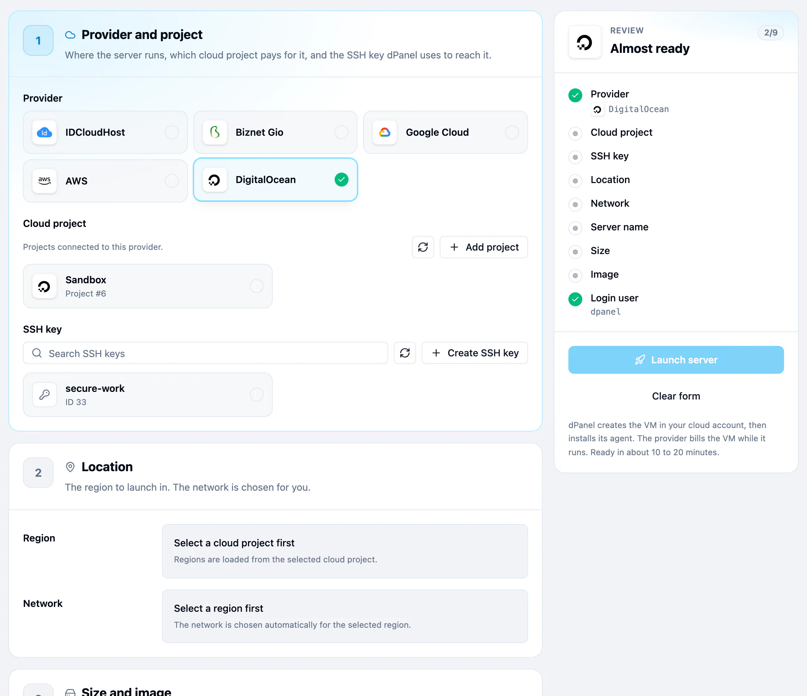

Formulir peluncuran menawarkan **AWS**, **Google Cloud**, **DigitalOcean**, **IDCloudHost**, dan **Biznet Gio**. Penyedia mana pun yang dipilih, pertanyaannya sama dan servernya berperilaku sama: agen yang sama, tab yang sama, modul yang sama.

Yang berbeda hanya cara penyedia menamai lokasi dan ukuran, serta user Linux yang dipakai dPanel untuk masuk. Panel **Review** menampilkan user itu sebagai **Login user** sebelum Anda meluncurkan.

## Google Cloud

- Lokasi dipilih dua tahap: region, lalu zone di dalamnya.
- Ukuran berupa machine type, misalnya `e2-small`.
- dPanel membuat `dpanel-network` di region itu saat pertama dipakai, dengan SSH, HTTP, dan HTTPS terbuka.
- User login-nya `ubuntu`.

## AWS

- Lokasi berupa region, dan dPanel memilih subnet di dalamnya.
- Ukuran berupa instance type, misalnya `t3.small`.
- dPanel membuat jaringan dan security group sendiri saat pertama dipakai, jadi akun baru cukup diberi kredensial.
- User login-nya `ubuntu`.

## DigitalOcean

- Lokasi cukup satu pilihan: region pusat datanya.
- Ukuran berupa ukuran droplet.
- User login-nya `dpanel`.

## IDCloudHost

- Lokasi berupa pusat data, misalnya `jkt01`.
- User login-nya `dpanel`.

:::note
Biznet Gio juga ada di formulir dengan langkah yang sama. Periksa **Login user** di panel Review sebelum meluncurkan.
:::
