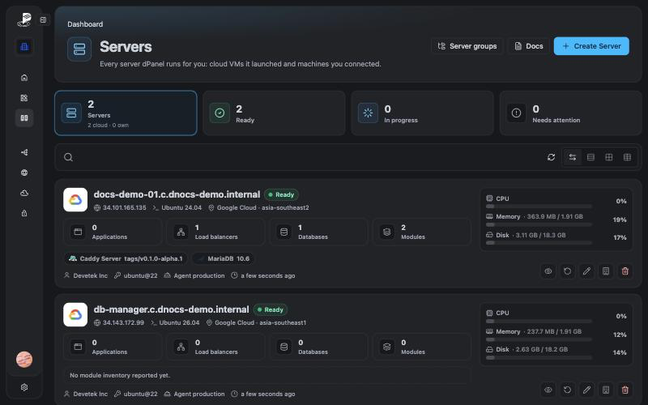
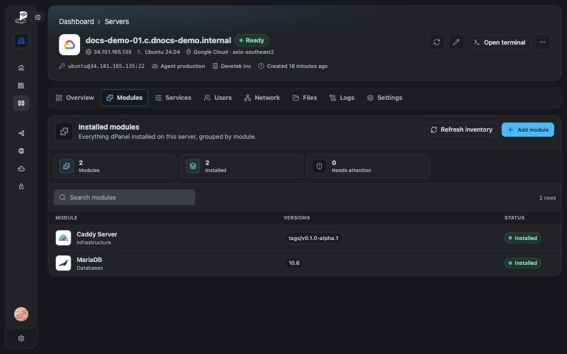

Tiga penyedia dibahas di sini karena ketiganya sudah diuji dari awal sampai akhir. Penyedia lain tetap muncul di formulir dan bekerja dengan cara yang sama, dan akan mendapat bagiannya sendiri setelah melewati pengujian yang sama.

Apa pun pilihannya, formulirnya menanyakan hal yang sama dan server jadinya berperilaku identik: agen yang sama, tab yang sama, modul yang sama.

## Google Cloud

- Lokasi ditanya dua tahap: region, lalu zone di dalamnya.
- Ukuran berupa machine type, misalnya e2-small.
- dPanel membuat dpanel-network di region itu saat pertama dipakai dan membuka SSH serta port web.
- Pengguna login adalah ubuntu.

## AWS

- Lokasi berupa region, dan dPanel memilihkan subnet di dalamnya.
- Ukuran berupa instance type, misalnya t3.small.
- dPanel membuat jaringan dan security group sendiri saat pertama dipakai, jadi akun baru tidak perlu persiapan selain kredensial.
- Pengguna login adalah ubuntu.

## DigitalOcean

- Lokasi cukup satu pilihan: region datacenter.
- Ukuran berupa ukuran droplet.
- Pengguna login adalah dpanel, satu-satunya perbedaan yang terasa saat membuka terminal.
