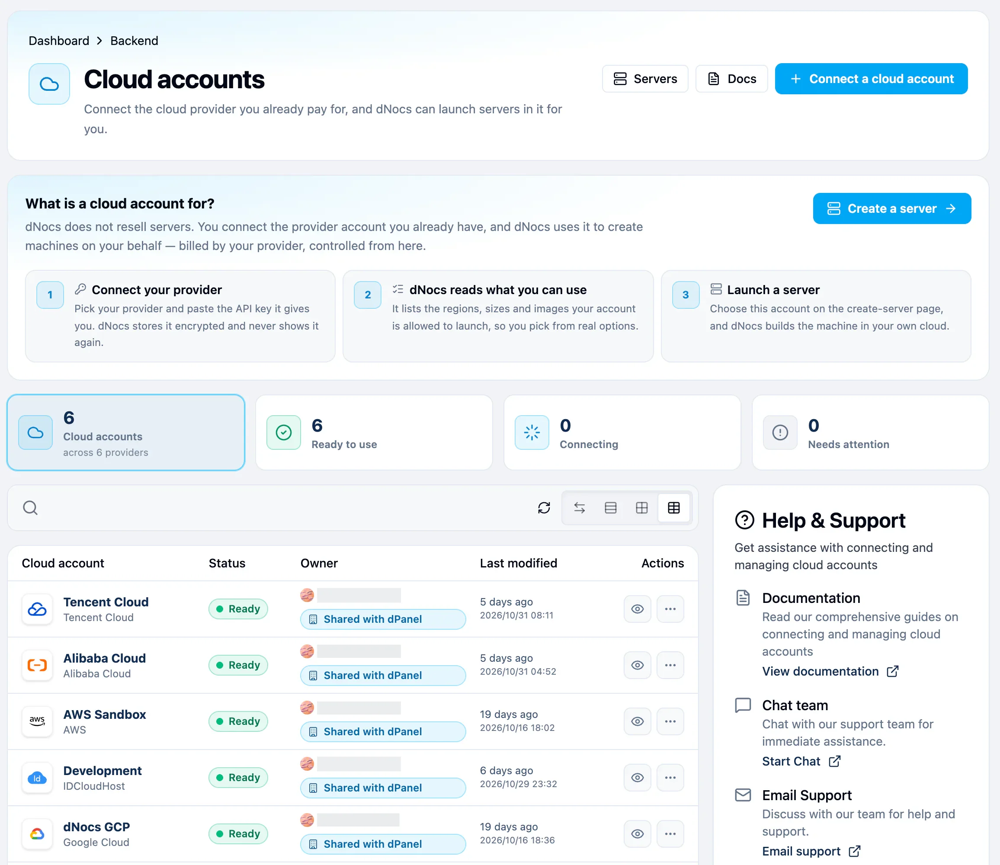

Untuk meluncurkan server atas nama Anda, dPanel memegang kredensial akun cloud Anda. Halaman ini menjelaskan apa artinya secara terus terang, supaya Anda bisa menimbang seberapa jauh memercayainya dan bagaimana membatasi kerugian kalau ada yang salah.

## Risikonya, dalam satu paragraf

Kredensial cloud memungkinkan siapa pun yang memegangnya menghabiskan uang Anda dan menyentuh infrastruktur Anda. Saat Anda menghubungkannya, Anda memercayakan kredensial itu kepada operator dPanel, server dPanel, dan kode dPanel. Kalau basis data dPanel dan kunci enkripsinya sama-sama dicuri, atau dPanel punya bug atau perubahan berbahaya, penyerang bisa memakai kredensial Anda untuk meluncurkan mesin atas tagihan Anda, atau menghapus mesin yang bisa dijangkau dPanel. dPanel tidak bisa menghilangkan risiko itu untuk Anda. Anda bisa memperkecilnya: beri dPanel kredensial yang hanya bisa mengelola VM, di akun atau project yang tidak berisi apa-apa lagi, dengan batas pengeluaran.

## Apa yang disimpan dPanel

| Apa                       | Bagaimana                                                                                                                                                          |
| ------------------------- | ------------------------------------------------------------------------------------------------------------------------------------------------------------------ |
| Kredensialnya             | Di basis data dPanel, setiap kolom dienkripsi dengan AES memakai kunci yang dibaca server dPanel dari sebuah berkas kunci. Kunci itu tidak disimpan di basis data. |
| Nama koneksi dan penyedia | Teks biasa.                                                                                                                                                        |
| Pemiliknya                | Workspace tempat akun itu dibuat. Semua orang di workspace itu bisa meluncurkan server dengannya. Tidak ada yang bisa membacanya kembali.                          |

Setelah disimpan, kredensial tidak pernah dikirim balik ke browser. Halaman hanya menampilkan akunnya, tidak pernah kuncinya.

dPanel mendekripsi kredensial di dua tempat:

1. **Di server dPanel**, untuk mengisi formulir peluncuran: membaca daftar region, ukuran, image, dan jaringan, serta memeriksa apakah nama server sudah dipakai.
2. **Di worker dPanel**, untuk membuat atau menghapus VM. Kredensial ikut terkirim bersama job dan dipakai oleh modul Ansible penyedia, yang berjalan dengan pencatatan rahasia dimatikan.

:::warning[Perlu dicek]
Enkripsinya AES mode CFB, dengan kunci simetris yang disimpan di samping aplikasi, bukan di KMS atau HSM cloud. Ini melindungi cadangan basis data yang dicuri. Ini tidak melindungi dari orang yang punya akses ke server dPanel yang sedang berjalan beserta berkas kuncinya. Dari kode, kami tidak bisa memastikan berapa lama worker menyimpan berkas kredensial sebuah job setelah dijalankan.
:::

## Apa yang bisa dilakukan tiap kredensial

| Penyedia     | Dengan batas minimum yang kami sarankan                                                                                     | Dengan kredensial yang luas                              |
| ------------ | --------------------------------------------------------------------------------------------------------------------------- | -------------------------------------------------------- |
| AWS          | Membuat dan menghapus instance EC2 yang diberinya tag, beserta jaringan dan security group-nya, di region yang Anda izinkan | Semua yang bisa dilakukan IAM user atau root user Anda   |
| Google Cloud | Membuat dan menghapus VM, disk, dan aturan firewall di satu project                                                         | Semua hal di setiap project yang bisa dijangkau akun itu |
| IDCloudHost  | Semua yang bisa dilakukan user IDCloudHost Anda; kunci bercakupan belum bisa kami pastikan (perlu dicek)                    | Sama                                                     |
| DigitalOcean | Membuat, membaca, dan menghapus Droplet dan SSH key; membaca region, ukuran, image, dan VPC                                 | Semua hal di team itu                                    |

Batas minimum tiap penyedia ada di halamannya: [AWS](./provider-aws.md#policy-iam-minimum), [Google Cloud](./provider-gcp.md#izin-minimum), [IDCloudHost](./provider-idcloudhost.md#1-buat-api-key), [DigitalOcean](./provider-digitalocean.md#1-buat-token-dengan-cakupan-khusus).

## Hak akses minimum, dalam praktik

:::danger[Jangan pernah memakai kredensial root atau owner]
Jangan hubungkan root user AWS, administrator AWS, owner Google Cloud, atau token DigitalOcean **Full Access**. Kalau kredensial itu bocor, seluruh isi akun ikut terancam.
:::

1. **Pakai akun atau project khusus.** Akun AWS, project Google Cloud, atau team DigitalOcean yang hanya berisi apa yang diluncurkan dPanel. Kalau bocor, kebocoran itu tidak bisa menjangkau basis data, penyimpanan, atau server Anda yang lain.
2. **Pakai identitas khusus.** IAM user, service account, atau token terpisah bernama `dpanel`, supaya Anda bisa melihat apa yang dilakukannya dan mencabutnya sendirian.
3. **Beri yang paling minimum.** Pakai policy, role, atau scope di halaman penyedia.
4. **Batasi pengeluaran.** Pasang peringatan anggaran di penyedia: [AWS Budgets](https://docs.aws.amazon.com/cost-management/latest/userguide/budgets-create.html), [anggaran Google Cloud](https://cloud.google.com/billing/docs/how-to/budgets), [peringatan tagihan DigitalOcean](https://docs.digitalocean.com/platform/billing/). Di IDCloudHost, simpan di billing account hanya saldo yang memang mau Anda pakai.
5. **Batasi region.** Di AWS, syarat `aws:RequestedRegion` di policy membatasi peluncuran ke region yang Anda sebut.
6. **Pantau log audit.** AWS CloudTrail, Google Cloud Audit Logs, dan riwayat keamanan DigitalOcean mencatat setiap panggilan yang memakai kredensial itu.

## Merotasi kredensial

Anda bisa mengganti kunci di dalam akun cloud yang sudah ada tanpa memutusnya. ID akun tidak berubah, jadi server yang diluncurkan dengannya tetap berfungsi dan tetap bisa dihapus.

1. Buat kunci baru di penyedia untuk identitas yang sama. AWS mengizinkan dua access key per user, dan Google Cloud beberapa kunci per service account. Di DigitalOcean dan IDCloudHost, buat token atau API key kedua.
2. Di sidebar, buka **Proyek Cloud**. Pada akun itu, buka aksinya (menu di tampilan daftar, atau deretan ikon di tampilan kartu), lalu pilih **Perbarui kredensial**.
3. Isi kolom yang sama seperti saat Anda menghubungkan akun itu, lalu tekan **Simpan kredensial**.
4. Pastikan kunci baru berfungsi: buka formulir peluncuran dan periksa apakah daftar region muncul.
5. Hapus atau nonaktifkan kunci lama di penyedia.

Dari command line, jalankan `dnocs cloud-project update-credentials --id <ID>`. Perintah ini menanyakan setiap kolom, sama seperti `dnocs cloud-project create`. Untuk nilai beberapa baris seperti JSON service account Google Cloud, jawab pertanyaannya dengan `@path/to/key.json` supaya isinya dibaca dari file. Anda juga bisa mengirim semua kolom sekaligus dengan `--credential-file credential.json`, berupa objek JSON seperti `{"project_id":"my-project","service_account_json":"..."}`, dan melewati konfirmasi dengan `--yes`.

dPanel memeriksa kunci baru sebelum menyimpannya:

- Semua kolom wajib harus terisi.
- Di Google Cloud, **Project ID** harus sama dengan milik akun saat ini. Untuk memakai project lain, hubungkan akun cloud baru.
- dPanel memanggil penyedia dengan kunci baru itu: memuat daftar region, dan di IDCloudHost juga daftar billing account. Kalau penyedia menolak kuncinya, tidak ada yang disimpan, kunci lama tetap dipakai, dan pesan galatnya menyebut bahwa penyedia menolak kredensial itu.

Kunci baru disimpan terenkripsi seperti yang lama, dan tidak pernah ditampilkan lagi. Di ruang kerja tim, memperbarui kredensial membutuhkan level **admin** untuk proyek cloud: Owner, Admin, DevOps, atau role admin proyek cloud.

:::warning[Pakai kunci untuk akun yang sama]
Di AWS, DigitalOcean, dan IDCloudHost, dPanel tidak bisa memastikan kunci baru berasal dari akun yang sama dengan kunci lama. Pastikan sendiri. Kalau tidak, dPanel tidak bisa menghapus server yang diluncurkan dengan kunci lama.
:::

Kalau kunci lama sudah bocor, jangan menunggu: perbarui kredensialnya dengan kunci baru sekarang, lalu cabut kunci lama di penyedia.

## Kalau kredensial dicabut

Mencabut berarti menghapus atau menonaktifkan kunci di penyedia. Ini yang terjadi pada server yang diluncurkan dengannya:

- **Server tetap berjalan.** dPanel menjangkau server lewat SSH dan agennya, bukan lewat kredensial cloud. Aplikasi, log, terminal, dan modul tetap bekerja.
- **Peluncuran baru gagal.** Formulir peluncuran tidak bisa memuat region atau ukuran, dan pembuatan gagal di penyedia.
- **Menghapus server hanya setengah berhasil.** dPanel tidak bisa menghancurkan VM di penyedia. Server tertahan di **Deleting** atau **Deleted**, dPanel tidak menghapus catatannya sampai penyedia mengonfirmasi, dan **VM tetap berjalan dan terus ditagih** di penyedia. Hapus sendiri lewat konsol penyedia.
- **Akun cloud tidak bisa diputus** selama masih ada server yang merujuk ke sana.

Untuk memperbaiki kunci yang dicabut atau kedaluwarsa, buat kunci baru untuk akun yang sama lalu [perbarui kredensialnya](#merotasi-kredensial). Peluncuran baru dan penghapusan server kembali berfungsi.

## Menghapus akun cloud dari dPanel

1. Hapus semua server yang diluncurkan dengan akun itu. Lihat [Menghapus server](../delete-a-server.md).
2. Di sidebar, buka **Proyek Cloud**.
3. Pada akun itu, buka menunya, pilih **Putuskan akun cloud**, lalu konfirmasi.

dPanel menghapus kredensial yang disimpannya. Itu tidak mencabut kunci di penyedia: hapus juga di sana.

