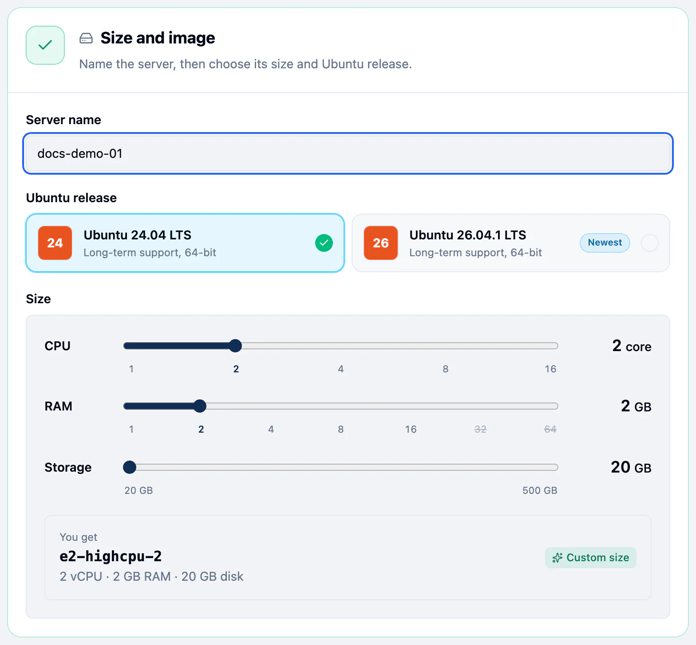

dPanel meluncurkan server Ubuntu baru (VM) di akun cloud Anda sendiri dari satu formulir: pilih penyedia, region, ukuran, dan rilis Ubuntu, lalu dPanel membuat mesinnya dan membuka SSH, HTTP, serta HTTPS. Mesin memasang agen dPanel saat pertama kali menyala dan bergabung ke dPanel dengan sendirinya, jadi dPanel tidak perlu memasang SSH key di mesin itu. Server siap dalam sekitar 10 sampai 20 menit.

Panduan ini memakai Google Cloud. Penyedia lain menanyakan hal yang sama dengan urutan yang sama. Perbedaannya dibahas di [Penyedia cloud](./index.md), yang punya halaman tersendiri untuk tiap penyedia.

## Yang perlu disiapkan

- Akun cloud di dPanel, dan SSH key hanya jika server perlu bergabung lewat SSH. Lihat [Sebelum mulai](../before-you-start.md).
- Kuota yang cukup di penyedia untuk satu mesin lagi.

## Buka formulirnya

Buka **Server**, lalu **Buat Server**, lalu **Luncurkan server**.

Formulirnya satu halaman dengan empat langkah bernomor. Panel **Review** di kanan terisi sambil Anda menjawab. Penghitungnya, misalnya **3/9**, menunjukkan berapa jawaban yang sudah masuk.

## Langkah 1: Provider and project

1. **Provider**: tempat mesin berjalan.
2. **Cloud project**: akun cloud mana yang membayarnya. **Add project** menghubungkan akun lain.

## Langkah 2: Location

- **Region** adalah wilayah tempat mesin berjalan. Pilih yang dekat dengan pengguna Anda.
- **Zone** adalah satu pusat data di dalam region itu. Mana saja boleh. Google Cloud, Alibaba Cloud, dan Tencent Cloud menanyakannya.
- **Network** terisi otomatis. Di sebagian besar penyedia, dPanel membuat `dpanel-network` saat pertama kali meluncurkan mesin di sebuah region, lalu memakainya lagi. Di AWS, Google Cloud, Alibaba Cloud, dan Tencent Cloud, dPanel hanya membuka port TCP 22 (SSH), 80 (HTTP), dan 443 (HTTPS) di penyedia. Di DigitalOcean dan IDCloudHost, dPanel tidak membuat firewall penyedia, jadi nyalakan [firewall](../firewall.md) dPanel atau tambahkan firewall di penyedia.

## Langkah 3: Cara dPanel terhubung

- **Agen dPanel** terpilih dan direkomendasikan. Mesin memasang agen dPanel saat pertama kali menyala lalu terhubung keluar ke dPanel. Tidak ada SSH key dPanel yang dipasang di mesin.
- **SSH** adalah alternatifnya: dPanel memasang **SSH key** yang Anda pilih di mesin lalu masuk untuk menyiapkannya. **Create SSH key** membuat kunci baru di sini. SSH membutuhkan IP publik.
- **IP publik** menyala secara bawaan, sehingga mesin bisa melayani situs web. Matikan untuk mesin yang hanya dipakai di dalam jaringan Anda. Tanpa IP publik, mesin hanya bergabung lewat agen, dan tetap perlu akses ke internet: di `dpanel-network`, dPanel menambahkan NAT (di AWS berupa NAT gateway, yang ditagih AWS selama masih ada, dan dihapus dPanel bersama mesin terakhir yang memakainya). Di jaringan yang Anda pilih sendiri, pastikan jaringan itu sudah memberi mesin akses internet, atau agen tidak bisa terhubung.

DigitalOcean selalu memberi Droplet IP publik, dan IDCloudHost tetap memakainya karena VM tanpa IP publik tidak bisa mengakses internet. Biznet Gio dan Alibaba Cloud untuk saat ini bergabung lewat SSH, jadi selalu meminta SSH key dan IP publiknya tetap menyala.

## Langkah 4: Size and image

1. **Server name** adalah nama mesin di dPanel dan di penyedia.
2. **Ubuntu release**: 24.04 LTS terpilih secara bawaan; 26.04 LTS ditandai **Newest**. LTS berarti pembaruan keamanan selama bertahun-tahun.
3. **Size**: geser slider **CPU** dan **RAM** ke ukuran yang Anda inginkan, dan **Storage** ke ukuran disk dalam GB.

Kartu di bawah slider menyebutkan dengan tepat apa yang akan Anda dapatkan:

- **You get**: penyedia yang menerima pasangan CPU dan memori apa pun, seperti Google Cloud dan IDCloudHost, meluncurkan ukuran persis itu.
- **Cheapest match**: penyedia dengan tipe instance tetap, seperti AWS, DigitalOcean, Alibaba Cloud, dan Tencent Cloud, meluncurkan tipe termurah dengan CPU dan memori minimal sebesar itu. **Rounded up from** muncul jika tipenya lebih besar dari yang Anda minta, dan kartu itu menampilkan harga bulanan jika penyedia memberikannya.

| Slider  | Rentang                                                                                                                            |
| ------- | ---------------------------------------------------------------------------------------------------------------------------------- |
| CPU     | 1, 2, 4, 8, atau 16 vCPU. Nilai yang tidak bisa dilayani penyedia dicoret.                                                         |
| RAM     | 1 sampai 64 GB. Menggeser CPU memindahkan RAM ke pasangan terdekat yang dijual penyedia.                                           |
| Storage | 20 sampai 500 GB dengan kelipatan 10 GB (40 sampai 500 GB di Alibaba Cloud). DigitalOcean dan Tencent Cloud menentukannya sendiri. |

Di penyedia dengan tipe tetap, **Choose the instance type yourself** membuka daftar lengkap milik penyedia sebagai pengganti slider. **Use the size sliders instead** kembali ke slider. Biznet Gio tetap memakai pilihan **Product** dan **Billing Cycle** miliknya sendiri.

:::tip[Mulai dari yang kecil]
1 vCPU dan RAM 2 GB sudah cukup untuk mencoba dPanel dengan satu aplikasi kecil. Anda bisa meluncurkan server yang lebih besar nanti dan memindahkan aplikasi ke sana.
:::

## Luncurkan

Saat panel Review bertuliskan **Ready to launch**, semua jawaban sudah lengkap.

1. Tekan **Launch server**.
2. Di dialog yang terbuka (**Server Anda sedang menyala** untuk agen, **Server Anda sedang dibuat** untuk SSH), tekan **Buka server** untuk memantau prosesnya, atau **Luncurkan lagi**.

**Clear form** mengosongkan formulir.

## Setelah itu

Banner biru memberi tahu bahwa dPanel sedang menyiapkan server. Biasanya 10 sampai 20 menit:

1. Penyedia membuat mesinnya.
2. Dengan agen dPanel, mesin memasang agen saat pertama kali menyala, dan server menjadi **Ready** begitu agen terhubung, biasanya 1 sampai 5 menit setelah mesin aktif. Dengan SSH, dPanel masuk, memasang agennya, dan membaca isi mesin.
3. dPanel membuka port yang dibutuhkan.

Begitu banner hilang dan lencananya bertuliskan **Ready**, server siap dipakai. Selanjutnya, [pasang perangkat lunak](../install-software.md) di server itu atau [buat aplikasi](../../applications/create-an-application.md).

:::warning[Kalau setup gagal]
Banner merah muncul dengan tombol **Lihat penyebabnya**, berisi alasan dari penyedia atau dari proses setup. Penyebab yang paling sering: kuota akun cloud tidak cukup, atau kredensialnya sudah kedaluwarsa. Kalau penyedia tidak pernah membuat mesinnya, **Instal ulang** tidak bisa membantu: perbaiki penyebab yang ditampilkan, hapus server di dPanel, lalu luncurkan lagi. Kalau mesinnya ada dan hanya setup yang gagal, pakai **Instal ulang** di tab **Pengaturan** server. Lihat [Masalah yang sering muncul](../../troubleshooting/faq.md#server).
:::

:::tip[Tagihan berjalan sejak sekarang]
Penyedia menagih mesin selama mesin itu ada, termasuk selama setup. [Hapus servernya](../delete-a-server.md) kalau sudah tidak dipakai.
:::

## Pertanyaan yang sering diajukan

### Berapa lama waktu yang dibutuhkan untuk meluncurkan server?

Sekitar 10 sampai 20 menit dari **Launch server** sampai **Ready**. Sebagian besar waktunya dipakai penyedia untuk membuat VM dan untuk memasang agen dPanel.

### Versi Ubuntu apa saja yang bisa diluncurkan?

Ubuntu 24.04 LTS dan 26.04 LTS. dPanel memilih image terbaru dari penyedia untuk rilis yang Anda pilih.

### Berapa biaya sebuah server?

Penyedia menagih Anda dengan harganya sendiri, karena server berjalan di akun Anda. Di penyedia dengan tipe instance tetap, kartu ukuran menampilkan harga bulanan penyedia jika tersedia.

### Bisakah saya memilih tipe instance tertentu, misalnya t3.small?

Bisa, di AWS, DigitalOcean, Alibaba Cloud, dan Tencent Cloud. Tekan **Choose the instance type yourself** di bawah slider, lalu pilih dari daftar penyedia.

### User login apa yang didapat server?

`ubuntu` di AWS, Google Cloud, dan Tencent Cloud, `root` di Alibaba Cloud, dan **Default User** yang Anda tentukan (bawaannya `dpanel`) di DigitalOcean dan IDCloudHost. Lihat [Terhubung lewat SSH](../connect-over-ssh.md).
