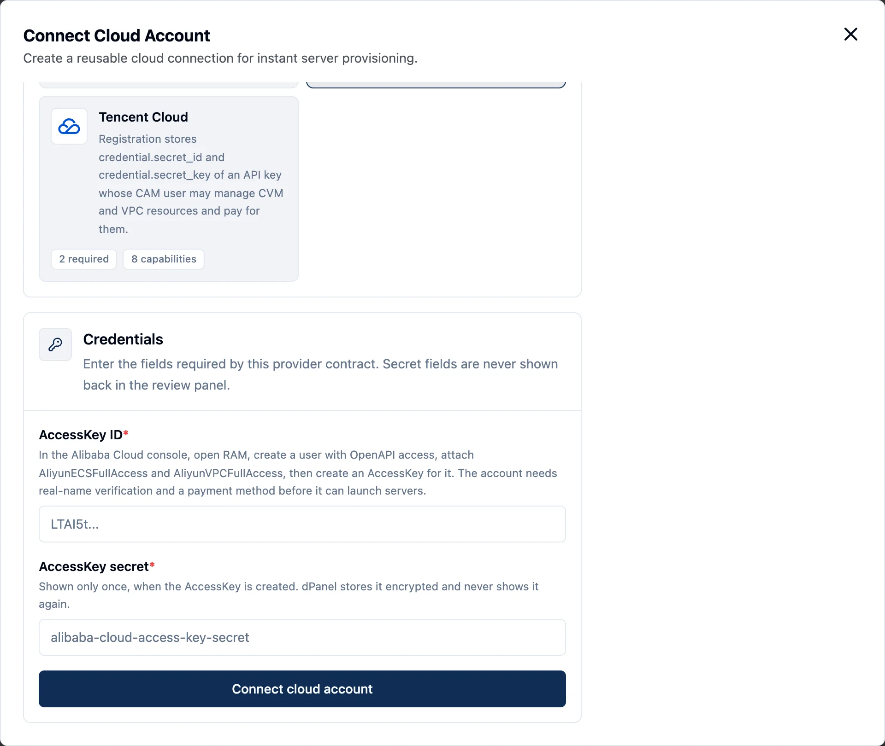
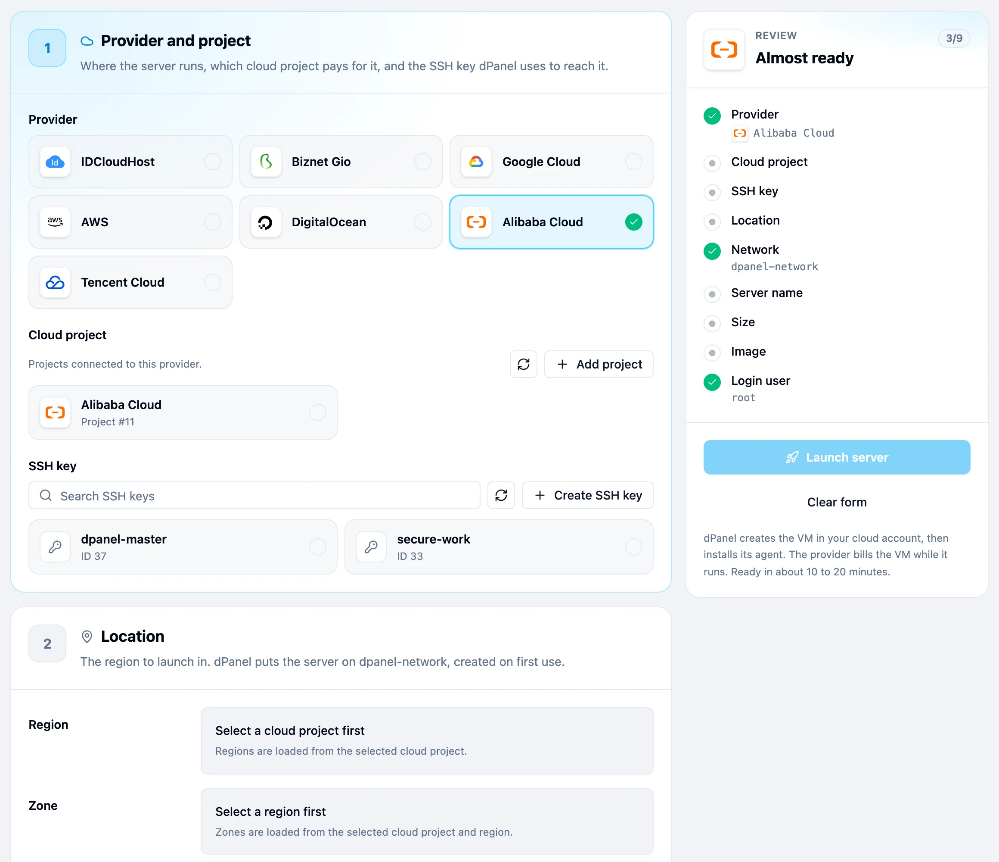

dPanel meluncurkan instance ECS Ubuntu di akun Alibaba Cloud Anda sendiri. dPanel masuk dengan AccessKey milik RAM user yang Anda buat khusus untuknya, dengan hanya izin ECS dan VPC yang tercantum di halaman ini.

## Yang perlu disiapkan

- Akun Alibaba Cloud yang boleh membeli server pay-as-you-go: verifikasi identitas (real-name verification) sudah selesai dan metode pembayaran sudah ditambahkan. Lihat [akun harus diizinkan membeli](#akun-harus-diizinkan-membeli).
- Izin di akun itu untuk membuat RAM user.
- SSH key di dPanel. Lihat [Sebelum mulai](../before-you-start.md).

## 1. Buat RAM user untuk dPanel

Jangan pernah memberi dPanel AccessKey milik akun Alibaba Cloud Anda sendiri.

1. Masuk ke konsol Alibaba Cloud, lalu buka **RAM** (Resource Access Management).
2. Buka **Identities**, lalu **Users**, dan tekan **Create User**.
3. Beri nama `dpanel`. Di **Access Mode**, centang **Using permanent AccessKey to access** (akses OpenAPI) dan biarkan akses konsol mati.
4. Salin **AccessKey ID** dan **AccessKey Secret**. Alibaba Cloud hanya menampilkan secret-nya sekali.
5. Kembali ke daftar user, pilih **Add Permissions** untuk `dpanel`, lalu berikan system policy `AliyunECSFullAccess` dan `AliyunVPCFullAccess`.

Panduan Alibaba Cloud: [Membuat RAM user](https://www.alibabacloud.com/help/en/ram/user-guide/create-a-ram-user), [Membuat AccessKey](https://www.alibabacloud.com/help/en/ram/user-guide/create-an-accesskey-pair), [Memberi izin ke RAM user](https://www.alibabacloud.com/help/en/ram/user-guide/grant-permissions-to-the-ram-user).

### Apa yang dilakukan dPanel dengan kunci ini

| Tempat                          | Fungsinya                                                   | Action API                                                                                                                                           |
| ------------------------------- | ----------------------------------------------------------- | ---------------------------------------------------------------------------------------------------------------------------------------------------- |
| API dPanel (pencarian pilihan)  | Membaca region, zona, instance type, image, vSwitch, dan VM | `DescribeRegions`, `DescribeZones`, `DescribeAvailableResource`, `DescribeInstanceTypes`, `DescribeImages`, `DescribeVSwitches`, `DescribeInstances` |
| Jaringan, hanya peluncuran awal | Membuat `dpanel-network` dan vSwitch di zona itu            | `CreateVpc`, `CreateVSwitch`                                                                                                                         |
| Setiap peluncuran               | Mengimpor SSH key Anda dan membuka TCP 22, 80, dan 443      | `ImportKeyPair`, `CreateSecurityGroup`, `AuthorizeSecurityGroup`                                                                                     |
| Instance                        | Meluncurkannya, pay-as-you-go, dengan IP publik             | `RunInstances`                                                                                                                                       |
| Penghapusan                     | Menghapus instance, security group, dan key pair-nya        | `DeleteInstance`, `DeleteSecurityGroup`, `DeleteKeyPairs`                                                                                            |

:::note[Kalau peluncuran ditolak]
Panggilan pencarian pilihan adalah panggilan yang dilakukan dPanel sendiri. Peluncuran dan penghapusan dijalankan lewat koleksi Ansible `alibaba.alicloud`, yang mungkin melakukan beberapa panggilan baca tambahan. Dua system policy di atas sudah mencakup semuanya. Kalau Anda menulis custom policy yang lebih sempit lalu peluncuran gagal, pesan error-nya menyebut action yang kurang.
:::

## 2. Hubungkan ke dPanel

1. Di sidebar, buka **Proyek Cloud**. Judul halamannya **Akun cloud**.
2. Tekan **Hubungkan akun cloud**.
3. Isi **Connection name**, misalnya `Alibaba produksi`.
4. Di **Cloud provider**, pilih **Alibaba Cloud**.
5. Tempel **AccessKey ID** dan **AccessKey secret**.
6. Tekan **Connect cloud account**.

dPanel langsung menyimpan akun itu sebagai **Siap**, tanpa menguji kuncinya. Ujian pertamanya ada di formulir peluncuran: kalau **Region** tetap kosong atau menampilkan error, kunci atau izinnya salah.

## 3. Kolom Alibaba Cloud di formulir peluncuran

| Kolom              | Yang dipilih                                                                                                                                                                                                                                  |
| ------------------ | --------------------------------------------------------------------------------------------------------------------------------------------------------------------------------------------------------------------------------------------- |
| **Region**         | Tempat server berjalan, misalnya `ap-southeast-5` (Jakarta).                                                                                                                                                                                  |
| **Zone**           | Zona di dalam region itu, misalnya `ap-southeast-5a`.                                                                                                                                                                                         |
| **Network**        | `dpanel-network`. Tidak perlu dipilih.                                                                                                                                                                                                        |
| **Size**           | Geser **CPU** dan **RAM**. dPanel meluncurkan tipe termurah yang tersedia di zona itu, `ecs.e-` lebih dulu, lalu `ecs.u1-`, `ecs.c7`, atau `ecs.g7`. **Choose the instance type yourself** menampilkan semuanya, misalnya `ecs.e-c1m2.large`. |
| **Ubuntu release** | 24.04 LTS atau 26.04 LTS. dPanel memilih image Alibaba Cloud terbaru untuk rilis itu.                                                                                                                                                         |
| **Storage**        | System disk, 40 sampai 500 GB, ESSD.                                                                                                                                                                                                          |

Untuk Alibaba Cloud tidak ada langkah **Access**. dPanel masuk sebagai `root` dengan SSH key Anda.

## 4. Luncurkan

Ikuti [Membuat server cloud](./create-a-cloud-server.md). Pilih Alibaba Cloud di langkah 1.

## Jebakan di Alibaba Cloud

### Akun harus diizinkan membeli

Kalau peluncuran gagal dengan `Forbidden.RiskControl`, Alibaba Cloud memblokir pembelian di akun itu. Ini bukan masalah kunci atau izin. Selesaikan verifikasi identitas, tambahkan metode pembayaran, dan pastikan tidak ada tagihan yang tertunggak, lalu luncurkan lagi. Akun baru bisa tetap terblokir sampai Alibaba Cloud selesai meninjaunya.

### Hal lain yang perlu diketahui

- **Jaringan muncul di peluncuran pertama.** Di setiap region, peluncuran pertama membuat VPC bernama `dpanel-network` (`10.88.0.0/16`). Setiap zona mendapat vSwitch sendiri, `dpanel-network-<zona>`, saat pertama kali ada server di sana. Menghapus server tidak pernah menghapusnya.
- **Satu security group per server**, bernama `dpanel-<nama server>`, terbuka ke internet di TCP 22, 80, dan 443. dPanel menghapusnya bersama server.
- **Satu key pair per server**, bernama `dpanel-<nama server>-key`, berisi bagian publik SSH key Anda. dPanel menghapusnya bersama server.
- **Nama server dipakai sebagai hostname.** Gunakan 2 sampai 63 huruf, angka, atau tanda hubung, diawali huruf. dPanel menolak nama yang sudah dipakai instance lain di region itu.
- **IP publik dan bandwidth.** Instance mendapat alamat IPv4 publik, ditagih berdasarkan trafik, dibatasi 100 Mbps.
- **Tagihan berjalan sejak peluncuran.** Anda membayar Alibaba Cloud untuk instance, disk, dan trafiknya selama masih ada, termasuk saat setup berjalan atau gagal. Hapus server yang sudah tidak dipakai.

## Keamanan

- Kunci ini bisa membuat dan menghapus resource ECS dan VPC di akun itu. Simpan di RAM user tersendiri supaya bisa dicabut tanpa mengganggu yang lain.
- Untuk merotasi kunci, buat AccessKey baru untuk RAM user yang sama, lalu ganti lewat **Perbarui kredensial** pada akun cloud. Lihat [Merotasi kredensial](./cloud-credentials-security.md#merotasi-kredensial).
- Untuk memutus akses dPanel, nonaktifkan atau hapus AccessKey-nya di RAM. Server yang sedang berjalan tetap berjalan. Lihat [apa yang terjadi saat kunci dicabut](./cloud-credentials-security.md#kalau-kredensial-dicabut).
- Selengkapnya di [Kredensial cloud dan keamanan](./cloud-credentials-security.md).

## Pertanyaan yang sering diajukan

### Siapa yang membayar servernya?

Alibaba Cloud menagih Anda langsung, karena server berjalan di akun Anda sendiri. dPanel tidak menjual ulang mesin. Hapus server di dPanel kalau sudah selesai, supaya penyedia berhenti menagih. Lihat [Menghapus server](../delete-a-server.md).

### Bisakah saya juga memakai firewall dPanel di server ini?

Bisa. [Firewall](../firewall.md) dPanel berjalan di server itu sendiri, di belakang aturan jaringan milik Alibaba Cloud, jadi sebuah port harus terbuka di keduanya agar bisa dijangkau.

### Apa yang terjadi pada server saya kalau kredensialnya dicabut?

Server tetap berjalan, tetapi dPanel tidak bisa lagi meluncurkan atau menghapus mesin dengan kredensial itu. Lihat [Kredensial cloud dan keamanan](./cloud-credentials-security.md#kalau-kredensial-dicabut).
