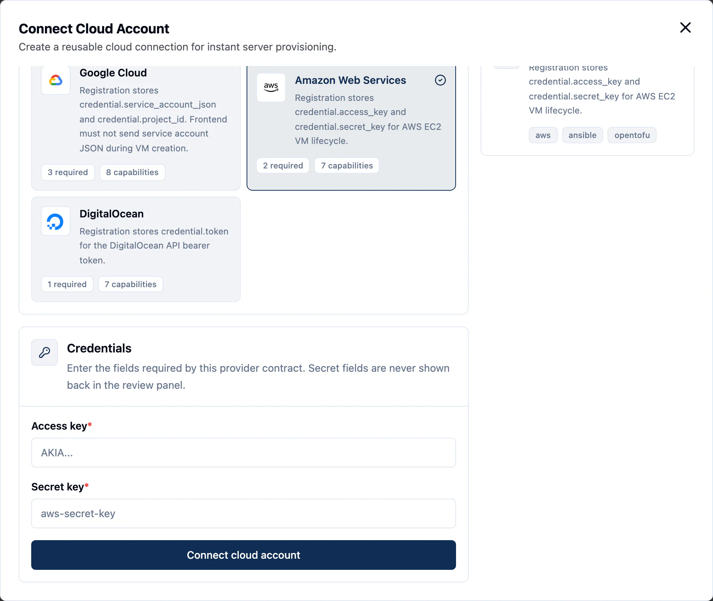
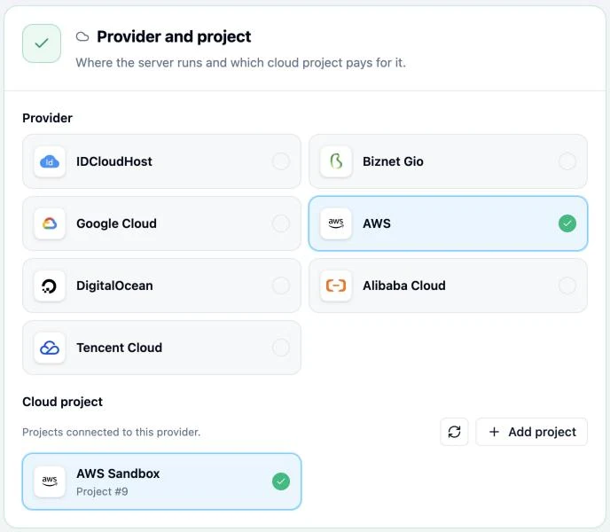

dPanel meluncurkan instance EC2 Ubuntu di akun AWS Anda sendiri. dPanel masuk dengan access key milik IAM user khusus yang Anda buat untuknya, yang dibatasi oleh policy IAM minimum di halaman ini sehingga hanya bisa mengelola instance EC2 yang diberinya tag, di region yang Anda izinkan.

## Yang perlu disiapkan

- Akun AWS yang sudah diatur penagihannya.
- Izin di akun itu untuk membuat IAM user dan policy.
- SSH key di dPanel, hanya jika server perlu bergabung lewat SSH. Dengan agen dPanel, pilihan bawaannya, Anda tidak butuh kunci. Lihat [Sebelum mulai](../before-you-start.md).

## 1. Buat IAM user khusus

Jangan pernah memberi dPanel kunci root user atau kunci administrator.

1. Masuk ke konsol AWS sebagai administrator, lalu buka **IAM**.
2. Buka **Policies**, lalu **Create policy**, dan pindah ke editor **JSON**.
3. Tempel [policy di bawah](#policy-iam-minimum). Ganti region di `aws:RequestedRegion` dengan region yang akan Anda pakai.
4. Beri nama `dpanel-ec2`, lalu buat.
5. Buka **Users**, lalu **Create user**. Beri nama `dpanel`. Biarkan akses konsol mati.
6. Di **Set permissions**, pilih **Attach policies directly**, lalu centang `dpanel-ec2`.
7. Buka user baru itu, masuk ke **Security credentials**, lalu **Create access key**. Pilih **Third-party service** sebagai kegunaannya.
8. Salin **Access key** dan **Secret access key**. AWS hanya menampilkan secret-nya sekali.

Panduan AWS: [Membuat IAM user](https://docs.aws.amazon.com/IAM/latest/UserGuide/id_users_create.html), [Mengelola access key](https://docs.aws.amazon.com/IAM/latest/UserGuide/id_credentials_access-keys.html), [Membuat policy dengan JSON](https://docs.aws.amazon.com/IAM/latest/UserGuide/access_policies_create-console.html).

:::tip[Pakai akun terpisah kalau bisa]
Akun AWS khusus untuk dPanel, di dalam AWS Organizations, menjauhkan apa pun yang dikerjakan dPanel dari beban kerja lain. Pasang juga [budget alert](https://docs.aws.amazon.com/cost-management/latest/userguide/budgets-create.html) di akun itu.
:::

## Policy IAM minimum

Berikut panggilan EC2 yang dilakukan dPanel, dibaca dari kodenya:

| Tempat                             | Fungsinya                                               | Action                                                                                                                                                                                                 |
| ---------------------------------- | ------------------------------------------------------- | ------------------------------------------------------------------------------------------------------------------------------------------------------------------------------------------------------ |
| API dPanel (penelusuran)           | Membaca daftar region, instance type, image, subnet, VM | `DescribeRegions`, `DescribeInstanceTypes`, `DescribeImages`, `DescribeSubnets`, `DescribeInstances`                                                                                                   |
| Jaringan, hanya peluncuran pertama | Membuat `dpanel-network`: VPC, gateway, subnet, route   | `CreateVpc`, `ModifyVpcAttribute`, `CreateInternetGateway`, `AttachInternetGateway`, `CreateSubnet`, `ModifySubnetAttribute`, `CreateRouteTable`, `CreateRoute`, `ReplaceRoute`, `AssociateRouteTable` |
| Security group, tiap peluncuran    | `dpanel-<nama server>`, TCP 22, 80, dan 443             | `CreateSecurityGroup`, `AuthorizeSecurityGroupIngress`, `RevokeSecurityGroupIngress`, `AuthorizeSecurityGroupEgress`, `RevokeSecurityGroupEgress`, `UpdateSecurityGroupRuleDescriptionsIngress`        |
| Instance                           | Meluncurkan, menyalakan, dan menghapusnya               | `RunInstances`, `StartInstances`, `TerminateInstances`, `CreateTags`                                                                                                                                   |
| Penghapusan                        | Menghapus security group server                         | `DeleteSecurityGroup`                                                                                                                                                                                  |

dPanel tidak butuh izin IAM, S3, atau `iam:PassRole`. dPanel tidak memasang instance profile dan juga tidak butuh `ec2:ImportKeyPair`: saat pertama kali menyala, cloud-init memasang agen dPanel, atau, kalau server bergabung lewat SSH, menaruh SSH key Anda di sana.

Setiap resource yang dibuat dPanel diberi tag `managed-by = dpanel`. Policy ini memakai tag itu supaya dPanel hanya bisa menghapus instance dan security group buatannya sendiri.

```json
{
  "Version": "2012-10-17",
  "Statement": [
    {
      "Sid": "DpanelDiscovery",
      "Effect": "Allow",
      "Action": [
        "ec2:DescribeRegions",
        "ec2:DescribeAvailabilityZones",
        "ec2:DescribeInstanceTypes",
        "ec2:DescribeImages",
        "ec2:DescribeInstances",
        "ec2:DescribeInstanceStatus",
        "ec2:DescribeInstanceAttribute",
        "ec2:DescribeVpcs",
        "ec2:DescribeVpcAttribute",
        "ec2:DescribeSubnets",
        "ec2:DescribeInternetGateways",
        "ec2:DescribeRouteTables",
        "ec2:DescribeSecurityGroups",
        "ec2:DescribeSecurityGroupRules",
        "ec2:DescribeTags"
      ],
      "Resource": "*"
    },
    {
      "Sid": "DpanelCreate",
      "Effect": "Allow",
      "Action": [
        "ec2:RunInstances",
        "ec2:CreateVpc",
        "ec2:ModifyVpcAttribute",
        "ec2:CreateInternetGateway",
        "ec2:AttachInternetGateway",
        "ec2:CreateSubnet",
        "ec2:ModifySubnetAttribute",
        "ec2:CreateRouteTable",
        "ec2:CreateRoute",
        "ec2:ReplaceRoute",
        "ec2:AssociateRouteTable",
        "ec2:CreateSecurityGroup",
        "ec2:AuthorizeSecurityGroupIngress",
        "ec2:RevokeSecurityGroupIngress",
        "ec2:AuthorizeSecurityGroupEgress",
        "ec2:RevokeSecurityGroupEgress",
        "ec2:UpdateSecurityGroupRuleDescriptionsIngress"
      ],
      "Resource": "*",
      "Condition": {
        "StringEquals": {
          "aws:RequestedRegion": ["ap-southeast-1", "ap-southeast-3"]
        }
      }
    },
    {
      "Sid": "DpanelTagOnlyItsOwnResources",
      "Effect": "Allow",
      "Action": "ec2:CreateTags",
      "Resource": "*",
      "Condition": {
        "StringEquals": { "aws:RequestTag/managed-by": "dpanel" }
      }
    },
    {
      "Sid": "DpanelTagOnCreate",
      "Effect": "Allow",
      "Action": "ec2:CreateTags",
      "Resource": "*",
      "Condition": {
        "StringEquals": {
          "ec2:CreateAction": [
            "RunInstances",
            "CreateVpc",
            "CreateInternetGateway",
            "CreateSubnet",
            "CreateRouteTable",
            "CreateSecurityGroup"
          ]
        }
      }
    },
    {
      "Sid": "DpanelManageOnlyItsOwnResources",
      "Effect": "Allow",
      "Action": [
        "ec2:StartInstances",
        "ec2:TerminateInstances",
        "ec2:DeleteSecurityGroup"
      ],
      "Resource": "*",
      "Condition": {
        "StringEquals": { "ec2:ResourceTag/managed-by": "dpanel" }
      }
    }
  ]
}
```

:::note[Kalau peluncuran ditolak]
Panggilan di tabel pertama adalah panggilan yang dilakukan dPanel sendiri. Beberapa action di JSON, misalnya `DescribeInstanceStatus`, `DescribeTags`, dan `DescribeSecurityGroupRules`, dipanggil di dalam library AWS yang dipakai dPanel, bukan oleh dPanel sendiri. Kalau peluncuran gagal dengan `UnauthorizedOperation`, pesan errornya menyebut action yang kurang. Tambahkan, lalu coba lagi. Server yang dibuat sebelum dPanel memberi tag mungkin tidak punya tag `managed-by`; menghapusnya butuh `TerminateInstances` tanpa syarat tag.
:::

### Izin tambahan untuk VM tanpa IP publik

Kalau Anda mematikan **Beri VM IP publik**, dPanel menambahkan subnet privat dan NAT gateway ke `dpanel-network`, lalu menghapus NAT gateway itu lagi bersama VM terakhir yang memakainya. Tambahkan statement ini ke policy untuk keperluan itu:

```json
{
  "Sid": "DpanelNatGateway",
  "Effect": "Allow",
  "Action": [
    "ec2:DescribeNatGateways",
    "ec2:DescribeAddresses",
    "ec2:AllocateAddress",
    "ec2:ReleaseAddress",
    "ec2:CreateNatGateway",
    "ec2:DeleteNatGateway"
  ],
  "Resource": "*"
}
```

Server dengan IP publik tidak membutuhkannya.

## 2. Hubungkan ke dPanel

1. Di sidebar, buka **Proyek Cloud**. Judul halamannya **Akun cloud**.
2. Tekan **Hubungkan akun cloud**.
3. Isi **Connection name**, misalnya `AWS produksi`.
4. Di **Cloud provider**, pilih **AWS**.
5. Tempel **Access key** dan **Secret key**.
6. Tekan **Connect cloud account**.



dPanel langsung menyimpan akun itu sebagai **Siap**, tanpa menguji kuncinya. Ujian pertamanya ada di formulir peluncuran: kalau **Region** tetap kosong atau menampilkan error, kunci atau policy-nya salah.

## 3. Kolom AWS di formulir peluncuran



| Kolom              | Yang dipilih                                                                                                                                                                                                                                                                                  |
| ------------------ | --------------------------------------------------------------------------------------------------------------------------------------------------------------------------------------------------------------------------------------------------------------------------------------------- |
| **Region**         | Region mana pun yang diizinkan untuk kunci Anda, misalnya `ap-southeast-1`.                                                                                                                                                                                                                   |
| **Size**           | Geser **CPU**, **RAM**, dan **Storage** (20 sampai 500 GB). dPanel meluncurkan tipe `t3a` atau `t3` termurah yang cukup, lalu `c6a`, `m6a`, `c6i`, atau `m6i` untuk ukuran yang lebih besar. **Choose the instance type yourself** menampilkan semua tipe di region itu, misalnya `t3.small`. |
| **Ubuntu release** | 24.04 LTS atau 26.04 LTS. dPanel mencari image yang cocok di region itu.                                                                                                                                                                                                                      |
| **Network**        | `dpanel-network`. Tidak perlu dipilih.                                                                                                                                                                                                                                                        |

Untuk AWS tidak ada langkah **Access**. Dengan SSH, dPanel masuk sebagai `ubuntu`.

## 4. Luncurkan

Ikuti [Membuat server cloud](./create-a-cloud-server.md). Pilih AWS di langkah 1.

## Jebakan di AWS

- **Jaringan muncul saat peluncuran pertama.** Di tiap region, peluncuran pertama membuat VPC bernama `dpanel-network` (`10.88.0.0/16`), internet gateway, subnet publik, dan route table. Peluncuran berikutnya memakainya lagi. Menghapus server tidak pernah menghapusnya.
- **Kuota VPC.** Bawaan AWS adalah 5 VPC per region. Kalau region sudah penuh, peluncuran pertama gagal sampai Anda mengosongkan satu atau menaikkan kuota.
- **Satu security group per server**, bernama `dpanel-<nama server>`, terbuka ke internet di TCP 22, 80, dan 443. dPanel menghapusnya bersama servernya.
- **IP publik.** Instance mendapat alamat IPv4 publik otomatis, kecuali Anda mematikan **Beri VM IP publik**. AWS menagih IPv4 publik per jam, dan alamatnya bisa berubah kalau instance dimatikan lalu dinyalakan di luar dPanel. Dengan agen dPanel, alamatnya bisa baru muncul di halaman server beberapa menit setelah server menjadi **Ready**.
- **NAT gateway untuk VM tanpa IP publik.** VM tanpa IP publik di `dpanel-network` mengakses internet lewat NAT gateway yang ditambahkan dPanel. AWS menagih NAT gateway untuk setiap jam keberadaannya, ditambah trafiknya. dPanel menghapusnya saat Anda menghapus VM tanpa IP publik terakhir di jaringan itu.
- **Nama harus unik.** dPanel menolak nama server yang sudah dipakai instance yang menyala atau mati di region itu.
- **Tagihan berjalan sejak peluncuran.** Anda membayar instance, volume EBS, dan IP publiknya selama masih ada, termasuk saat setup berjalan atau gagal.

## Keamanan

- Kunci ini bisa membuat dan menghapus resource EC2 di region yang Anda izinkan. Dengan policy di atas, kunci ini tidak bisa menyentuh IAM, S3, basis data, atau instance yang tidak diberi tagnya.
- Untuk merotasi kunci, buat kunci baru untuk IAM user yang sama, lalu ganti lewat **Perbarui kredensial** pada akun cloud. Lihat [Merotasi kredensial](./cloud-credentials-security.md#merotasi-kredensial).
- Untuk memutus akses dPanel, nonaktifkan access key-nya di IAM. Server yang sedang berjalan tetap berjalan. Lihat [apa yang terjadi saat kunci dicabut](./cloud-credentials-security.md#kalau-kredensial-dicabut).
- Selengkapnya di [Kredensial cloud dan keamanan](./cloud-credentials-security.md).

## Pertanyaan yang sering diajukan

### Izin IAM apa yang dibutuhkan dPanel di AWS?

Hanya EC2: panggilan describe yang mengisi formulir peluncuran, panggilan yang membuat `dpanel-network` dan security group, serta `RunInstances`, `TerminateInstances`, dan `CreateTags`. [Policy IAM minimum](#policy-iam-minimum) di atas mencantumkannya, tanpa izin IAM, S3, atau `iam:PassRole`.

### Bisakah saya membatasi dPanel ke satu region AWS?

Bisa. Syarat `aws:RequestedRegion` di policy membatasi peluncuran ke region yang Anda sebut. Ubah daftarnya sebelum memasang policy itu.

### Tipe instance EC2 apa yang diluncurkan dPanel?

Tipe `t3a` atau `t3` termurah dengan CPU dan RAM minimal sebesar pilihan Anda, atau tipe `c6a`, `m6a`, `c6i`, atau `m6i` untuk ukuran yang lebih besar. Tekan **Choose the instance type yourself** untuk memilih tipe apa pun, misalnya `t3.small`.

### Apakah menghapus server di dPanel juga menghentikan (terminate) instance EC2-nya?

Ya. dPanel menghentikan instance itu dan menghapus security group-nya. VPC `dpanel-network` tetap ada, sehingga peluncuran berikutnya di region itu memakainya lagi.
