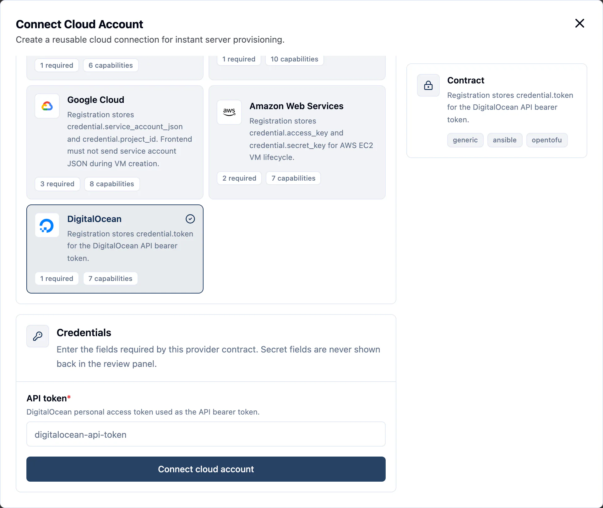
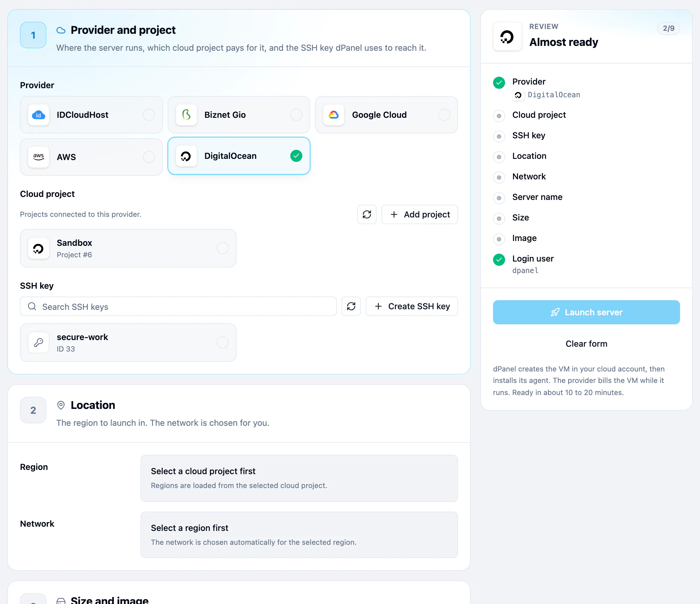

dPanel meluncurkan Droplet Ubuntu di team DigitalOcean Anda sendiri. dPanel masuk dengan personal access token bercakupan khusus yang Anda buat untuknya, yang hanya bisa mengelola Droplet, SSH key, dan daftar yang dibaca formulir peluncuran.

## Yang perlu disiapkan

- Team DigitalOcean yang sudah diatur penagihannya. Team terpisah khusus untuk dPanel membuat aksesnya tetap terbatas.
- SSH key di dPanel. Lihat [Sebelum mulai](../before-you-start.md).

## 1. Buat token dengan cakupan khusus

DigitalOcean membolehkan Anda menentukan persis apa yang boleh dilakukan sebuah token. Jangan beri dPanel token **Full Access**.

1. Di [control panel DigitalOcean](https://cloud.digitalocean.com), buka **API**, lalu **Tokens**.
2. Tekan **Generate New Token**, dan beri nama `dpanel`.
3. Pilih masa berlaku. 90 hari cukup seimbang; Anda harus [merotasinya](./cloud-credentials-security.md#merotasi-kredensial) saat habis.
4. Di **Scopes**, pilih **Custom Scopes** dan centang hanya ini:

| Scope                                              | Kenapa dPanel membutuhkannya                                 |
| -------------------------------------------------- | ------------------------------------------------------------ |
| `droplet:create`, `droplet:read`, `droplet:delete` | Membuat Droplet, menunggunya siap, menghapusnya nanti        |
| `ssh_key:create`, `ssh_key:read`                   | Mengimpor SSH key dPanel Anda sebagai `dpanel-<nama server>` |
| `regions:read`                                     | Daftar **Region**                                            |
| `sizes:read`                                       | Slider **Size** dan daftar ukuran Droplet                    |
| `image:read`                                       | Daftar image Ubuntu                                          |
| `vpc:read`                                         | Daftar jaringan di sebuah region                             |

5. Tekan **Generate Token**, lalu salin. DigitalOcean hanya menampilkannya sekali.

Panduan DigitalOcean: [Membuat personal access token](https://docs.digitalocean.com/reference/api/create-personal-access-token/), [Cakupan token](https://docs.digitalocean.com/reference/api/scopes/).

:::warning[Perlu dicek]
Daftar di atas berasal dari panggilan API di kode dPanel (`/v2/regions`, `/v2/sizes`, `/v2/images`, `/v2/vpcs`, `/v2/droplets`) dan modul Ansible `digitalocean.cloud` yang dijalankannya (`droplet`, `droplets_info`, `ssh_key`). DigitalOcean kadang mewajibkan scope baca tambahan untuk sebuah aksi pembuatan, misalnya `actions:read` saat menunggu Droplet. Halaman token memberi tahu scope apa saja yang dibutuhkan sebuah scope pembuatan; terima saja. Kalau peluncuran gagal dengan `403`, pesan errornya menyebut scope yang kurang.
:::

## 2. Hubungkan ke dPanel

1. Di sidebar, buka **Proyek Cloud**. Judul halamannya **Akun cloud**.
2. Tekan **Hubungkan akun cloud**.
3. Isi **Connection name**, misalnya `DigitalOcean SGP`.
4. Di **Cloud provider**, pilih **DigitalOcean**.
5. Tempel tokennya di **API token**.
6. Tekan **Connect cloud account**.

dPanel menyimpan akun itu sebagai **Siap** tanpa mengujinya. Ujian pertamanya ada di formulir peluncuran: kalau **Region** tetap kosong atau error, periksa token dan scope-nya.

## 3. Kolom DigitalOcean di formulir peluncuran

| Kolom              | Yang dipilih                                                                                                                                                                                     |
| ------------------ | ------------------------------------------------------------------------------------------------------------------------------------------------------------------------------------------------ |
| **Region**         | Pusat datanya, misalnya `sgp1`.                                                                                                                                                                  |
| **Size**           | Geser **CPU** dan **RAM**. dPanel meluncurkan Droplet Basic termurah yang cukup, misalnya `s-1vcpu-2gb`; disknya sudah termasuk. **Choose the instance type yourself** menampilkan semua ukuran. |
| **Ubuntu release** | 24.04 LTS atau 26.04 LTS.                                                                                                                                                                        |
| **Network**        | VPC bawaan region itu, kecuali Anda memilih yang lain.                                                                                                                                           |

DigitalOcean menambahkan langkah keempat, **Access**, berisi **Default User**: user Linux yang dibuat dPanel dan dipakainya untuk masuk. Bawaannya `dpanel`.

## 4. Luncurkan

Ikuti [Membuat server cloud](./create-a-cloud-server.md). Pilih DigitalOcean di langkah 1.

## Jebakan di DigitalOcean

- **Ada SSH key baru di team Anda.** Setiap peluncuran mengimpor kunci publik dPanel Anda sebagai `dpanel-<nama server>` di **Settings**, **Security**. Menghapus server tidak ikut menghapusnya.
- **dPanel tidak membuat firewall.** dPanel tidak membuat Cloud Firewall. Droplet baru menerima lalu lintas di semua port sampai Anda menambahkan firewall. Kalau menambahkannya, izinkan TCP 22, 80, dan 443, atau dPanel dan aplikasi Anda berhenti bekerja.
- **Batas Droplet.** Team baru hanya boleh menjalankan sedikit Droplet. Peluncuran yang gagal karena batas butuh kenaikan limit dari DigitalOcean.
- **Tanpa backup.** dPanel tidak menyalakan backup maupun monitoring DigitalOcean. Nyalakan di control panel kalau Anda butuh; backup dikenai biaya tambahan.
- **Tagihan berjalan sejak peluncuran.** Anda membayar Droplet selama masih ada, bahkan saat dimatikan.

## Keamanan

- Dengan custom scope, token ini bisa membuat, membaca, dan menghapus Droplet dan SSH key, serta membaca region, ukuran, image, dan VPC. Token ini tidak bisa menyentuh Spaces, basis data, DNS, atau penagihan.
- Dengan **Full Access**, token bisa melakukan apa saja di team itu. Jadi jangan.
- Untuk merotasi token, buat token baru di team yang sama, lalu ganti lewat **Perbarui kredensial** pada akun cloud. Lihat [Merotasi kredensial](./cloud-credentials-security.md#merotasi-kredensial).
- Untuk memutus akses dPanel, hapus tokennya di **API**, **Tokens**. Server yang sedang berjalan tetap berjalan. Lihat [apa yang terjadi saat kunci dicabut](./cloud-credentials-security.md#kalau-kredensial-dicabut).
- Selengkapnya di [Kredensial cloud dan keamanan](./cloud-credentials-security.md).

## Pertanyaan yang sering diajukan

### Siapa yang membayar servernya?

DigitalOcean menagih Anda langsung, karena server berjalan di akun Anda sendiri. dPanel tidak menjual ulang mesin. Hapus server di dPanel kalau sudah selesai, supaya penyedia berhenti menagih. Lihat [Menghapus server](../delete-a-server.md).

### Bisakah saya juga memakai firewall dPanel di server ini?

Bisa. [Firewall](../firewall.md) dPanel berjalan di server itu sendiri, di belakang aturan jaringan milik DigitalOcean, jadi sebuah port harus terbuka di keduanya agar bisa dijangkau.

### Apa yang terjadi pada server saya kalau kredensialnya dicabut?

Server tetap berjalan, tetapi dPanel tidak bisa lagi meluncurkan atau menghapus mesin dengan kredensial itu. Lihat [Kredensial cloud dan keamanan](./cloud-credentials-security.md#kalau-kredensial-dicabut).
