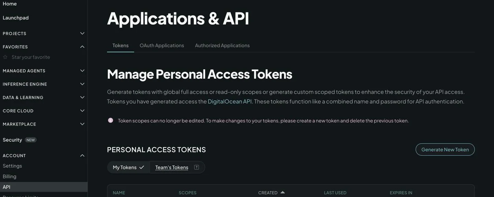
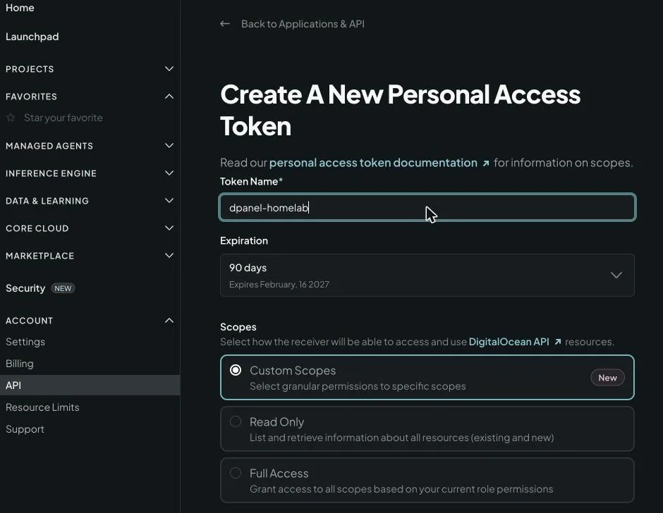
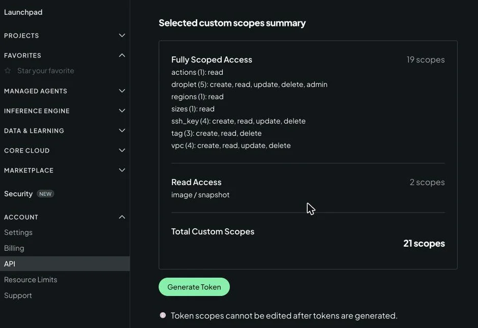

dPanel meluncurkan Droplet Ubuntu di team DigitalOcean Anda sendiri. dPanel masuk dengan personal access token bercakupan khusus yang Anda buat untuknya, yang hanya bisa mengelola Droplet dan hal yang dibutuhkan peluncuran di sekitarnya.

## Yang perlu disiapkan

- Team DigitalOcean yang sudah diatur penagihannya. Team terpisah khusus untuk dPanel membuat aksesnya tetap terbatas.
- SSH key di dPanel, hanya jika server perlu bergabung lewat SSH. Dengan agen dPanel, pilihan bawaannya, Anda tidak butuh kunci. Lihat [Sebelum mulai](../before-you-start.md).

## 1. Buat token dengan cakupan khusus

DigitalOcean membolehkan Anda menentukan persis apa yang boleh dilakukan sebuah token. Jangan beri dPanel token **Full Access**. Jangan pilih **Read Only** juga: dPanel tidak bisa meluncurkan server dengannya.

1. Masuk ke [control panel DigitalOcean](https://cloud.digitalocean.com). Di menu kiri, di bawah **Account**, buka **API**. Halamannya berjudul **Applications & API**; tetap di tab **Tokens**.
2. Tekan **Generate New Token**.

   

3. Di **Token Name**, ketik nama yang mudah Anda kenali nanti, misalnya `dpanel`.
4. Pilih **Expiration** (masa berlaku). Bawaannya, 90 hari, cukup seimbang; Anda harus [merotasi](./cloud-credentials-security.md#merotasi-kredensial) token saat masa itu habis.
5. Di **Scopes**, pilih **Custom Scopes**.

   

   Ketik setiap jenis resource di bawah ke kotak **Search by resource type**, lalu centang hanya scope berikut, total 21:

| Jenis resource | Scope yang dicentang                          | Untuk apa                                                                                                 |
| -------------- | --------------------------------------------- | --------------------------------------------------------------------------------------------------------- |
| `droplet`      | `create`, `read`, `update`, `delete`, `admin` | Membuat Droplet, menunggunya berjalan dan mendapat alamat IP, dan menghapusnya saat Anda menghapus server |
| `ssh_key`      | `create`, `read`, `update`, `delete`          | Mengimpor SSH key dPanel Anda, hanya bila server bergabung lewat SSH                                      |
| `regions`      | `read`                                        | Daftar **Region**                                                                                         |
| `sizes`        | `read`                                        | Slider **Size** dan daftar ukuran Droplet                                                                 |
| `image`        | `read`                                        | Daftar rilis Ubuntu                                                                                       |
| `vpc`          | `create`, `read`, `update`, `delete`          | Daftar **Network**, dan menempatkan Droplet di jaringan yang Anda pilih                                   |
| `tag`          | `create`, `read`, `delete`                    | Bagian dari token yang sudah diuji; lihat catatan di bawah                                                |
| `actions`      | `read`                                        | Bagian dari token yang sudah diuji; lihat catatan di bawah                                                |
| `snapshot`     | `read`                                        | Bagian dari token yang sudah diuji; lihat catatan di bawah                                                |

6. Sebelum lanjut, gulir ke **Selected custom scopes summary**. Totalnya harus **21 scopes**: 19 di **Fully Scoped Access** dan 2 (`image` dan `snapshot`) di **Read Access**.

   

7. Tekan **Generate Token**. DigitalOcean hanya menampilkan token sekali: salin dengan ikon salin di sebelahnya, dan simpan di tempat aman sampai Anda menempelnya ke dPanel di langkah berikutnya.

Panduan DigitalOcean: [Membuat personal access token](https://docs.digitalocean.com/reference/api/create-personal-access-token/), [Cakupan token](https://docs.digitalocean.com/reference/api/scopes/).

:::note[Kenapa 21 scope]
Ini persis set yang dipakai untuk menguji dPanel: token dengan scope ini meluncurkan Droplet dari awal sampai selesai. dPanel sendiri hanya meminta DigitalOcean menampilkan daftar region, ukuran, image Ubuntu, jaringan, dan Droplet, membuat dan menghapus Droplet, serta menambahkan SSH key. dPanel tidak memakai scope lainnya secara langsung, tetapi scope itu bagian dari token yang sudah diuji. Token dengan scope lebih sedikit belum diuji, jadi bisa gagal di tengah peluncuran. Kalau peluncuran gagal dengan `403`, pesan errornya menyebut scope yang kurang: tambahkan ke token.
:::

## 2. Hubungkan ke dPanel

1. Di sidebar, buka **Proyek Cloud**. Judul halamannya **Akun cloud**.
2. Tekan **Hubungkan akun cloud**.
3. Isi **Connection name**, misalnya `DigitalOcean SGP`.
4. Di **Cloud provider**, pilih **DigitalOcean**.
5. Tempel tokennya di **API token**.
6. Tekan **Connect cloud account**.

dPanel langsung menyimpan akun itu sebagai **Siap**, tanpa menguji tokennya. Untuk memeriksanya sebelum meluncurkan apa pun:

1. Tekan **Buat server**, lalu **Luncurkan server cloud**.
2. Pilih **DigitalOcean**, lalu akun cloud yang baru Anda hubungkan.
3. Tunggu daftar **Region**. Kalau terisi region DigitalOcean, misalnya `sgp1`, tokennya berfungsi. Anda boleh menutup formulir tanpa meluncurkan apa pun.

Kalau **Region** tetap kosong atau menampilkan error, periksa apakah token sudah ditempel utuh dan scope di atas sudah dicentang.

## 3. Kolom DigitalOcean di formulir peluncuran

| Kolom              | Yang dipilih                                                                                                                                                                                     |
| ------------------ | ------------------------------------------------------------------------------------------------------------------------------------------------------------------------------------------------ |
| **Region**         | Pusat datanya, misalnya `sgp1`.                                                                                                                                                                  |
| **Size**           | Geser **CPU** dan **RAM**. dPanel meluncurkan Droplet Basic termurah yang cukup, misalnya `s-1vcpu-2gb`; disknya sudah termasuk. **Choose the instance type yourself** menampilkan semua ukuran. |
| **Ubuntu release** | 24.04 LTS atau 26.04 LTS.                                                                                                                                                                        |
| **Network**        | VPC bawaan region itu, kecuali Anda memilih yang lain.                                                                                                                                           |

DigitalOcean menambahkan langkah **Access**, berisi **Default User**: user Linux yang dibuat dPanel, dan dipakainya untuk masuk bila server bergabung lewat SSH. Bawaannya `dpanel`.

Droplet selalu mendapat IP publik, jadi formulir tidak punya sakelar IP publik untuk DigitalOcean.

## 4. Luncurkan

Ikuti [Membuat server cloud](./create-a-cloud-server.md). Pilih DigitalOcean di langkah 1.

## Jebakan di DigitalOcean

- **Ada SSH key baru di team Anda, khusus SSH.** Setiap peluncuran yang bergabung lewat SSH mengimpor kunci publik dPanel Anda sebagai `dpanel-<nama server>-key` di **Settings**, **Security**. Menghapus server tidak ikut menghapusnya. Dengan agen dPanel, tidak ada kunci yang diimpor.
- **dPanel tidak membuat firewall.** dPanel tidak membuat Cloud Firewall. Droplet baru menerima lalu lintas di semua port sampai Anda menambahkan firewall. Kalau menambahkannya, izinkan TCP 80 dan 443 untuk aplikasi Anda, dan TCP 22 bila server bergabung lewat SSH atau Anda sendiri masuk lewat SSH.
- **Batas Droplet.** Team baru hanya boleh menjalankan sedikit Droplet. Peluncuran yang gagal karena batas butuh kenaikan limit dari DigitalOcean.
- **Tanpa backup.** dPanel tidak menyalakan backup maupun monitoring DigitalOcean. Nyalakan di control panel kalau Anda butuh; backup dikenai biaya tambahan.
- **Tagihan berjalan sejak peluncuran.** Anda membayar Droplet selama masih ada, bahkan saat dimatikan.

## Keamanan

- Dengan custom scope di atas, token ini bisa mengelola Droplet, SSH key, VPC, dan tag, serta membaca region, ukuran, image, snapshot, dan actions. Token ini tidak bisa menyentuh Spaces, basis data, DNS, atau penagihan.
- Dengan **Full Access**, token bisa melakukan apa saja di team itu. Jadi jangan.
- Untuk merotasi token, buat token baru di team yang sama, lalu ganti lewat **Perbarui kredensial** pada akun cloud. Lihat [Merotasi kredensial](./cloud-credentials-security.md#merotasi-kredensial).
- Untuk memutus akses dPanel, hapus tokennya di **Applications & API**, **Tokens**, lalu putuskan akun cloud di dPanel: pada barisnya di **Akun cloud**, buka menu ⋯, pilih **Hapus**, lalu konfirmasi **Putuskan akun cloud**. Server yang sedang berjalan tetap berjalan, dan DigitalOcean tetap menagihnya. Lihat [apa yang terjadi saat kunci dicabut](./cloud-credentials-security.md#kalau-kredensial-dicabut).
- Selengkapnya di [Kredensial cloud dan keamanan](./cloud-credentials-security.md).

## Pertanyaan yang sering diajukan

### Siapa yang membayar servernya?

DigitalOcean menagih Anda langsung, karena server berjalan di akun Anda sendiri. dPanel tidak menjual ulang mesin. Hapus server di dPanel kalau sudah selesai, supaya penyedia berhenti menagih. Lihat [Menghapus server](../delete-a-server.md).

### Bisakah saya juga memakai firewall dPanel di server ini?

Bisa. [Firewall](../firewall.md) dPanel berjalan di server itu sendiri, di belakang aturan jaringan milik DigitalOcean, jadi sebuah port harus terbuka di keduanya agar bisa dijangkau.

### Apa yang terjadi pada server saya kalau kredensialnya dicabut?

Server tetap berjalan, tetapi dPanel tidak bisa lagi meluncurkan atau menghapus mesin dengan kredensial itu. Lihat [Kredensial cloud dan keamanan](./cloud-credentials-security.md#kalau-kredensial-dicabut).
