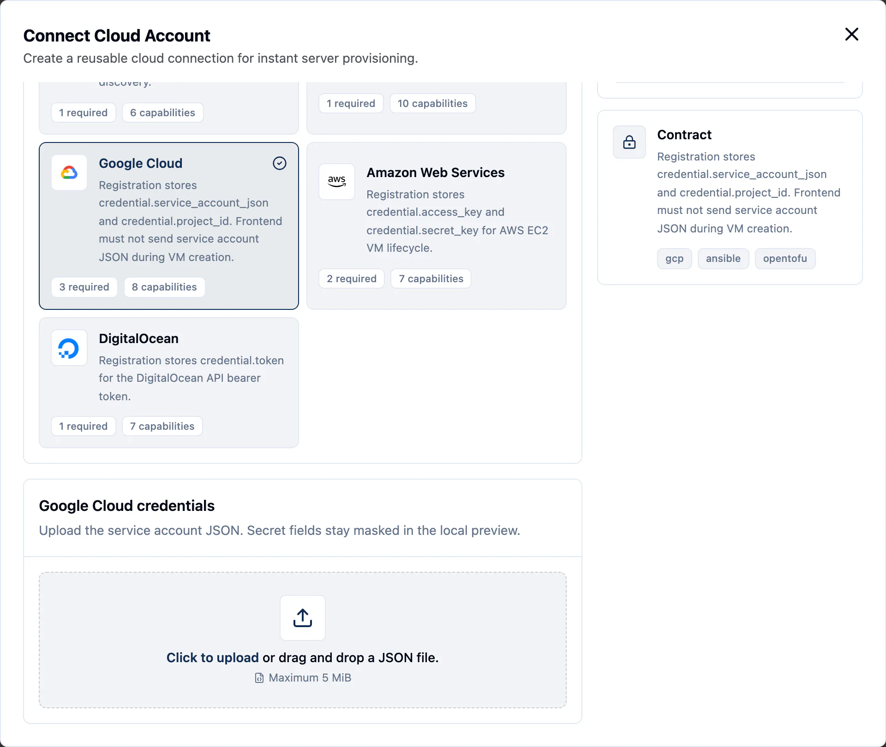
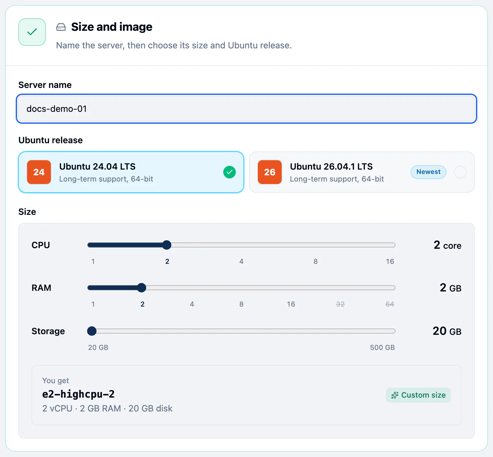

dPanel meluncurkan VM Compute Engine di salah satu project Google Cloud Anda. dPanel masuk dengan kunci JSON service account yang Anda buat khusus untuknya.

## Yang perlu disiapkan

- Project Google Cloud yang sudah terhubung ke akun penagihan. Paling baik project baru khusus untuk dPanel.
- **Compute Engine API** sudah aktif di project itu.
- Izin membuat service account, custom role, dan kunci di project itu.
- SSH key di dPanel. Lihat [Sebelum mulai](../before-you-start.md).

## 1. Buat project dan service account khusus

Jalankan perintah berikut dengan [gcloud CLI](https://cloud.google.com/sdk/docs/install), masuk sebagai pemilik project. Ganti `my-dpanel-project` dan `BILLING_ACCOUNT_ID`.

```bash
# A project only dPanel uses
gcloud projects create my-dpanel-project
gcloud billing projects link my-dpanel-project --billing-account=BILLING_ACCOUNT_ID
gcloud services enable compute.googleapis.com --project=my-dpanel-project

# The custom role with only what dPanel calls (see the list below)
gcloud iam roles create dpanelCompute --project=my-dpanel-project \
  --title="dPanel Compute" \
  --permissions=compute.regions.list,compute.zones.list,compute.machineTypes.list,compute.machineTypes.get,compute.subnetworks.list,compute.subnetworks.use,compute.subnetworks.useExternalIp,compute.networks.get,compute.networks.create,compute.networks.updatePolicy,compute.firewalls.get,compute.firewalls.create,compute.firewalls.update,compute.firewalls.delete,compute.instances.list,compute.instances.get,compute.instances.create,compute.instances.delete,compute.instances.setMetadata,compute.instances.setTags,compute.instances.setLabels,compute.disks.create,compute.images.useReadOnly,compute.globalOperations.get,compute.zoneOperations.get

# The service account, with that role and nothing else
gcloud iam service-accounts create dpanel --project=my-dpanel-project \
  --display-name="dPanel"
gcloud projects add-iam-policy-binding my-dpanel-project \
  --member="serviceAccount:dpanel@my-dpanel-project.iam.gserviceaccount.com" \
  --role="projects/my-dpanel-project/roles/dpanelCompute"

# The JSON key you upload to dPanel
gcloud iam service-accounts keys create dpanel-key.json \
  --iam-account=dpanel@my-dpanel-project.iam.gserviceaccount.com
```

Simpan `dpanel-key.json` baik-baik, unggah ke dPanel, lalu hapus salinan lokalnya.

Lebih suka lewat konsol? Panduan Google: [Membuat project](https://cloud.google.com/resource-manager/docs/creating-managing-projects), [Membuat custom role](https://cloud.google.com/iam/docs/creating-custom-roles), [Membuat service account](https://cloud.google.com/iam/docs/service-accounts-create), [Membuat kunci service account](https://cloud.google.com/iam/docs/keys-create-delete).

:::info[Organisasi Anda mungkin memblokir kunci]
Sebagian organisasi memberlakukan policy `iam.disableServiceAccountKeyCreation`. dPanel butuh kunci JSON, jadi administrator harus mengizinkannya untuk project ini.
:::

## Izin minimum

Dibaca dari kode dPanel:

| Tempat                             | Fungsinya                                                 | Izin                                                                                                                                                                                                                                                                      |
| ---------------------------------- | --------------------------------------------------------- | ------------------------------------------------------------------------------------------------------------------------------------------------------------------------------------------------------------------------------------------------------------------------- |
| API dPanel (penelusuran)           | Membaca daftar region, zone, machine type, subnet, dan VM | `compute.regions.list`, `compute.zones.list`, `compute.machineTypes.list`, `compute.subnetworks.list`, `compute.instances.list`, `compute.instances.get`                                                                                                                  |
| Jaringan, hanya peluncuran pertama | Membuat `dpanel-network` (VPC mode otomatis)              | `compute.networks.get`, `compute.networks.create`                                                                                                                                                                                                                         |
| Firewall, tiap peluncuran          | Satu aturan ingress per server, TCP 22, 80, 443           | `compute.firewalls.get`, `compute.firewalls.create`, `compute.firewalls.update`, `compute.networks.updatePolicy`                                                                                                                                                          |
| Instance                           | Membuat VM dengan SSH key, network tag, dan label Anda    | `compute.instances.create`, `compute.instances.setMetadata`, `compute.instances.setTags`, `compute.instances.setLabels`, `compute.disks.create`, `compute.images.useReadOnly`, `compute.subnetworks.use`, `compute.subnetworks.useExternalIp`, `compute.machineTypes.get` |
| Penghapusan                        | Menghapus VM dan aturan firewall-nya                      | `compute.instances.delete`, `compute.firewalls.delete`                                                                                                                                                                                                                    |
| Menunggu operasi                   | Memantau proses buat dan hapus sampai selesai             | `compute.zoneOperations.get`, `compute.globalOperations.get`                                                                                                                                                                                                              |

dPanel tidak memasang service account ke VM yang dibuatnya, jadi `roles/iam.serviceAccountUser` tidak diperlukan.

Kalau lebih suka predefined role, kombinasi terdekatnya adalah `roles/compute.instanceAdmin.v1`, ditambah `roles/compute.securityAdmin` (aturan firewall), ditambah `roles/compute.networkAdmin` (jaringan, hanya saat peluncuran pertama). Ketiganya memberi jauh lebih banyak dari yang dipakai dPanel.

:::warning[Perlu dicek]
Izin penelusuran berasal dari panggilan API dPanel sendiri. Sisanya berasal dari modul Ansible `google.cloud` yang dijalankan dPanel, dan izin yang diperiksa modul itu bisa berbeda antarversi. Kalau peluncuran gagal dengan `Required '…' permission`, tambahkan izin yang disebut ke custom role dengan `gcloud iam roles update`.
:::

## 2. Hubungkan ke dPanel

1. Di sidebar, buka **Proyek Cloud**. Judul halamannya **Akun cloud**.
2. Tekan **Hubungkan akun cloud**.
3. Isi **Connection name**, misalnya `GCP produksi`.
4. Di **Cloud provider**, pilih **Google Cloud**.
5. Unggah `dpanel-key.json`. dPanel menampilkan **Project ID** dan **Client Email** yang ditemukannya, dan menyamarkan **Private Key**.
6. Tekan **Connect cloud account**.



dPanel menyimpan akun itu sebagai **Siap** tanpa mengujinya. Ujian pertamanya ada di formulir peluncuran: kalau **Region** tetap kosong atau error, periksa kunci dan role-nya.

## 3. Kolom Google Cloud di formulir peluncuran


| Kolom              | Yang dipilih                                                                        |
| ------------------ | ----------------------------------------------------------------------------------- |
| **Region**         | Lokasi VM, misalnya `asia-southeast2`.                                              |
| **Zone**           | Satu zone di region itu, misalnya `asia-southeast2-a`.                              |
| **Machine Type**   | Ukurannya, misalnya `e2-small`. Daftarnya diambil dari project Anda untuk zone itu. |
| **Ubuntu release** | 24.04 LTS atau 26.04 LTS, dari image family Ubuntu publik milik Google.             |
| **Disk**           | Ukuran boot disk dalam GB. Bawaannya 20.                                            |
| **Network**        | `dpanel-network`. Tidak perlu dipilih.                                              |

Untuk Google Cloud tidak ada langkah **Access**. dPanel masuk sebagai `ubuntu`.



## 4. Luncurkan

Ikuti [Membuat server cloud](./create-a-cloud-server.md). Pilih Google Cloud di langkah 1.

## Jebakan di Google Cloud

- **Aktifkan API-nya dulu.** Tanpa Compute Engine API, semua daftar di formulir peluncuran gagal dimuat.
- **Jaringan muncul saat peluncuran pertama.** Peluncuran pertama membuat VPC mode otomatis bernama `dpanel-network`, yang punya subnet di setiap region. Peluncuran berikutnya memakainya lagi. Menghapus server tidak pernah menghapusnya.
- **Satu aturan firewall per server**, bernama `dpanel-c-<ID akun cloud>-m-<ID server>-ingress`, terbuka ke internet di TCP 22, 80, dan 443, hanya untuk network tag server itu. dPanel menghapusnya bersama servernya.
- **Kuota.** Project baru punya kuota CPU dan IP eksternal yang kecil per region. Peluncuran yang gagal dengan `QUOTA_EXCEEDED` butuh penambahan kuota di konsol.
- **IP sementara.** VM mendapat IP eksternal sementara (ephemeral). Alamatnya bisa berubah kalau VM dimatikan lalu dinyalakan di luar dPanel.
- **Tagihan berjalan sejak peluncuran.** Anda membayar VM, disk, dan IP eksternalnya selama masih ada.

## Keamanan

- Kunci ini bisa membuat dan menghapus VM, disk, dan aturan firewall di satu project ini. Di project khusus, hanya itu yang bisa dijangkaunya.
- Kunci service account tidak kedaluwarsa secara bawaan. Untuk merotasinya, buat kunci baru untuk service account yang sama, lalu ganti lewat **Perbarui kredensial** pada akun cloud. **Project ID** harus tetap sama. Lihat [Merotasi kredensial](./cloud-credentials-security.md#merotasi-kredensial).
- Untuk memutus akses dPanel, hapus kuncinya atau nonaktifkan service account-nya. Server yang sedang berjalan tetap berjalan. Lihat [apa yang terjadi saat kunci dicabut](./cloud-credentials-security.md#kalau-kredensial-dicabut).
- Selengkapnya di [Kredensial cloud dan keamanan](./cloud-credentials-security.md).
