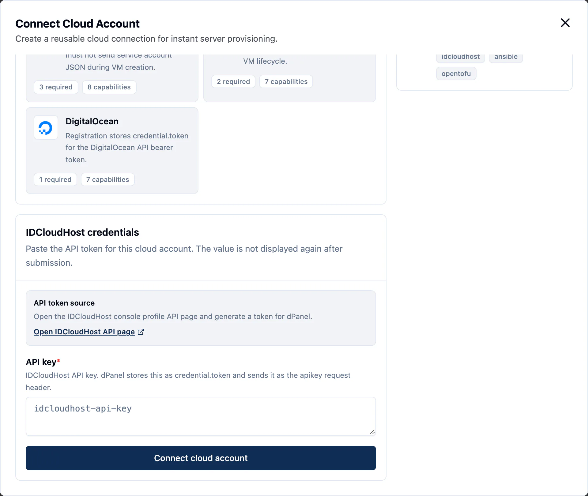
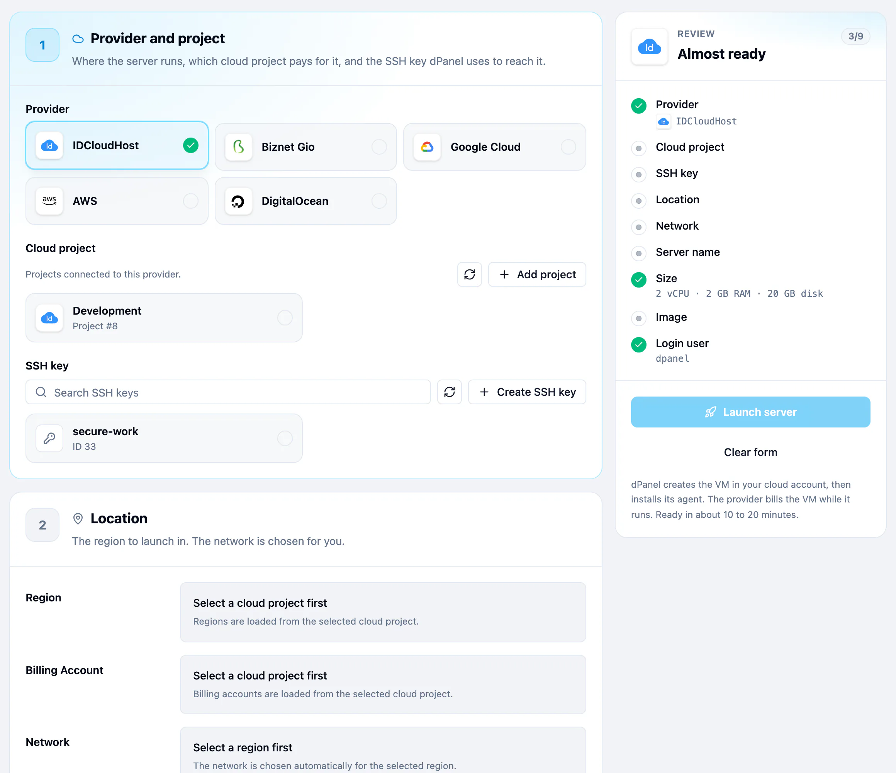

dPanel meluncurkan VM cloud Ubuntu di Indonesia, di akun IDCloudHost Anda sendiri. dPanel masuk dengan API key dari profil IDCloudHost Anda dan menagihkannya ke billing account IDCloudHost Anda.

## Yang perlu disiapkan

- Akun IDCloudHost dengan billing account yang punya saldo atau metode pembayaran.
- SSH key di dPanel. Lihat [Sebelum mulai](../before-you-start.md).

## 1. Buat API key

1. Masuk ke [konsol IDCloudHost](https://console.idcloudhost.com).
2. Buka profil Anda, lalu halaman **API**. Tautan langsungnya [console.idcloudhost.com/user-profile/api](https://console.idcloudhost.com/user-profile/api).
3. Buat API key baru untuk dPanel, dan beri nama yang mudah dikenali, misalnya `dpanel`.
4. Salin kuncinya.

Referensi API IDCloudHost: [api.idcloudhost.com](https://api.idcloudhost.com/).

:::warning[Perlu dicek: cakupan kunci]
Kode dPanel memakai satu API key yang dikirim di header `apikey`. Dari kode, kami tidak bisa memastikan apakah IDCloudHost mengizinkan kunci dibatasi ke tindakan atau resource tertentu. Anggap saja kunci ini bisa melakukan apa pun yang bisa dilakukan user Anda di konsol, termasuk memakai saldo. Kalau akun Anda punya fitur tim atau sub-user, buat kuncinya di bawah user yang hanya boleh mengelola VM cloud.
:::

### Yang dipanggil dPanel

| Keperluan                        | API IDCloudHost                                             |
| -------------------------------- | ----------------------------------------------------------- |
| Daftar lokasi                    | `GET /v1/config/locations`                                  |
| Daftar template Ubuntu           | `GET /v1/config/vm_images/plain_os`                         |
| Daftar jaringan di sebuah lokasi | `GET /v1/{location}/network/networks`                       |
| Daftar billing account           | `GET /v1/payment/billing_account/list`                      |
| Membuat, membaca, menghapus VM   | `POST`, `GET`, dan `DELETE /v1/{location}/user-resource/vm` |
| Membaca alamat IP VM             | `GET /v1/{location}/network/ip_addresses`                   |

## 2. Hubungkan ke dPanel

1. Di sidebar, buka **Proyek Cloud**. Judul halamannya **Akun cloud**.
2. Tekan **Hubungkan akun cloud**.
3. Isi **Connection name**, misalnya `IDCloudHost Jakarta`.
4. Di **Cloud provider**, pilih **IDCloudHost**.
5. Tempel kuncinya di **API key**. Panel itu menautkan ke halaman API IDCloudHost kalau Anda belum punya kunci.
6. Tekan **Connect cloud account**.

dPanel menyimpan akun itu sebagai **Siap** tanpa mengujinya. Ujian pertamanya ada di formulir peluncuran: kalau **Region** tetap kosong atau error, periksa kuncinya.

## 3. Kolom IDCloudHost di formulir peluncuran

| Kolom               | Yang dipilih                                                                                              |
| ------------------- | --------------------------------------------------------------------------------------------------------- |
| **Region**          | Lokasinya, misalnya `jkt01`.                                                                              |
| **Billing Account** | Biarkan **Auto-select billing account** untuk memakai akun aktif bawaan, atau pilih salah satu.           |
| **Network**         | Dipilihkan dari jaringan di lokasi itu. Kalau belum ada, buat dulu di konsol IDCloudHost.                 |
| **Size**            | Geser **CPU** (2 sampai 16 vCPU) dan **RAM** (2 sampai 64 GB). IDCloudHost meluncurkan ukuran persis itu. |
| **Storage**         | 20 sampai 500 GB.                                                                                         |
| **Ubuntu release**  | 24.04 LTS atau 26.04 LTS.                                                                                 |

IDCloudHost menambahkan langkah keempat, **Access**:

- **Default User**: user Linux pertama. Bawaannya `dpanel`, dan dPanel masuk sebagai user ini.
- **Bootstrap Password**: kata sandi awal user itu. IDCloudHost mewajibkannya. dPanel tetap masuk dengan SSH key Anda.

## 4. Luncurkan

Ikuti [Membuat server cloud](./create-a-cloud-server.md). Pilih IDCloudHost di langkah 1, dan isi **Access** sebelum menekan **Launch server**.

## Jebakan di IDCloudHost

- **Saldo.** IDCloudHost menagih billing account. Tanpa saldo atau metode pembayaran, pembuatan VM gagal di sisi penyedia.
- **Pembuatan berjalan asinkron.** dPanel menunggu sampai 10 menit sampai VM muncul sebelum menyerah. Lokasi yang sedang sibuk bisa lambat.
- **dPanel tidak membuat firewall.** dPanel tidak membuat aturan firewall di IDCloudHost. Apa pun yang dibuka penyedia secara bawaan tetap terbuka, jadi periksa pengaturan jaringan VM di konsol kalau Anda perlu membatasi port.
- **Harus ada jaringan.** Kalau lokasi itu belum punya jaringan, formulir peluncuran memberi tahu. Buat jaringan di konsol IDCloudHost, lalu muat ulang.
- **Tagihan berjalan sejak peluncuran.** Anda membayar VM selama VM itu ada.

## Keamanan

- Kunci ini bisa melakukan apa yang bisa dilakukan user IDCloudHost Anda. Perlakukan seperti kata sandi konsol.
- Untuk merotasi kunci, buat kunci baru untuk akun IDCloudHost yang sama, lalu ganti lewat **Perbarui kredensial** pada akun cloud. Lihat [Merotasi kredensial](./cloud-credentials-security.md#merotasi-kredensial).
- Untuk memutus akses dPanel, hapus kuncinya di halaman API IDCloudHost. Server yang sedang berjalan tetap berjalan. Lihat [apa yang terjadi saat kunci dicabut](./cloud-credentials-security.md#kalau-kredensial-dicabut).
- Selengkapnya di [Kredensial cloud dan keamanan](./cloud-credentials-security.md).

## Pertanyaan yang sering diajukan

### Siapa yang membayar servernya?

IDCloudHost menagih Anda langsung, karena server berjalan di akun Anda sendiri. dPanel tidak menjual ulang mesin. Hapus server di dPanel kalau sudah selesai, supaya penyedia berhenti menagih. Lihat [Menghapus server](../delete-a-server.md).

### Bisakah saya juga memakai firewall dPanel di server ini?

Bisa. [Firewall](../firewall.md) dPanel berjalan di server itu sendiri, di belakang aturan jaringan milik IDCloudHost, jadi sebuah port harus terbuka di keduanya agar bisa dijangkau.

### Apa yang terjadi pada server saya kalau kredensialnya dicabut?

Server tetap berjalan, tetapi dPanel tidak bisa lagi meluncurkan atau menghapus mesin dengan kredensial itu. Lihat [Kredensial cloud dan keamanan](./cloud-credentials-security.md#kalau-kredensial-dicabut).
