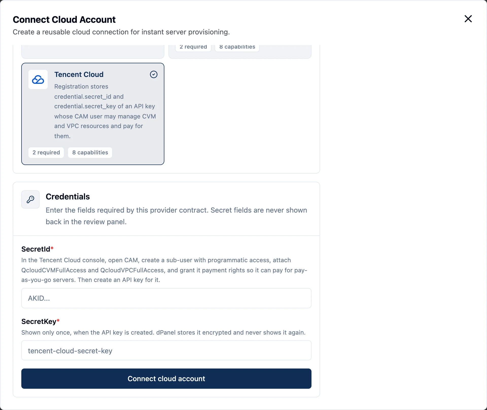
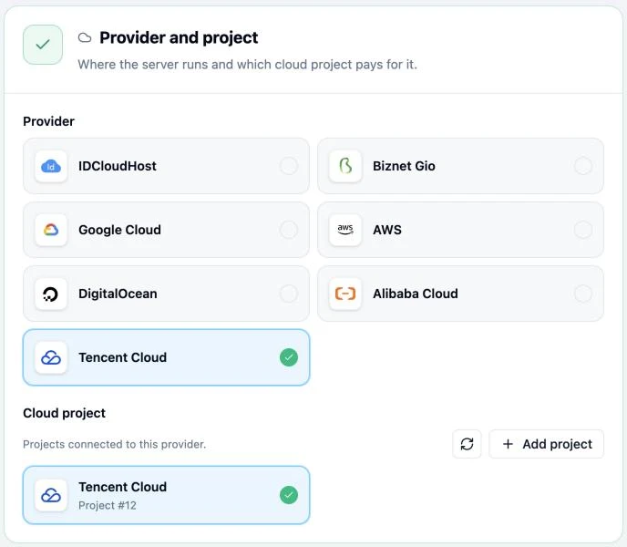

dPanel meluncurkan instance CVM di akun Tencent Cloud Anda. dPanel masuk dengan API key (SecretId dan SecretKey) milik sub-user CAM yang Anda buat khusus untuknya.

## Yang perlu disiapkan

- Akun Tencent Cloud yang boleh membeli server pay-as-you-go, dengan verifikasi identitas selesai dan saldo atau metode pembayaran.
- Izin di akun itu untuk membuat sub-user CAM dan memberinya hak pembayaran.
- SSH key di dPanel. Lihat [Sebelum mulai](../before-you-start.md).

## 1. Buat sub-user CAM untuk dPanel

Jangan pernah memberi dPanel API key milik root account.

1. Masuk ke konsol Tencent Cloud sebagai root account atau administrator, lalu buka **CAM** (Cloud Access Management).
2. Buka **Users**, lalu **User List**, dan buat **custom sub-user**. Beri nama `dpanel`.
3. Berikan **Programmatic access** saja. Biarkan akses konsol mati.
4. Pasang preset policy `QcloudCVMFullAccess` dan `QcloudVPCFullAccess`.
5. Beri sub-user itu **hak pembayaran**, supaya bisa membayar server pay-as-you-go yang diluncurkannya. Lihat [sub-user harus diizinkan membayar](#sub-user-harus-diizinkan-membayar).
6. Buka sub-user itu, masuk ke **API key**, lalu buat kunci. Salin **SecretId** dan **SecretKey**. Tencent Cloud hanya menampilkan SecretKey sekali.

Panduan Tencent Cloud: [Membuat sub-user](https://www.tencentcloud.com/document/product/598/13674), [Mengelola API key](https://www.tencentcloud.com/document/product/598/32675), [Memberi izin](https://www.tencentcloud.com/document/product/598/10602).

### Apa yang dilakukan dPanel dengan kunci ini

| Tempat                          | Fungsinya                                                  | Action API                                                                                                                      |
| ------------------------------- | ---------------------------------------------------------- | ------------------------------------------------------------------------------------------------------------------------------- |
| API dPanel (pencarian pilihan)  | Membaca region, zona, instance type, image, subnet, dan VM | `DescribeRegions`, `DescribeZones`, `DescribeZoneInstanceConfigInfos`, `DescribeImages`, `DescribeSubnets`, `DescribeInstances` |
| Jaringan, hanya peluncuran awal | Membuat `dpanel-network` dan subnet di zona itu            | `CreateVpc`, `CreateSubnet`                                                                                                     |
| Setiap peluncuran               | Mengimpor SSH key Anda dan membuka TCP 22, 80, dan 443     | `ImportKeyPair`, `CreateSecurityGroup`, `CreateSecurityGroupPolicies`                                                           |
| Instance                        | Meluncurkannya, pay-as-you-go, dengan IP publik            | `RunInstances`                                                                                                                  |
| Penghapusan                     | Menghapus instance, security group, dan key pair-nya       | `TerminateInstances`, `DeleteSecurityGroup`, `DeleteKeyPairs`                                                                   |

:::warning[Perlu dicek]
Panggilan pencarian pilihan diambil langsung dari kode dPanel. Peluncuran dan penghapusan dijalankan lewat koleksi Ansible `susunola.tencentcloud`, yang mungkin melakukan beberapa panggilan baca tambahan. Dua preset policy di atas sudah mencakup semuanya. Kalau Anda menulis custom policy yang lebih sempit lalu peluncuran gagal, pesan error-nya menyebut action yang kurang.
:::

## 2. Hubungkan ke dPanel

1. Di sidebar, buka **Proyek Cloud**. Judul halamannya **Akun cloud**.
2. Tekan **Hubungkan akun cloud**.
3. Isi **Connection name**, misalnya `Tencent produksi`.
4. Di **Cloud provider**, pilih **Tencent Cloud**.
5. Tempel **SecretId** dan **SecretKey**.
6. Tekan **Connect cloud account**.

dPanel langsung menyimpan akun itu sebagai **Siap**, tanpa menguji kuncinya. Ujian pertamanya ada di formulir peluncuran: kalau **Region** tetap kosong atau menampilkan error, kunci atau izinnya salah.

## 3. Kolom Tencent Cloud di formulir peluncuran

| Kolom              | Yang dipilih                                                                            |
| ------------------ | --------------------------------------------------------------------------------------- |
| **Region**         | Tempat server berjalan, misalnya `ap-jakarta`.                                          |
| **Zone**           | Zona di dalam region itu, misalnya `ap-jakarta-1`.                                      |
| **Network**        | `dpanel-network`. Tidak perlu dipilih.                                                  |
| **Instance Type**  | Ukurannya, misalnya `SA5.MEDIUM2`. Daftarnya hanya berisi tipe yang dijual di zona itu. |
| **Ubuntu release** | 24.04 LTS atau 26.04 LTS. dPanel memilih image Tencent Cloud terbaru untuk rilis itu.   |

Untuk Tencent Cloud tidak ada langkah **Access**. dPanel masuk sebagai `ubuntu` dengan SSH key Anda; image Ubuntu di Tencent Cloud tidak mengizinkan `root` login.

## 4. Luncurkan

Ikuti [Membuat server cloud](./create-a-cloud-server.md). Pilih Tencent Cloud di langkah 1.

## Jebakan di Tencent Cloud

### Sub-user harus diizinkan membayar

Kalau peluncuran gagal dengan `UnauthorizedOperation` dan pesan tentang **payment rights**, sub-user itu boleh mengelola server tetapi tidak boleh membayarnya. Ini bukan masalah kunci. Masuk sebagai root account, beri sub-user `dpanel` hak pembayaran (izin keuangan untuk pembelian) di CAM, lalu luncurkan lagi. Pastikan juga akun punya saldo atau metode pembayaran.

### Hal lain yang perlu diketahui

- **Jaringan muncul di peluncuran pertama.** Di setiap region, peluncuran pertama membuat VPC bernama `dpanel-network` (`10.88.0.0/16`). Setiap zona mendapat subnet sendiri, `dpanel-network-<zona>`, saat pertama kali ada server di sana. Menghapus server tidak pernah menghapusnya.
- **Satu security group per server**, bernama `dpanel-<nama server>`, terbuka ke internet di TCP 22, 80, dan 443, dengan trafik keluar diizinkan. dPanel menghapusnya bersama server.
- **Satu key pair per server**, bernama `dpanel_<lingkungan>_<ID server>`, karena Tencent Cloud hanya menerima huruf, angka, dan garis bawah di sana. dPanel menghapusnya bersama server, termasuk saat peluncurannya gagal.
- **Nama server dipakai sebagai hostname.** Gunakan 2 sampai 63 huruf, angka, atau tanda hubung, diawali huruf. dPanel menolak nama yang sudah dipakai instance lain di region itu.
- **Disk.** Ukuran dan tipe system disk mengikuti pilihan Tencent Cloud untuk image itu. Formulir peluncuran tidak punya pilihan disk.
- **IP publik dan bandwidth.** Instance mendapat alamat IPv4 publik, ditagih berdasarkan trafik, dibatasi 100 Mbps.
- **Tagihan berjalan sejak peluncuran.** Anda membayar Tencent Cloud untuk instance, disk, dan trafiknya selama masih ada, termasuk saat setup berjalan atau gagal. Hapus server yang sudah tidak dipakai.

## Keamanan

- Kunci ini bisa membuat, menghapus, dan membayar resource CVM dan VPC di akun itu. Simpan di sub-user tersendiri supaya bisa dicabut tanpa mengganggu yang lain.
- Untuk merotasi kunci, buat API key baru untuk sub-user yang sama, lalu ganti lewat **Perbarui kredensial** pada akun cloud. Lihat [Merotasi kredensial](./cloud-credentials-security.md#merotasi-kredensial).
- Untuk memutus akses dPanel, nonaktifkan atau hapus API key-nya di CAM. Server yang sedang berjalan tetap berjalan. Lihat [apa yang terjadi saat kunci dicabut](./cloud-credentials-security.md#kalau-kredensial-dicabut).
- Selengkapnya di [Kredensial cloud dan keamanan](./cloud-credentials-security.md).
