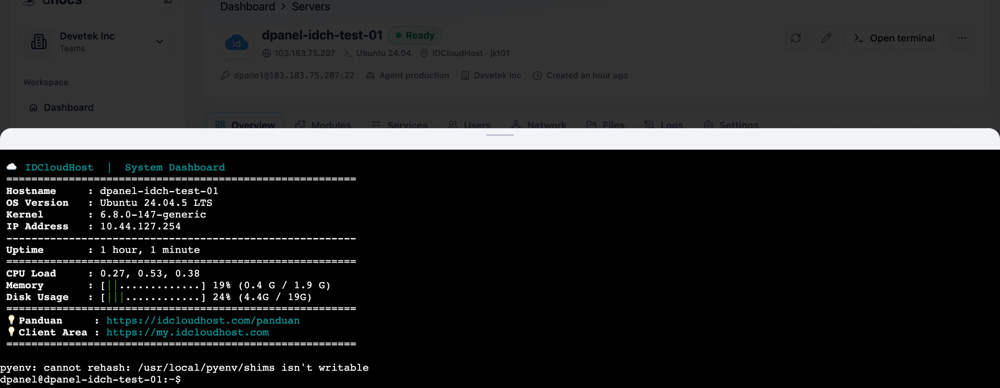

dPanel menyediakan terminal SSH di browser: tekan **Buka terminal** di bagian atas halaman server, lalu dPanel masuk dengan kunci yang disimpannya dan membuka shell. Biasanya Anda tidak membutuhkannya, karena tab-tab di halaman server sudah mencakup layanan, pengguna, berkas, dan log.



Tidak ada yang perlu dipasang di komputer Anda, dan Anda tidak butuh kunci privatnya. Sesi itu milik user login yang disiapkan dPanel. Bagian kepala server menampilkannya, misalnya `dpanel@203.0.113.10:22`.

| Penyedia                         | User login               |
| -------------------------------- | ------------------------ |
| Google Cloud, AWS, Tencent Cloud | `ubuntu`                 |
| Alibaba Cloud                    | `root`                   |
| DigitalOcean, IDCloudHost        | `dpanel`                 |
| Server yang Anda hubungkan       | User Linux yang Anda isi |

## Dari komputer sendiri

Kalau lebih suka terminal sendiri, pakai klien SSH apa pun dengan login yang tertera di kepala server.

```bash
ssh ubuntu@203.0.113.10
```

Supaya bisa, kunci publik komputer Anda harus ada di server. Kunci buatan dPanel tetap tinggal di dPanel. Tambahkan kunci Anda ke `authorized_keys` server, lewat terminal browser atau pengelola berkas.

```bash
echo "ssh-ed25519 AAAA... anda@example.com" >> ~/.ssh/authorized_keys
```

Ganti contoh itu dengan kunci publik Anda. Di komputer Anda, biasanya ada di `~/.ssh/id_ed25519.pub`.
