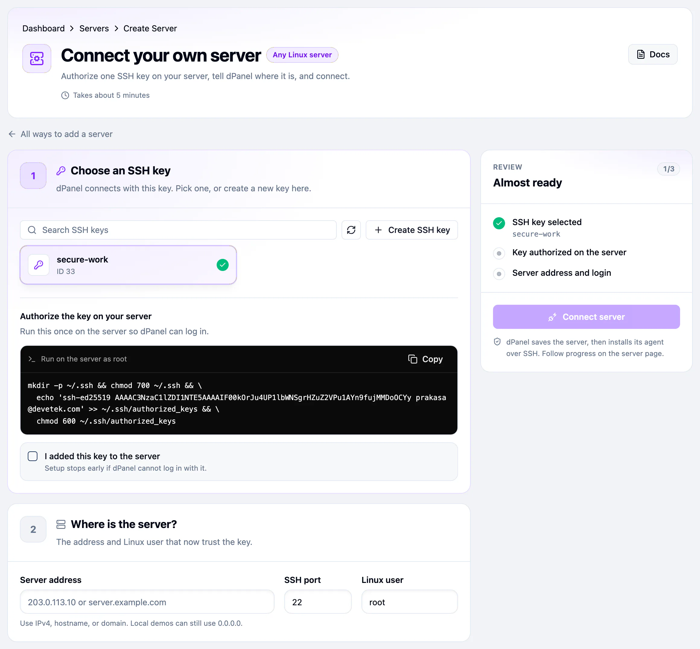

Anda bisa menambahkan server yang sudah berjalan, di penyedia hosting mana pun atau di rumah, ke dPanel. dPanel masuk lewat SSH dengan salah satu SSH key Anda di dPanel, memasang agennya, lalu mesin itu bisa dipakai seperti server yang diluncurkan dPanel. Prosesnya sekitar 5 menit dan tidak butuh akun cloud.

## Yang perlu disiapkan

- Server Ubuntu atau Debian yang bisa dijangkau dPanel lewat SSH dari internet.
- User Linux di server itu yang boleh memakai `sudo`, atau `root`.
- SSH key di dPanel. Anda juga bisa membuatnya langsung dari formulir.

## Hubungkan

1. Buka **Server**, lalu **Buat Server**, lalu **Hubungkan server**.
2. Di **Pilih SSH key**, pilih sebuah kunci, atau tekan **Buat kunci SSH**.
3. Salin perintah di **Izinkan key di server Anda**, lalu jalankan sekali di server. Perintah itu menambahkan separuh publik kunci ke `~/.ssh/authorized_keys`.
4. Centang **Saya sudah menambahkan key ini ke server**.
5. Di **Di mana servernya?**, isi alamat server (IPv4, hostname, atau domain), port SSH, dan user Linux.
6. Setelah panel tinjauan menunjukkan 3/3, tekan **Hubungkan server**.

:::warning[Jalankan di mesin dan user yang benar]
Jalankan perintahnya sebagai user yang sama dengan yang Anda isi di kolom user Linux. Setup berhenti lebih awal jika dPanel tidak bisa login dengan kunci itu.
:::

## Setelah itu

dPanel menyimpan server, lalu memasang agen lewat SSH. Pantau progresnya di halaman server. Biasanya sekitar 5 menit.

Begitu lencananya bertuliskan **Ready**, server ini bisa dipakai seperti server lain. Lihat [Halaman server Anda](./your-server-page.md).

:::info[Menghapus server yang Anda hubungkan sendiri]
Untuk server yang Anda hubungkan sendiri, dPanel hanya melupakannya. Mesinnya tetap berjalan. Lihat [Menghapus server](./delete-a-server.md).
:::

## Pertanyaan yang sering diajukan

### Sistem operasi apa saja yang bisa dihubungkan?

Ubuntu dan Debian. dPanel memasang agen dan modulnya dengan perkakas standar kedua sistem itu.

### Apakah dPanel butuh kata sandi root?

Tidak. dPanel masuk dengan SSH key, tidak pernah dengan kata sandi. User Linux yang Anda isi harus `root` atau boleh memakai `sudo`.

### Apakah server saya butuh alamat IP publik?

dPanel harus bisa menjangkau **Alamat server** dan **Port SSH** yang Anda isi. Server di balik router rumah perlu port SSH yang diteruskan (port forwarding) ke server itu, atau alamat publik.

### Apa yang terjadi jika saya menghapus server dari dPanel?

dPanel melupakannya, dan mesin Anda tetap berjalan beserta seluruh isinya. Lihat [Menghapus server](./delete-a-server.md).
