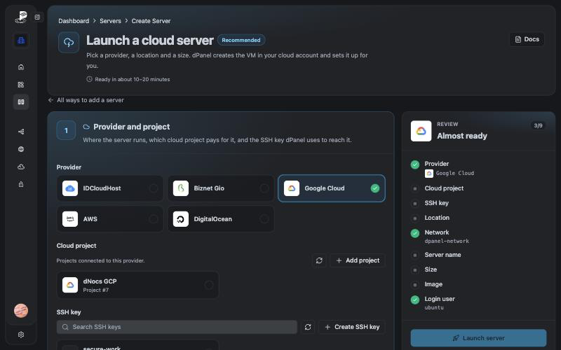
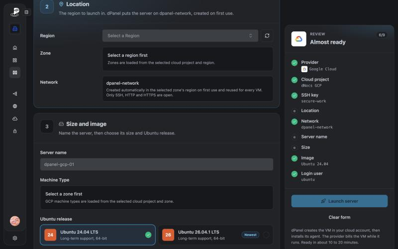
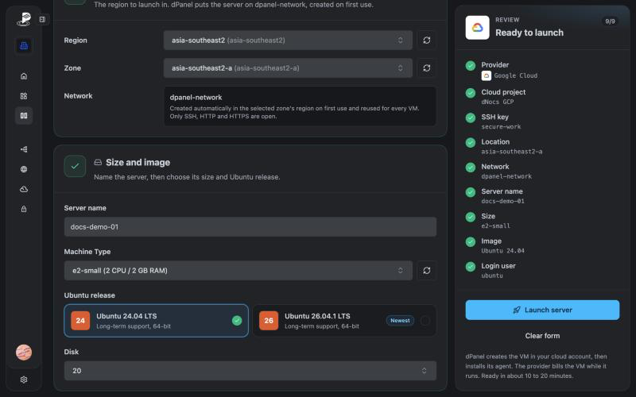

Panduan ini memakai Google Cloud. AWS dan DigitalOcean menanyakan hal yang sama dengan urutan sama; perbedaannya ada di halaman penyedia cloud.

Buka Servers, lalu Create Server, lalu Launch a server. Formulirnya satu halaman dengan tiga langkah bernomor dan panel ringkasan di kanan yang terisi seiring jawaban Anda. Angka di atasnya, misalnya 3/9, menunjukkan jumlah jawaban yang sudah lengkap.

## Langkah 1, provider dan project

- Provider: tempat mesin akan berjalan.
- Cloud project: akun cloud mana yang membayarnya.
- SSH key: kunci yang dipakai dPanel untuk menjangkau mesin.

## Langkah 2, lokasi

- Region adalah wilayah dunia tempat mesin berjalan. Pilih yang dekat dengan penggunanya.
- Zone adalah satu pusat data di dalam region itu. Mana pun boleh.
- Network diisikan untuk Anda. dPanel membuat jaringan dpanel-network saat pertama meluncurkan di sebuah region lalu memakainya kembali, dengan hanya SSH dan port web yang terbuka.

## Langkah 3, ukuran dan image

- Server name adalah nama mesin di dPanel dan di penyedia Anda.
- Machine type menentukan besar prosesor dan memorinya. Ukuran kecil cukup untuk mencoba.
- Ubuntu release: 24.04 LTS adalah pilihan aman, dan LTS berarti pembaruan keamanan bertahun-tahun.
- Disk adalah ukuran penyimpanan dalam gigabyte.

## Meluncurkan

Jika panel ringkasan menulis Ready to launch, semua jawaban lengkap. Tekan Launch server.

Spanduk biru bertuliskan dPanel is setting this server up muncul selama proses berjalan. Perkirakan 10 sampai 20 menit: penyedia membuat mesinnya, lalu dPanel memasang agennya, membaca isi mesin dan membuka port yang diperlukan. Saat spanduk hilang dan lencana berubah menjadi Ready, server siap dipakai.

:::warning[Jika penyiapan gagal]
Spanduk merah muncul dengan tombol See what happened, yang menampilkan alasan dari penyedia atau dari proses penyiapan. Penyebab yang biasa adalah kuota akun cloud yang kurang dan kredensial yang kedaluwarsa.
:::
