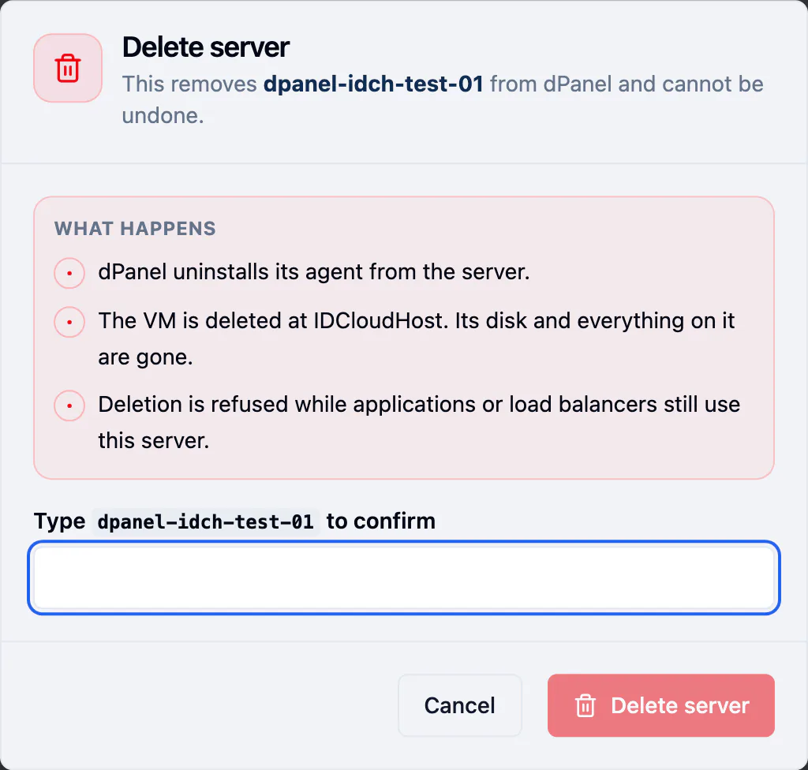

Menghapus server di dPanel menghancurkan VM cloud di penyedia Anda, atau hanya memutus server yang Anda hubungkan sendiri. Penyedia menagih mesin cloud selama mesin itu ada, jadi hapus begitu tidak dipakai lagi.

## Yang perlu disiapkan

Penghapusan ditolak selama masih ada aplikasi atau load balancer yang memakai server ini. Hapus dulu keduanya:

- [Menghapus aplikasi](../applications/update-or-delete.md)
- [Load balancer](../networking/load-balancers.md)

## Hapus servernya

1. Buka server, lalu tab **Pengaturan**.
2. Di **Zona berbahaya**, tekan **Hapus server**. Perintah yang sama juga ada di bagian kepala, di bawah **Tindakan lain** (⋯).
3. Baca bagian **Yang akan terjadi**.
4. Ketik nama server untuk konfirmasi, lalu tekan **Hapus server**.



:::danger[Tidak bisa dibatalkan]
Untuk server yang diluncurkan dPanel, penghapusan mencopot agen dan menghancurkan mesinnya di penyedia cloud, beserta disk dan seluruh isinya. Untuk server yang Anda hubungkan sendiri, dPanel hanya melupakannya dan mesinnya tetap berjalan.
:::

## Setelah itu

Server berstatus **Deleting** selama penyedia membongkar mesinnya, lalu menjadi **Deleted**.

Periksa dua tempat:

1. Daftar **Server**.
2. Konsol penyedia Anda. dPanel melaporkan apa yang dikatakan penyedia, jadi penghapusan yang gagal sebagian di penyedia akan terlihat di sana.

## Menghapus server yang tidak bisa dijangkau dPanel

Kadang server sudah hilang sebelum Anda menghapusnya di dPanel: Anda sendiri menghapus VM-nya di penyedia, mesinnya rusak, atau dimatikan untuk selamanya. dPanel lalu tidak bisa membersihkan aplikasi dan load balancer-nya di mesin itu, sehingga penghapusan biasa ditolak.

Dalam kasus itu **Hapus server** menawarkan **Hapus dari dPanel**. Dialognya menunjukkan kapan agen terakhir melapor dan apa saja yang akan dihapus:

- server itu, beserta rilis, build, dan load balancer-nya di dPanel;
- tugas yang belum selesai, yang dihentikan;
- record DNS yang dibuat dPanel untuk load balancer-nya.

Tidak ada yang diubah atau dihapus di mesin, dan menghapus server di sini tidak pernah menghapus VM di penyedia Anda. Centang **Saya mengerti bahwa ini hanya menghapus data di dPanel** lalu tekan **Hapus dari dPanel**. Untuk server cloud yang penyedianya tidak bisa diperiksa dPanel, Anda juga diminta mencentang bahwa VM-nya sudah Anda hapus di penyedia. Periksa dulu konsol penyedia Anda, supaya Anda tidak terus membayar VM yang tidak lagi terlihat di dPanel.

Dari terminal:

```bash
dnocs server delete --id <id server> --forget
```

Tambahkan `--vm-deleted` jika dPanel meminta Anda memastikan bahwa VM cloud-nya sudah dihapus di penyedia.

### Jika server aktif kembali

dPanel tidak bisa tahu apakah mesin hilang untuk selamanya atau hanya mati sementara. Jika server yang sudah dihapus menyala lagi, agennya ditolak dan berhenti menghubungi dPanel; tidak ada yang berubah di mesin, dan aplikasinya tetap berjalan. Pemberitahuan di **Server**, misalnya **1 server yang dihapus aktif kembali**, mencantumkannya beserta perintah di bawah ini. Lalu pilih salah satu:

- jalankan `sudo dnocs machine register` di mesin itu untuk mengelolanya lagi di dPanel, atau
- hentikan agennya dengan `sudo systemctl disable --now dpanel-agent`.

## Pertanyaan yang sering diajukan

### Kenapa Hapus server ditolak?

Masih ada aplikasi atau load balancer yang memakai server itu, atau server itu adalah node klaster Kubernetes. Hapus semuanya dulu, atau uninstall lalu hapus klasternya. Lihat [Grup server dan klaster](../clusters/overview.md).

### Hapus server bilang server tidak bisa dijangkau. Lalu bagaimana?

Mesinnya mati atau sudah tidak ada. Jika hanya mati sementara, nyalakan lagi dan tunggu agennya melapor, lalu hapus seperti biasa. Jika sudah hilang untuk selamanya, gunakan **Hapus dari dPanel**. Lihat [Menghapus server yang tidak bisa dijangkau dPanel](#menghapus-server-yang-tidak-bisa-dijangkau-dpanel).

### Bisakah server yang sudah dihapus dikembalikan?

Tidak. Disk server cloud dihancurkan di penyedia. Cadangkan apa pun yang Anda perlukan sebelum menghapusnya.

### Apakah menghapus server yang saya hubungkan sendiri akan mengosongkannya?

Tidak. dPanel hanya melupakannya; mesin dan semua isinya tetap berjalan.
