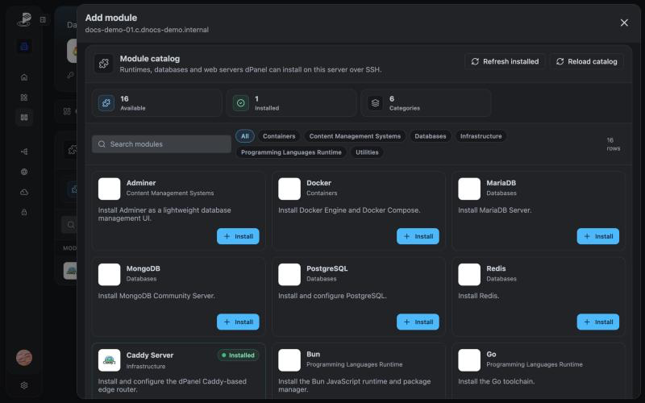
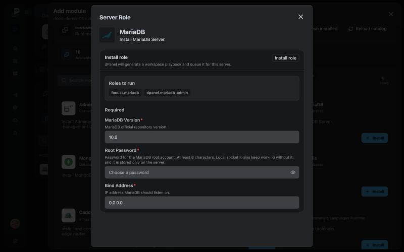
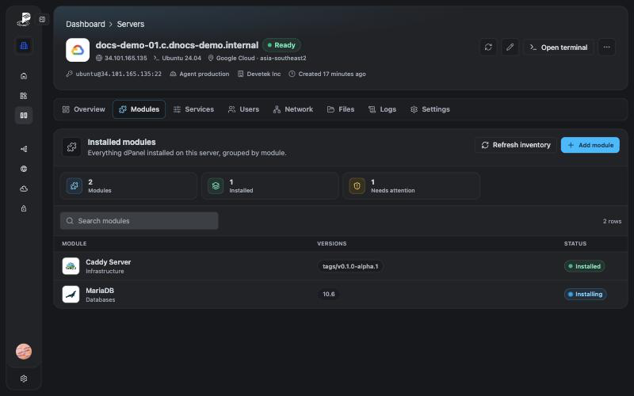

dPanel memasang perangkat lunak melalui modul. Modul adalah resep yang sudah diuji: Anda menjawab beberapa pertanyaan, dPanel memasang, mengatur dan menjalankannya di server, lalu mencatat apa yang dipasang.

Buka server, masuk ke Modules, lalu tekan Add module. Katalog mengelompokkan isinya: basis data, runtime bahasa, kontainer, sistem manajemen konten dan infrastruktur.

## Memasang basis data

Tekan Install pada modul yang diinginkan. Formulirnya menyebutkan apa yang akan dijalankan dan hanya menanyakan hal yang tidak bisa diputuskan sendiri: untuk basis data yaitu versinya, kata sandi akun administrator, dan alamat mana yang boleh didengarkan.

:::warning[Tentukan sendiri kata sandinya]
Kata sandi administrator wajib diisi dan minimal 8 karakter. Tidak ada nilai bawaan, karena basis data dengan kata sandi bawaan yang dipublikasikan bisa diakses siapa pun yang mengetahuinya. dPanel menyimpannya terenkripsi di server dan tidak menampilkannya lagi, jadi simpan salinan Anda sendiri di tempat aman.
:::

Tekan Install role lalu konfirmasi. Modul muncul sebagai Installing, dan basis data perlu beberapa menit.

## Memastikan hasilnya

- Tab Modules menampilkannya sebagai Installed beserta versinya.
- Tab Overview mencantumkannya di What runs here, sesuai laporan agen.
- Tab Services menampilkan layanannya berjalan.

Jika Anda mengelola banyak mesin, server group memasang modul yang sama ke seluruh anggotanya dalam satu operasi dan menampilkan hasilnya per server. Grup ada di Servers, lalu Server groups.
