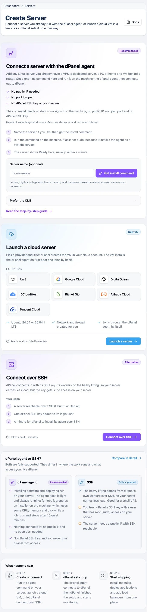

Server di dPanel adalah satu mesin Linux yang dirawat control panel ini untuk Anda: VPS yang diluncurkan dPanel di akun cloud Anda sendiri (AWS EC2, Google Compute Engine, Droplet DigitalOcean, IDCloudHost, Alibaba Cloud ECS, atau Tencent Cloud CVM), atau server Ubuntu maupun Debian yang sudah Anda jalankan lalu Anda hubungkan lewat SSH.

Setelah server masuk ke dPanel, semua urusannya bisa dikerjakan dari browser. Anda tidak perlu membuka terminal di komputer sendiri.

- Melihat apakah server sehat, dan berapa banyak CPU, memori, dan disk yang terpakai.
- Memasang perangkat lunak, misalnya basis data atau runtime bahasa pemrograman.
- Menyalakan, menghentikan, dan memulai ulang layanan yang berjalan.
- Mengelola akun pengguna Linux.
- Menjelajah berkas dan membaca log.
- Membuka terminal.
- Men-deploy [aplikasi](../applications/overview.md) ke server itu, lalu memasang [load balancer](../networking/load-balancers.md) dengan HTTPS di depannya.

Daftar ini terbuka sebagai tabel. Beralihlah ke **Tampilan Grid Kartu** untuk melihat pemakaian CPU, memori, dan disk secara langsung di kartu setiap server.

## Dua cara menambah server

Buka **Server**, lalu **Buat Server**. Halaman itu menawarkan dua jalur.

|                        | Luncurkan server cloud                                                                 | Hubungkan server Anda                     |
| ---------------------- | -------------------------------------------------------------------------------------- | ----------------------------------------- |
| Cocok untuk            | Anda butuh mesin baru dan punya akun cloud                                             | Anda sudah punya mesin yang berjalan      |
| Penyedia               | AWS, Google Cloud, DigitalOcean, IDCloudHost, Biznet Gio, Alibaba Cloud, Tencent Cloud | Server Ubuntu atau Debian apa pun via SSH |
| Yang dikerjakan dPanel | Membuat mesin, lalu menyiapkannya                                                      | Masuk lewat SSH, lalu menyiapkannya       |
| Yang Anda butuhkan     | Akun cloud dan SSH key di dPanel                                                       | SSH key dan alamat server                 |
| Waktu                  | Sekitar 10 sampai 20 menit                                                             | Sekitar 5 menit                           |

Apa pun jalurnya, dPanel memasang agennya dan mulai memantau mesin itu. Server yang diluncurkan dPanel menjalankan Ubuntu 24.04 LTS atau 26.04 LTS.

## Langkah berikutnya

- Baru memakai dPanel? Mulai dari [Sebelum mulai](./before-you-start.md).
- Meluncurkan mesin baru: [Membuat server cloud](./cloud-providers/create-a-cloud-server.md).
- Membawa mesin sendiri: [Menghubungkan server Anda](./connect-your-own-server.md).
- Sudah punya server: [Halaman server Anda](./your-server-page.md) menjelaskan setiap tab.
- Mengatur port mana yang bisa dijangkau: [Firewall](./firewall.md).
