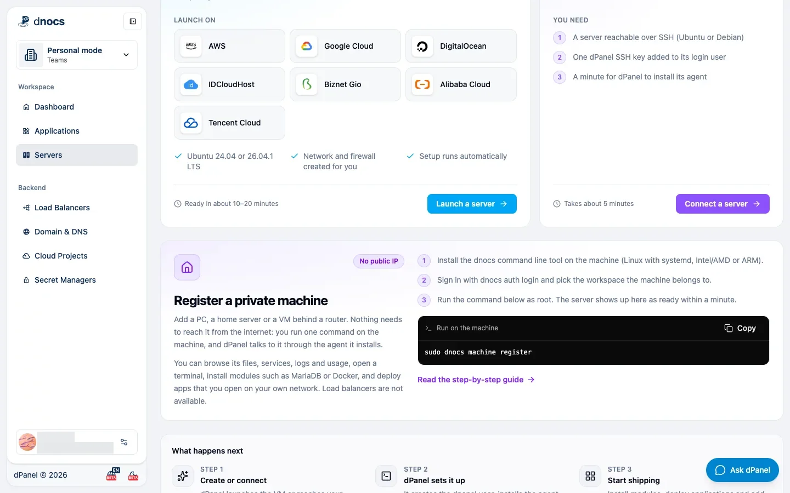
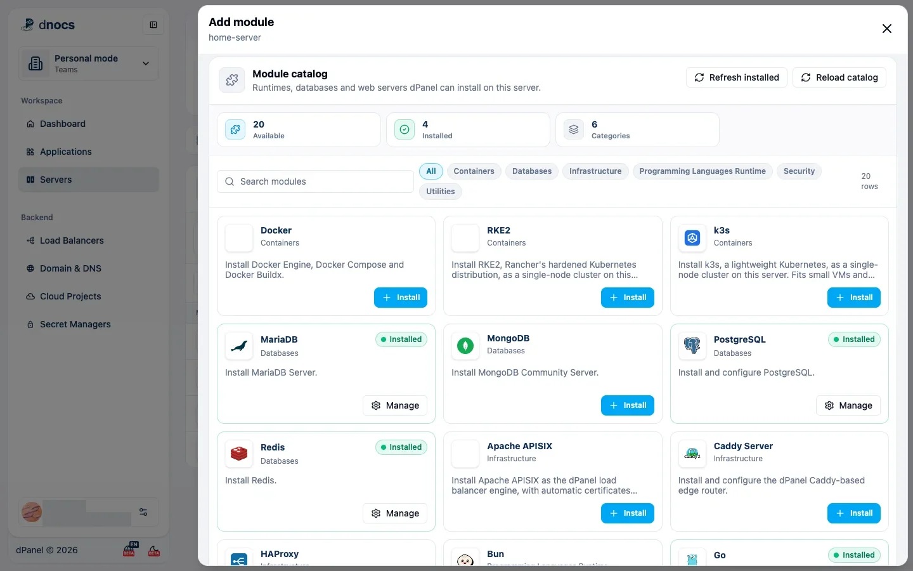
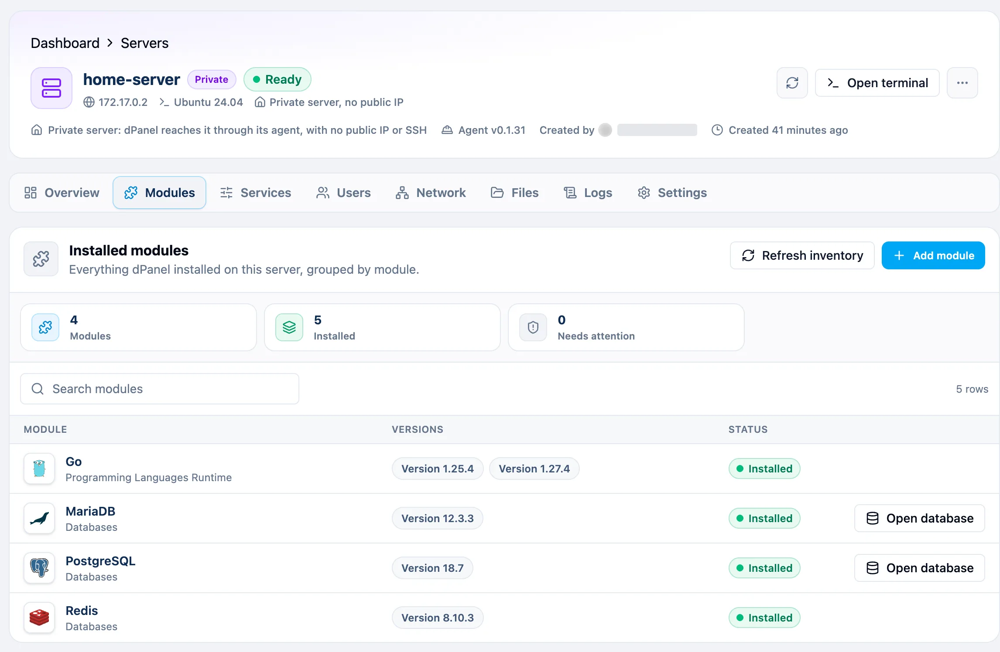

Mesin privat adalah komputer yang tidak bisa dijangkau dari internet: PC, server rumahan, atau VM di balik router. dPanel tidak pernah menghubunginya. Sebagai gantinya, Anda menjalankan satu perintah di mesin itu untuk memasang agen dPanel, dan agen tersebut menjaga koneksi keluar ke dPanel. Semua hal lain (memasang perangkat lunak, deploy aplikasi, terminal, membuka database) berjalan lewat koneksi itu.

Panduan ini menunjukkan seluruh langkahnya dengan mesin sungguhan bernama `home-server`.

## Yang perlu disiapkan

- Mesin Linux dengan systemd, seperti Ubuntu atau Debian, di prosesor Intel/AMD (`amd64`) atau ARM (`arm64`).
- Terminal di mesin itu yang bisa memakai `sudo`: pendaftaran membutuhkan root.
- Akses internet dari mesin itu. Mesin hanya terhubung keluar, jadi tidak perlu port forwarding.

## Langkah 1: Daftarkan mesinnya

Di dPanel, buka **Servers**, lalu **Create Server**. Kartu **Register a private machine** menampilkan satu perintah yang perlu dijalankan dan tautan ke panduan ini.



Di mesin itu:

1. Pasang alat baris perintah dnocs. Ikuti [Memasang dnocs](../ai/ai-in-the-terminal.md#memasang-dnocs).
2. Masuk, lalu pilih ruang kerja tempat mesin ini berada (lewati langkah ini agar mesin tetap di ruang kerja personal Anda):

   ```bash
   dnocs auth login -u <username Anda>
   dnocs workspace list
   dnocs workspace set --id <ID ruang kerja>
   ```

3. Daftarkan mesinnya:

   ```bash
   sudo dnocs machine register
   ```

dnocs meminta konfirmasi, membuat pengguna Linux untuk akun dPanel Anda, memasang agen, dan menunggu sampai server siap. Biasanya kurang dari satu menit.

**Mengapa `sudo`?** Pendaftaran mengubah mesin itu sendiri: membuat pengguna Linux, memasang agen sebagai layanan sistem, dan memberinya kredensial sendiri, yang hanya boleh dilakukan root. Jalankan `dnocs auth login` dan `dnocs workspace set` sebagai pengguna biasa, tanpa `sudo`. `sudo dnocs machine register` lalu memakai login tersebut. Jika muncul `please login first using 'dnocs auth login'` padahal Anda sudah login, versi dnocs Anda lebih lama dari v0.1.15: perbarui, atau login dulu dengan `sudo dnocs auth login -u <username Anda>`.


Mesin itu kini muncul di halaman server dengan lencana **Private**. Alamatnya adalah alamat mesin di jaringan Anda sendiri.


## Langkah 2: Kenali halaman servernya

Buka servernya. Server privat punya tab yang sama dengan server lain: pemakaian langsung, modul, layanan, pengguna, jaringan, berkas, log, dan pengaturan. Bagian detail menjelaskan cara dPanel menjangkaunya: **Local address**, **Public address** (IP yang dipakai agen untuk terhubung ke dPanel, bila IP itu publik), dan **Connection: Through the dPanel agent**, bukan login SSH.


## Langkah 3: Pasang database atau perangkat lunak lain

Buka tab **Modules** lalu pilih **Add module**. Pilih dari katalog yang sama dengan server lain: database seperti MariaDB, PostgreSQL, atau Redis, runtime bahasa pemrograman, Docker, dan lainnya.



Pemasangan pertama butuh beberapa menit lebih lama: agen menyiapkan installer dPanel di mesin itu (Python dan Ansible, sekitar satu setengah menit). Setelah itu installer menjalankan setiap pekerjaan di mesin itu sendiri dan berhenti lagi setelah 10 menit tanpa pekerjaan.

Anda juga bisa memasang dari terminal mesin, misalnya `dnocs module install mariadb --server-id <id> --generate-secrets`, yang menyimpan kata sandi admin buatannya ke berkas yang hanya bisa Anda baca.



## Langkah 4: Buka database di browser

Pilih **Open database** di samping MariaDB atau PostgreSQL. Pengelola database dPanel akan terbuka. Masuk dengan akun database, misalnya akun admin yang dibuat saat database dipasang.


Telusuri tabel, jalankan query, dan gunakan **Import** serta **Export**. Ekspor dan impor menjalankan alat bawaan database itu sendiri di mesin Anda, lewat agen. Database tidak perlu terbuka ke internet, bahkan ke jaringan Anda.


## Langkah 5: Deploy aplikasi

Buat aplikasi dari repositori GitHub Anda seperti biasa (lihat [Membuat aplikasi](../applications/create-an-application.md)). Saat memilih server, server privat menampilkan alamat lokalnya dan **Private · through the agent**.

Build dan deploy berjalan di mesin itu sendiri. Aplikasi mendengarkan di mesin itu, jadi Anda membukanya dari jaringan sendiri di alamat mesin dan port aplikasinya, misalnya `http://192.168.1.20:3000`.


## Langkah 6: Buka terminal

Pilih **Open terminal** di bagian atas halaman server. Anda mendapat shell root di mesin itu langsung dari browser, diteruskan lewat agen, tanpa SSH. Dari komputer Anda, `dnocs server exec --id <id> --command '<perintah>'` menjalankan perintah dengan cara yang sama.


## Yang bisa dilakukan

| Bisa                                                                            | Tidak tersedia                                 |
| ------------------------------------------------------------------------------- | ---------------------------------------------- |
| Melihat pemakaian CPU, memori, dan disk                                         | Cluster Kubernetes bersama server lain         |
| Menelusuri dan mengubah berkas                                                  | Mengubah detail koneksi SSH (memang tidak ada) |
| Menyalakan, mematikan, dan memulai ulang layanan, membaca log                   |                                                |
| Mengelola pengguna Linux                                                        |                                                |
| Memasang modul seperti MariaDB, PostgreSQL, Redis, atau Docker                  |                                                |
| Membuka MariaDB dan PostgreSQL di pengelola database, termasuk impor dan ekspor |                                                |
| Build dan deploy aplikasi                                                       |                                                |
| Membuka terminal di browser atau dengan `dnocs server exec`                     |                                                |
| Menambah load balancer dan domain, bila mesin bisa dijangkau dari internet      |                                                |

## Memasang load balancer

Mesin privat tetap bisa dijangkau dari internet: VPS yang Anda daftarkan dari dalam, server rumahan dengan port 80 dan 443 diteruskan di router, atau VM cloud di VPC dengan IP publik. dPanel tidak bisa membedakannya, jadi Anda bisa menambah load balancer ke server privat mana pun; pemasangannya lewat agen seperti hal lain.

- Dengan domain yang dikelola di dPanel, record DNS mengarah ke **Public address** server. Bila dPanel tidak mengetahuinya (agen terhubung dari jaringan privat), gunakan domain Anda sendiri dan arahkan sendiri ke server.
- Pastikan lalu lintas port 80 dan 443 sampai ke mesin, atau load balancer tidak bisa mendapatkan sertifikat HTTPS.

Jika mesin mati atau offline saat Anda memulai pemasangan atau deploy, pekerjaannya menunggu lalu gagal; jalankan lagi setelah mesin kembali menyala.

## Berbagi dengan tim

Mesin yang didaftarkan dari ruang kerja personal hanya milik Anda. Agar tim bisa mengaksesnya, daftarkan ke ruang kerja tim atau pindahkan ke sana: lihat [Berbagi homelab dengan tim](../tutorials/team-homelab.md).

## Menjaga agen tetap terbaru

Saat agen yang lebih baru dirilis, halaman server menampilkan **Pembaruan agen tersedia** dengan tombol **Perbarui ke**, dan **Agen berhenti melapor** saat mesin tidak lagi memberi kabar. Lihat [Pemberitahuan agen](./your-server-page.md#pemberitahuan-agen).

Anda juga bisa memasang ulang agen sendiri: buka tab **Pengaturan** server dan tekan **Instal ulang** di **Penyiapan**. Pada mesin privat, ini hanya memasang ulang agen dari rilis terbaru; tidak ada hal lain di mesin yang berubah. Jika agen sudah menjalankan rilis terbaru, tidak ada yang dilakukan, kecuali Anda mencentang **Instal ulang meskipun agen sudah terbaru**. Koneksi terputus beberapa detik, dan jika agen baru tidak bisa menjangkau dPanel, agen sebelumnya kembali dengan sendirinya dalam 3 menit.

## Mendaftarkannya lagi

Menjalankan `sudo dnocs machine register` lagi di mesin yang sama akan mempertahankan server yang sama di dPanel dan memberi agennya kredensial baru. Satu mesin hanya bisa berada di satu ruang kerja pada satu waktu, dan satu ruang kerja bisa menampung hingga 10 mesin privat.

## Menghapusnya

Hapus server itu di dPanel (dari halamannya, atau dengan `dnocs server delete --id <id>`). dPanel langsung menghapusnya, dan kredensial agennya tidak berlaku lagi. Jika mesinnya sudah tidak ada, gunakan **Hapus dari dPanel**; lihat [Menghapus server](./delete-a-server.md#menghapus-server-yang-tidak-bisa-dijangkau-dpanel). Setelah itu hentikan agen di mesin itu:

```bash
sudo systemctl disable --now dpanel-agent
```
