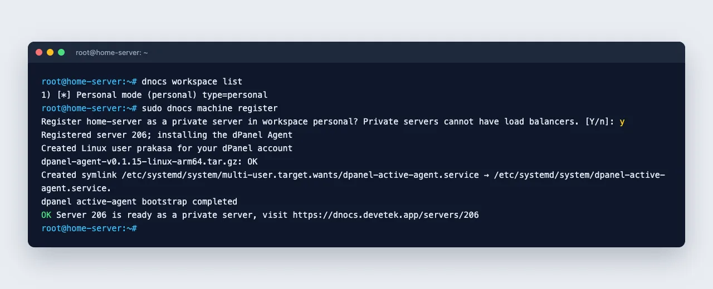
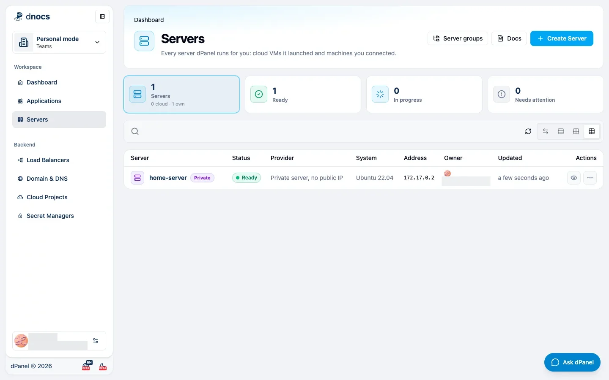
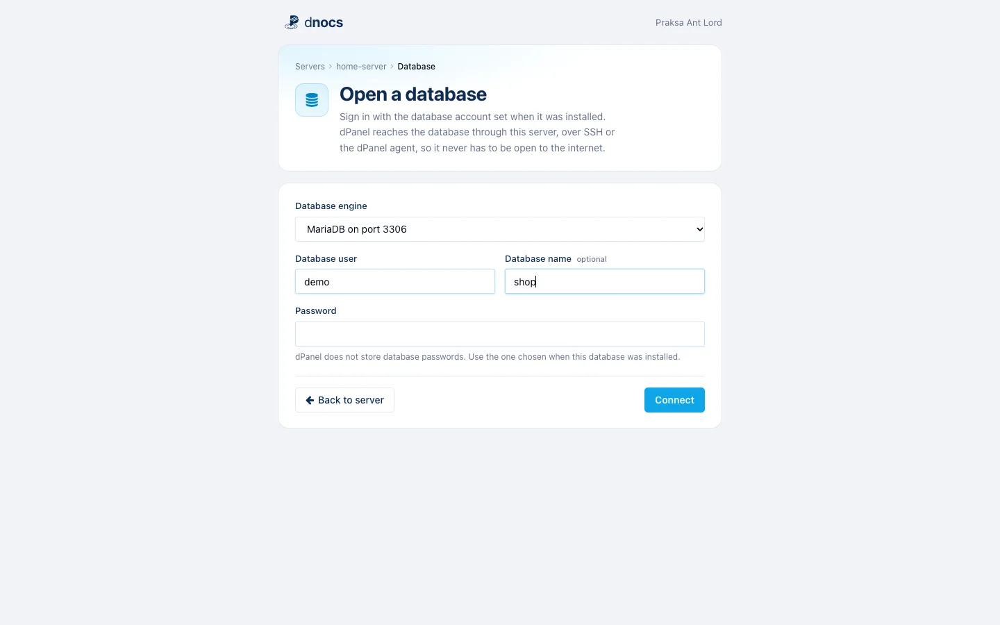
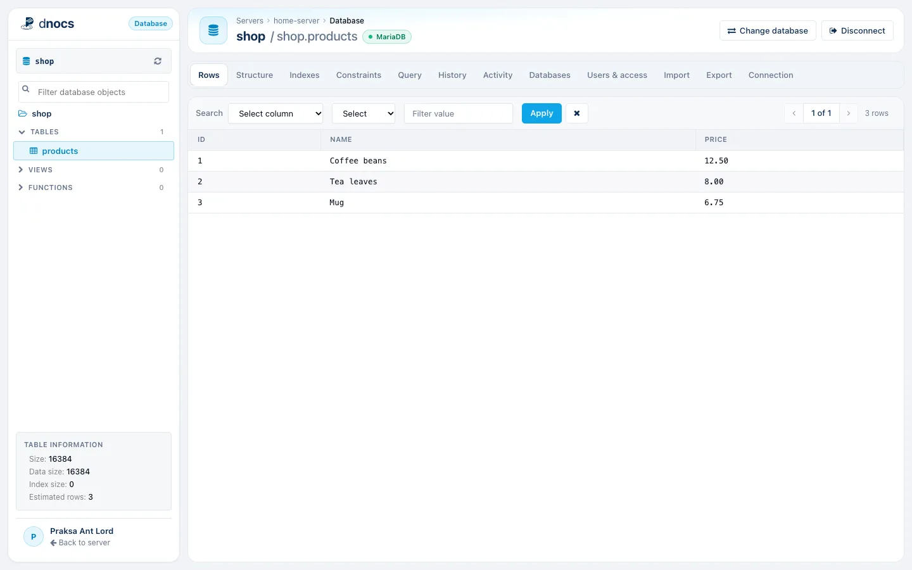
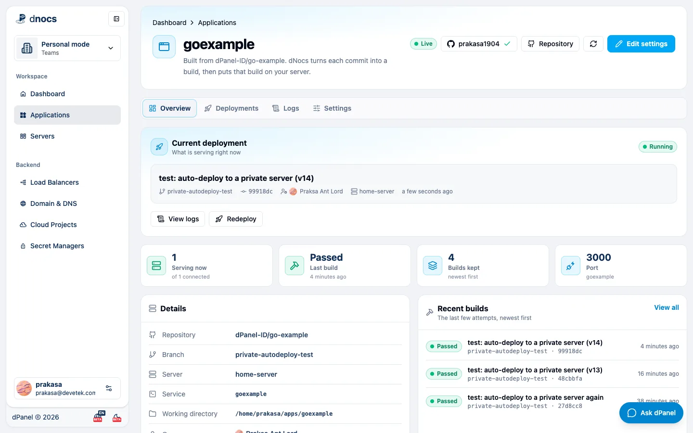
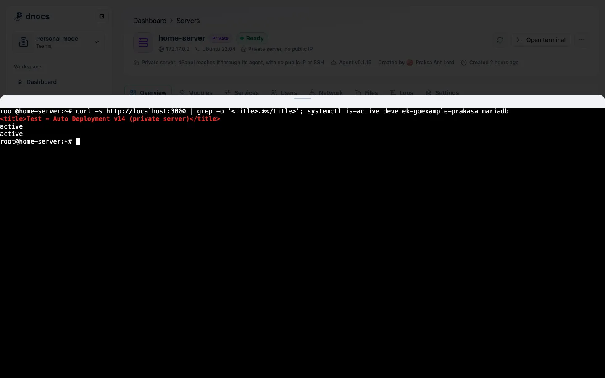

Ini cara yang direkomendasikan untuk menambahkan server yang sudah Anda punya: server rumahan, PC homelab, Raspberry Pi, VPS di penyedia hosting mana pun, server dedicated, atau VM di balik router. Anda menjalankan satu perintah di mesin itu. Perintah ini memasang **agen dPanel**, program kecil yang terhubung keluar ke dPanel dan menjaga koneksi itu tetap terbuka. Semua yang Anda lakukan di dPanel setelahnya (memasang perangkat lunak, deploy aplikasi, terminal di browser, membuka database) berjalan lewat koneksi itu.

Tidak ada yang masuk ke mesin Anda. Anda tidak memasang SSH key dPanel di sana, tidak membuka atau meneruskan port, dan mesin tidak butuh alamat IP publik.

Panduan ini menunjukkan seluruh langkahnya dengan mesin sungguhan bernama `home-server`. Waktunya sekitar lima menit.

## Yang perlu disiapkan

- Mesin **Linux 64-bit** (Intel/AMD `x86_64` atau ARM `arm64`) yang menjalankan **systemd**. Disarankan Ubuntu atau Debian; Raspberry Pi OS 64-bit, Fedora, dan sebagian besar sistem Linux lengkap lainnya juga bisa.
- Terminal di mesin itu, langsung di depan mesinnya atau lewat cara masuk yang biasa Anda pakai, tempat Anda menjadi **root** atau bisa menjalankan perintah dengan `sudo`.
- **HTTPS keluar** (port 443) dari mesin itu ke dPanel dan ke `github.com`, tempat agen diunduh. Mesin hanya terhubung keluar, jadi tidak ada yang perlu dibuka di router.
- Akun dPanel. Anda tidak butuh SSH key, akun cloud, atau dnocs di mesin itu.

| Mesin Anda                     | Bisa menjalankan agen?                                                                                          |
| ------------------------------ | --------------------------------------------------------------------------------------------------------------- |
| Server Linux, VPS, atau PC     | Bisa                                                                                                            |
| Raspberry Pi                   | Bisa, dengan sistem 64-bit (`uname -m` menampilkan `aarch64`)                                                   |
| PC Windows                     | Bisa, di dalam Ubuntu di WSL2 dengan systemd menyala: lihat [Windows (WSL2)](#windows-wsl2)                     |
| Mac                            | Tidak. Gunakan mesin virtual Linux di Mac, VPS, atau [server cloud](./cloud-providers/create-a-cloud-server.md) |
| HP atau tablet                 | Tidak. Gunakan VPS, PC Linux, atau server cloud; Anda tetap bisa mengelolanya dari HP                           |
| Kontainer Docker, Alpine Linux | Tidak: keduanya tidak menjalankan systemd. Gunakan server atau VM Linux lengkap                                 |

## Langkah 1: Hubungkan mesinnya

Cara termudah adalah dari situs web dPanel. Anda menyalin satu perintah lalu menjalankannya di mesin itu.

1. Di dPanel, pilih ruang kerja tempat mesin ini akan berada, buka **Server**, lalu **Buat Server**.
2. Di kartu **Hubungkan server dengan agen dPanel**, pilih jenis mesinnya. Untuk **Server Linux atau VPS** kartu langsung lanjut; untuk **PC Windows** kartu lebih dulu menampilkan langkah WSL2 (lihat [Windows (WSL2)](#windows-wsl2)); untuk **Mac** atau **HP atau tablet** kartu menjelaskan mengapa agen tidak bisa berjalan di sana dan apa yang bisa dipakai sebagai gantinya.
3. Ketik nama server jika mau, misalnya `server-saya`. Jika dibiarkan kosong, server memakai nama mesinnya sendiri begitu terhubung.
4. Pilih **Ambil perintah pemasangan**. dPanel menampilkan perintah satu baris di kotak gelap. Pilih **Salin**.
5. Di mesin itu, tempel perintahnya di terminal lalu jalankan. Bentuknya seperti ini:

   ```bash
   curl -fsSL --data 'code=dpe_…' https://…/api/v2/agent/install | sudo bash
   ```

   Perintah ini mungkin meminta kata sandi Anda, karena memakai `sudo`. **Sudah root, atau tidak ada `sudo` di mesin?** Buka **Sudah root, atau tidak ada curl di mesin?** di bawah perintah untuk perintah yang sama tanpa `sudo`, dan perintah yang memakai `wget` untuk mesin tanpa `curl`.

   Perintah memeriksa mesin lebih dulu dan berhenti dengan pesan yang jelas jika ada yang kurang. Di akhir, perintah menunggu hingga 90 detik sampai agen terhubung lalu menampilkan **Done: this machine is connected to dPanel** atau apa yang salah dan apa yang perlu dicek.

6. Kembali ke dPanel, kartu menampilkan **Menunggu mesinnya…**, lalu **Memasang** begitu perintah berjalan di sana, dan **Terhubung!** begitu agen terhubung, biasanya dalam beberapa menit. Jika pemasangan berhenti, kartu menampilkan penyebabnya. Pilih **Buka server**.


Perintah ini hanya bisa dipakai **sekali, selama 2 jam**. Untuk mesin lain, pilih **Ambil perintah baru**; setiap perintah menambahkan server baru. Anda tidak perlu memasang dnocs atau masuk akun di mesin itu, dan tidak ada yang butuh IP publik, port terbuka, atau SSH key dPanel.

**Apa yang dilakukan perintah ini.** Perintah mengunduh skrip pemasangan dPanel dan mengirim kode sekali pakainya di badan permintaan (tidak pernah di alamat web). Skrip membuat pengguna Linux untuk akun dPanel Anda, memasang agen sebagai layanan sistem `dpanel-agent`, lalu agen terhubung keluar ke dPanel.

**Mengapa `sudo`?** Menghubungkan mengubah mesin itu sendiri: membuat pengguna Linux dan memasang agen sebagai layanan sistem, yang hanya boleh dilakukan administrator.

**Ingin membacanya dulu?** Ganti `| sudo bash` di akhir perintah dengan `> install.sh`, baca `install.sh`, lalu jalankan `sudo bash install.sh`. Kodenya baru terpakai saat agen terhubung, jadi menyimpan skripnya lebih dulu tidak menghabiskan kode itu.

### Lebih suka baris perintah? Pakai dnocs

Jika Anda sudah memakai dnocs, alat baris perintah dPanel, Anda juga bisa menghubungkan mesin dengannya. Bagian **Lebih suka CLI?** di kartu tadi menampilkan perintah yang sama.

Di mesin itu:

1. Pasang dnocs. Ikuti [Memasang dnocs](../ai/ai-in-the-terminal.md#memasang-dnocs).
2. Masuk sebagai pengguna biasa, tanpa `sudo`:

   ```bash
   dnocs auth login -u <username Anda>
   ```

3. Opsional: pilih ruang kerja tempat mesin ini berada. Lewati langkah ini agar mesin tetap di ruang kerja personal Anda.

   ```bash
   dnocs workspace list
   dnocs workspace set --id <ID ruang kerja>
   ```

4. Hubungkan mesinnya:

   ```bash
   sudo dnocs machine register
   ```

   `sudo dnocs server register` melakukan hal yang sama.

dnocs menyebutkan ruang kerjanya dan meminta konfirmasi. Lalu dnocs membuat pengguna Linux untuk akun dPanel Anda, memasang agen sebagai layanan sistem, dan menunggu sampai server siap. Biasanya kurang dari satu menit.



Login dan pilih ruang kerja sebagai pengguna biasa; `sudo dnocs machine register` lalu memakai login tersebut. Jika muncul `please login first using 'dnocs auth login'` padahal Anda sudah login, perbarui dnocs ke versi terbaru, atau login dulu dengan `sudo dnocs auth login -u <username Anda>`. `sudo dnocs machine register --print-only` menampilkan skrip pemasangan tanpa menjalankan apa pun.

Untuk mendapatkan perintah satu baris seperti di situs web dari komputer tempat Anda memakai dnocs, jalankan `dnocs server agent-install --name home-server`. Perintah ini mencetak perintah yang sama, berlaku sekali selama 2 jam, untuk dijalankan di mesin itu.

Mesin itu kini muncul di halaman **Server** dengan status **Ready** dan lencana **Privat**, yang berarti dPanel menjangkaunya lewat agennya. Alamatnya adalah alamat mesin di jaringan Anda sendiri.



## Windows (WSL2)

PC Windows menjalankan agen di dalam Ubuntu di WSL2 (Windows Subsystem for Linux), dengan systemd menyala. Di Windows 10 (versi 2004 atau lebih baru) atau Windows 11:

1. Buka **PowerShell sebagai administrator** lalu pasang Ubuntu:

   ```powershell
   wsl --install -d Ubuntu
   ```

   Mulai ulang jika Windows meminta, lalu buka **Ubuntu** dari menu Start dan buat pengguna serta kata sandi Linux Anda.

2. Di jendela Ubuntu, nyalakan systemd, yang dibutuhkan agen:

   ```bash
   printf '[boot]\nsystemd=true\n' | sudo tee /etc/wsl.conf
   ```

3. Kembali ke PowerShell, mulai ulang WSL, lalu buka Ubuntu lagi:

   ```powershell
   wsl --shutdown
   ```

4. Di dPanel, pilih **PC Windows** di kartu, ambil perintah pemasangan, lalu jalankan di jendela Ubuntu.

Server dan aplikasinya hanya berjalan selama PC menyala, tidak tidur, dan Ubuntu berjalan. Untuk server yang selalu online, gunakan VPS atau [server cloud](./cloud-providers/create-a-cloud-server.md).

## Mengapa agen menjadi pilihan utama

- **Tidak ada yang masuk.** Agen menghubungi dPanel keluar lewat HTTPS, seperti browser. Router dan firewall Anda tetap tertutup.
- **Tidak ada kunci yang diserahkan.** dPanel tidak pernah butuh akses SSH Anda dan tidak pernah memasang SSH key-nya di mesin Anda.
- **Kendali tetap di tangan Anda.** Anda bisa membaca skrip pemasangan lebih dulu, menghentikan agen kapan saja, dan menghapus server di dPanel, yang langsung mencabut akses agen.

## Agen dPanel atau SSH: pilih yang mana?

dPanel juga bisa terhubung ke server lewat SSH. Keduanya didukung penuh; agen dPanel adalah pilihan utama yang direkomendasikan.

- **Agen dPanel:** tidak ada yang masuk ke server Anda; agen yang terhubung keluar ke dPanel. Anda tidak butuh IP publik, port terbuka, atau SSH key dPanel, dan Anda tidak pernah memberi dPanel akses administrator (root) lewat SSH. Konsekuensinya: pekerjaan berjalan **di server Anda**. Selain agen itu sendiri, yang ringan dan selalu berjalan, memasang perangkat lunak atau deploy aplikasi memakai installer yang disiapkan agen di mesin itu (Python dan Ansible, disiapkan sekali, butuh beberapa menit pada kali pertama). Installer menjalankan pekerjaan di mesin itu lalu berhenti lagi setelah 10 menit tanpa pekerjaan. Jadi pemasangan dan deploy memakai sebagian CPU, memori, dan disk server Anda selama berjalan.
- **SSH:** dPanel memasang SSH key-nya di server Anda untuk pengguna dengan hak administrator (`sudo`) lalu masuk dari worker milik dPanel. Worker itulah yang mengerjakan bagian berat memasang dan mengonfigurasi perangkat lunak dari luar, sehingga beban server Anda lebih ringan, cocok untuk VPS kecil. Konsekuensinya: Anda memercayakan akses administrator ke mesin Anda pada SSH key dPanel, dan server butuh IP publik dengan SSH yang bisa dijangkau dari internet.

|                                       | Agen dPanel (direkomendasikan)                                               | SSH                                                  |
| ------------------------------------- | ---------------------------------------------------------------------------- | ---------------------------------------------------- |
| Tempat pemasangan dan deploy berjalan | Di server Anda                                                               | Di worker dPanel, yang terhubung ke server Anda      |
| Beban pada server Anda                | Sedikit lebih besar selama pekerjaan berjalan                                | Lebih ringan                                         |
| Akses yang Anda berikan ke dPanel     | Tidak ada: agen yang terhubung keluar                                        | SSH key dPanel, dengan hak `sudo`                    |
| Perlu IP publik                       | Tidak                                                                        | Ya                                                   |
| Perlu port terbuka                    | Tidak                                                                        | Ya, SSH yang bisa dijangkau dari internet            |
| Paling cocok untuk                    | Homelab, PC, server di balik router, siapa pun yang menjaga SSH tetap privat | VPS kecil dengan IP publik, jika Anda lebih suka SSH |

Untuk terhubung lewat SSH, lihat [Menghubungkan server sendiri lewat SSH](./connect-your-own-server.md). Server cloud baru membuat pilihan yang sama di langkah **Cara dPanel terhubung**; lihat [Membuat server cloud](./cloud-providers/create-a-cloud-server.md#langkah-3-cara-dpanel-terhubung).

## Langkah 2: Kenali halaman servernya

Buka servernya. Tab-nya sama dengan server lain: pemakaian langsung, modul, layanan, pengguna, jaringan, berkas, log, dan pengaturan. Bagian detail menjelaskan cara dPanel menjangkaunya: **Alamat lokal** (alamatnya di jaringan Anda sendiri), **Terhubung dari** (alamat publik yang dipakai jaringan Anda untuk keluar ke internet, atau **Tidak diketahui: agen terhubung dari jaringan privat**), dan **Koneksi**: **Lewat agen dPanel (tanpa IP publik atau SSH)**, bukan login SSH.


## Langkah 3: Pasang database atau perangkat lunak lain

Buka tab **Modules** lalu pilih **Add module**. Pilih dari katalog yang sama dengan server lain: database seperti MariaDB, PostgreSQL, atau Redis, runtime bahasa pemrograman, Docker, dan lainnya.


Pemasangan pertama butuh beberapa menit lebih lama, karena agen menyiapkan installer dPanel di mesin itu satu kali. Setelah itu, setiap pemasangan langsung dimulai.

Anda juga bisa memasang dari terminal mesin, misalnya `dnocs module install mariadb --server-id <id> --generate-secrets`, yang menyimpan kata sandi admin buatannya ke berkas yang hanya bisa Anda baca.


## Langkah 4: Buka database di browser

Pilih **Open database** di samping MariaDB atau PostgreSQL. Pengelola database dPanel akan terbuka. Masuk dengan akun database, misalnya akun admin yang dibuat saat database dipasang.



Telusuri tabel, jalankan query, dan gunakan **Import** serta **Export**. Ekspor dan impor menjalankan alat bawaan database itu sendiri di mesin Anda, lewat agen. Database tidak perlu terbuka ke internet, bahkan ke jaringan Anda.



## Langkah 5: Deploy aplikasi

Buat aplikasi dari repositori GitHub Anda seperti biasa (lihat [Membuat aplikasi](../applications/create-an-application.md)). Saat memilih server, server yang terhubung lewat agen menampilkan alamat lokalnya dan **Privat · lewat agen**.

Build dan deploy berjalan di mesin itu sendiri. Aplikasi mendengarkan di mesin itu, jadi dari jaringan sendiri Anda membukanya di alamat mesin dan port aplikasinya, misalnya `http://192.168.1.20:3000`. Untuk menerbitkannya di domain, tambahkan load balancer (di bawah).



## Langkah 6: Buka terminal

Pilih **Open terminal** di bagian atas halaman server. Anda mendapat shell root di mesin itu langsung dari browser, diteruskan lewat agen, tanpa SSH. Dari komputer Anda, `dnocs server exec --id <id> --command '<perintah>'` menjalankan perintah dengan cara yang sama.



## Yang bisa dilakukan

| Bisa                                                                                                   | Tidak tersedia                                 |
| ------------------------------------------------------------------------------------------------------ | ---------------------------------------------- |
| Melihat pemakaian CPU, memori, dan disk                                                                | Mengubah detail koneksi SSH (memang tidak ada) |
| Menelusuri dan mengubah berkas                                                                         |                                                |
| Menyalakan, mematikan, dan memulai ulang layanan, membaca log                                          |                                                |
| Mengelola pengguna Linux                                                                               |                                                |
| Memasang modul seperti MariaDB, PostgreSQL, Redis, atau Docker                                         |                                                |
| Membuka MariaDB dan PostgreSQL di pengelola database, termasuk impor dan ekspor                        |                                                |
| Build dan deploy aplikasi                                                                              |                                                |
| Membuka terminal di browser atau dengan `dnocs server exec`                                            |                                                |
| Menambah load balancer dan domain                                                                      |                                                |
| Bergabung ke [cluster Kubernetes](../clusters/overview.md) bersama server di jaringan privat yang sama |                                                |

## Pasang load balancer di server ini

Anda bisa menambah [load balancer](../networking/load-balancers.md) ke server yang terhubung lewat agen; pemasangannya lewat agen seperti hal lain. Pengunjung tetap harus bisa menjangkau mesin di port 80 dan 443:

- **VPS dengan IP publik:** tidak perlu apa-apa lagi. Record DNS yang dikelola dPanel mengarah ke IP publik server.
- **Server rumahan atau PC homelab:** record DNS yang dikelola dPanel mengarah ke IP publik router Anda. Teruskan port 80 dan 443 di router ke mesin itu, atau situs tidak bisa dijangkau dan load balancer tidak bisa mendapatkan sertifikat HTTPS.
- **Domain yang Anda kelola sendiri:** arahkan sendiri ke alamat publik server.

Bila **Terhubung dari** server bertuliskan **Tidak diketahui**, gunakan domain Anda sendiri dan arahkan sendiri ke server.

Jika mesin mati atau offline saat Anda memulai pemasangan atau deploy, pekerjaannya menunggu lalu gagal; jalankan lagi setelah mesin kembali menyala.

## Berbagi dengan tim

Mesin yang dihubungkan dari ruang kerja personal hanya milik Anda. Agar tim bisa mengaksesnya, hubungkan ke ruang kerja tim atau pindahkan ke sana: lihat [Berbagi homelab dengan tim](../tutorials/team-homelab.md).

## Menjaga agen tetap terbaru

Saat agen yang lebih baru dirilis, halaman server menampilkan **Pembaruan agen tersedia** dengan tombol **Perbarui ke**, dan **Agen berhenti melapor** saat mesin tidak lagi memberi kabar. Lihat [Pemberitahuan agen](./your-server-page.md#pemberitahuan-agen).

Anda juga bisa memasang ulang agen sendiri: buka tab **Pengaturan** server dan tekan **Instal ulang** di **Penyiapan**. Pada server yang terhubung lewat agen, ini hanya memasang ulang agen dari rilis terbaru; tidak ada hal lain di mesin yang berubah. Jika agen sudah menjalankan rilis terbaru, tidak ada yang dilakukan, kecuali Anda mencentang **Instal ulang meskipun agen sudah terbaru**. Koneksi terputus beberapa detik, dan jika agen baru tidak bisa menjangkau dPanel, agen sebelumnya kembali dengan sendirinya dalam 3 menit.

## Menghubungkannya lagi

Menjalankan `sudo dnocs machine register` lagi di mesin yang sama akan menghubungkan kembali server yang sama di dPanel dan memberi agennya kredensial baru. Satu mesin hanya bisa berada di satu ruang kerja pada satu waktu. Perintah dari **Ambil perintah pemasangan** selalu menambahkan server baru; untuk memperbaiki agen server yang sudah ada, gunakan **Instal ulang** (di atas).

Ruang pribadi Anda bisa menghubungkan hingga 10 mesin dengan cara ini, begitu juga setiap ruang kerja tim. Server cloud yang dibuat dPanel untuk Anda tidak dihitung dalam batas itu, begitu pula server yang pemasangannya tidak pernah terhubung dan gagal.

## Menghapusnya

Hapus server itu di dPanel (dari halamannya, atau dengan `dnocs server delete --id <id>`). dPanel langsung menghapusnya, dan akses agennya dicabut. Jika mesinnya sudah tidak ada, gunakan **Hapus dari dPanel**; lihat [Menghapus server](./delete-a-server.md#menghapus-server-yang-tidak-bisa-dijangkau-dpanel). Setelah itu hentikan agen di mesin itu:

```bash
sudo systemctl disable --now dpanel-agent
```

## Pertanyaan yang sering diajukan

### Apakah server rumahan saya butuh IP publik atau port forwarding?

Tidak, kalau hanya untuk dikelola dPanel. Agen hanya terhubung keluar. Anda perlu meneruskan port 80 dan 443 hanya jika ingin menerbitkan situs web dari mesin itu ke internet.

### Bisakah saya memakai Raspberry Pi?

Bisa, dengan Linux 64-bit (`arm64`) yang memakai systemd, seperti Raspberry Pi OS 64-bit atau Ubuntu. Jalankan `uname -m` di sana: `aarch64` berarti benar, `armv7l` berarti sistem 32-bit, yang tidak bisa menjalankan agen.

### Server menampilkan Menunggu agen. Apa artinya?

dPanel sudah membuat server dan menunggu Anda menjalankan perintah instalasinya di mesin. Perintah itu berlaku 2 jam. Jika belum ada yang terhubung sampai saat itu, server menampilkan **Gagal** dengan catatan bahwa perintah pemasangan tidak pernah dijalankan di mesin itu. Hapus server itu (server yang perintahnya belum pernah dijalankan bisa langsung dihapus), lalu pilih **Ambil perintah pemasangan** lagi dan jalankan perintah barunya di mesin.

### Perintahnya menunggu dan server tidak pernah menjadi Ready. Apa yang perlu dicek?

Baca baris terakhir yang ditampilkan perintah: di sana tertulis apa yang salah. Halaman server di dPanel menampilkan penyebab yang sama. Lalu periksa di mesin itu:

```bash
sudo systemctl status dpanel-agent
sudo journalctl -u dpanel-agent -n 50
```

Mesin harus bisa menjangkau dPanel dan `github.com` lewat HTTPS (port 443). Jaringan kantor, proxy, atau firewall yang memblokir HTTPS keluar membuat agen tidak bisa terhubung. Begitu agen terhubung, server menjadi **Ready** dengan sendirinya, meskipun sebelumnya menampilkan **Failed**.

### Apa arti pesan galat di server?

Jika mesin yang ditambahkan dengan perintah pemasangan tidak terhubung, server menampilkan salah satu dari ini:

- **The install command was never run on the machine.** Perintah kedaluwarsa sebelum ada yang menjalankannya. Ambil perintah baru lalu jalankan di mesin itu.
- **The install ran on the machine but stopped:** diikuti penyebabnya. Perbaiki lalu jalankan perintahnya lagi (ambil yang baru jika sudah kedaluwarsa).
- **The dPanel Agent was installed but couldn't connect to dPanel.** Agen sudah ada di mesin tetapi tidak bisa menjangkau dPanel; periksa status dan log-nya seperti di atas.

| Penyebab yang tampil                                   | Yang perlu dilakukan                                                                                   |
| ------------------------------------------------------ | ------------------------------------------------------------------------------------------------------ |
| the command was not run as root                        | Jalankan dengan `sudo`, atau sebagai root (`su -`) dengan perintah tanpa `sudo`                        |
| the machine does not run Linux                         | Gunakan mesin Linux; untuk Windows lihat [Windows (WSL2)](#windows-wsl2)                               |
| the machine does not run systemd                       | Gunakan server atau VM Linux lengkap; di WSL2 nyalakan systemd; kontainer Docker dan Alpine tidak bisa |
| the machine is not 64-bit                              | Pasang sistem 64-bit (di Raspberry Pi, Raspberry Pi OS 64-bit)                                         |
| a required tool ... is missing                         | Pasang `curl`, `tar`, dan `sha256sum` (paket `coreutils`) dengan pengelola paket sistem                |
| the dPanel Agent could not be downloaded               | Izinkan mesin menjangkau `github.com` lewat HTTPS                                                      |
| the downloaded dPanel Agent failed its integrity check | Jalankan perintahnya lagi; jika terus gagal, ada sesuatu di jaringan yang mengubah unduhan             |
| the owner's Linux user could not be created            | Pastikan `useradd` berfungsi di mesin itu dan disk tidak penuh                                         |
| the dPanel Agent files could not be written            | Kosongkan ruang disk di `/opt`, lalu jalankan perintahnya lagi                                         |
| the dpanel-agent service did not start                 | Baca `sudo journalctl -u dpanel-agent -n 50`                                                           |
| dPanel did not accept the install code                 | Perintah kedaluwarsa atau sudah dipakai: ambil yang baru                                               |
| the agent could not reach dPanel                       | Izinkan HTTPS keluar (port 443) ke dPanel                                                              |

### Bisakah saya menambahkan mesin di jaringan rumah lewat SSH?

Tidak. Penambahan lewat SSH butuh alamat yang bisa dijangkau dPanel dari internet, jadi alamat lokal, jaringan privat (LAN, seperti `192.168.x.x` atau `10.x.x.x`), dan alamat contoh ditolak. Hubungkan mesin seperti itu dengan perintah pemasangan agen; tidak perlu IP publik.
