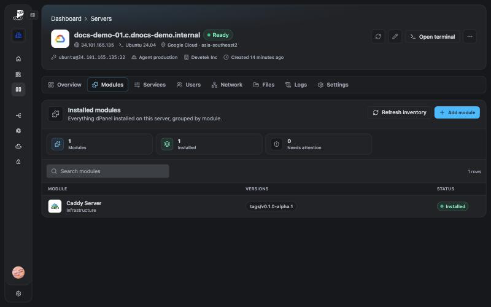
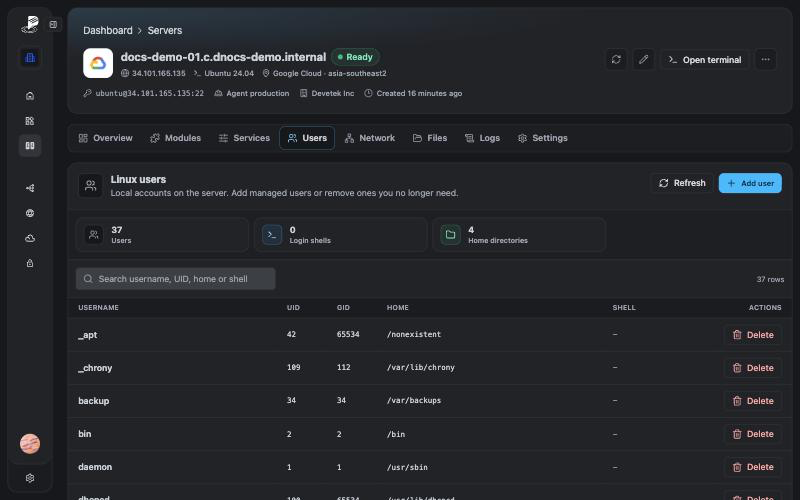
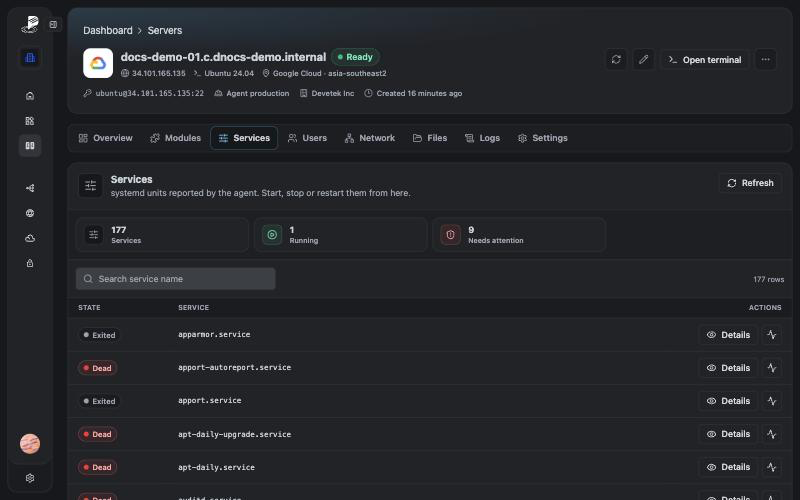
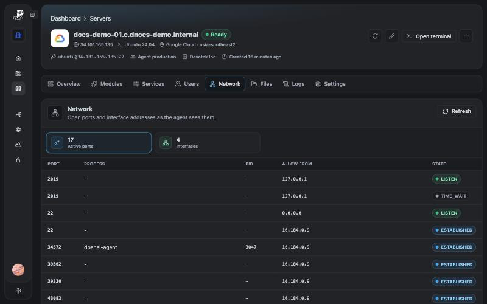
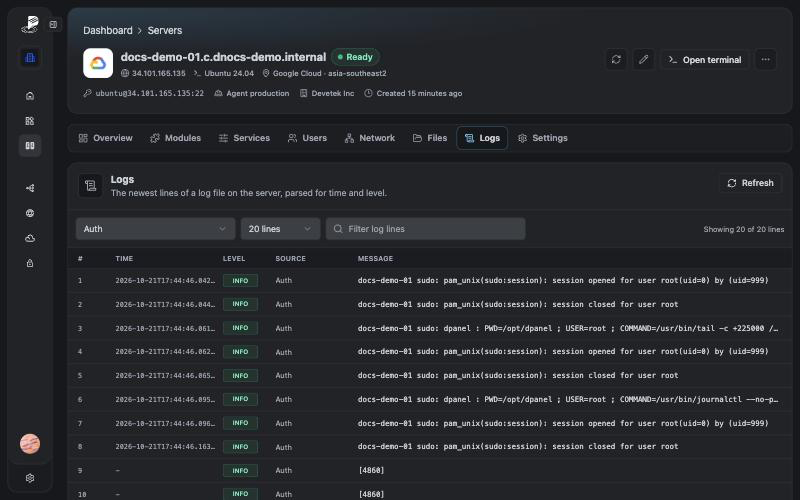
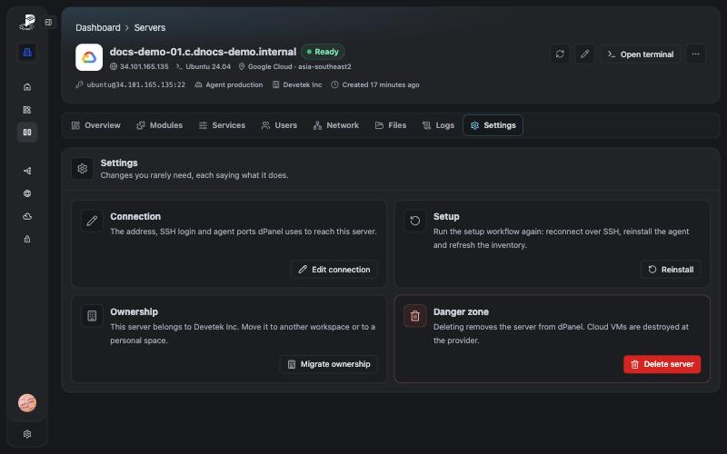

Setiap server punya satu halaman, dan semua tindakan terhadap server itu ada di sana. Bagian kepala menampilkan nama, status siap atau tidak, alamatnya, versi Ubuntu, lokasinya, login yang dipakai dPanel, versi agen dan waktu pembuatannya.

## Modules

Semua yang dipasang dPanel, dengan versi dan kondisinya. Add module membuka katalog.

## Services

Semua unit systemd yang terlihat oleh agen. Service adalah program yang dijaga Linux tetap berjalan di latar belakang, misalnya basis data atau web server. Start, stop, restart atau reload lewat menu di ujung barisnya.

Kebanyakan server punya lebih dari seratus unit dan banyak yang memang Dead atau Exited, jadi angka Needs attention pada mesin baru itu wajar.

## Users

Akun Linux di mesin itu, dengan direktori home dan shell-nya. Sebagian besar entri di server baru milik sistem dan sebaiknya dibiarkan.

## Network

Port mana yang terbuka, proses mana yang memakainya, dan dari mana koneksi diizinkan. Halaman inilah yang dicek saat sesuatu tidak bisa dijangkau.

## Files dan Logs

Files membuka pengelola berkas untuk menelusuri, mengunggah dan melihat berkas teks. Logs menampilkan baris terbaru sebuah berkas log, terurai menjadi waktu, level dan pesan, lengkap dengan penyaring.

## Settings

Perubahan yang jarang diperlukan, masing-masing menjelaskan dirinya: mengubah detail koneksi, menjalankan ulang penyiapan, memindahkan server ke workspace lain, dan zona berbahaya untuk menghapusnya.

