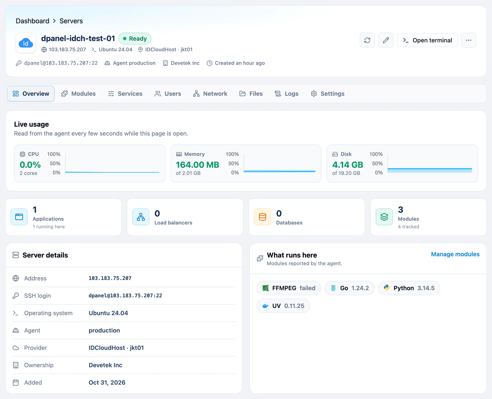
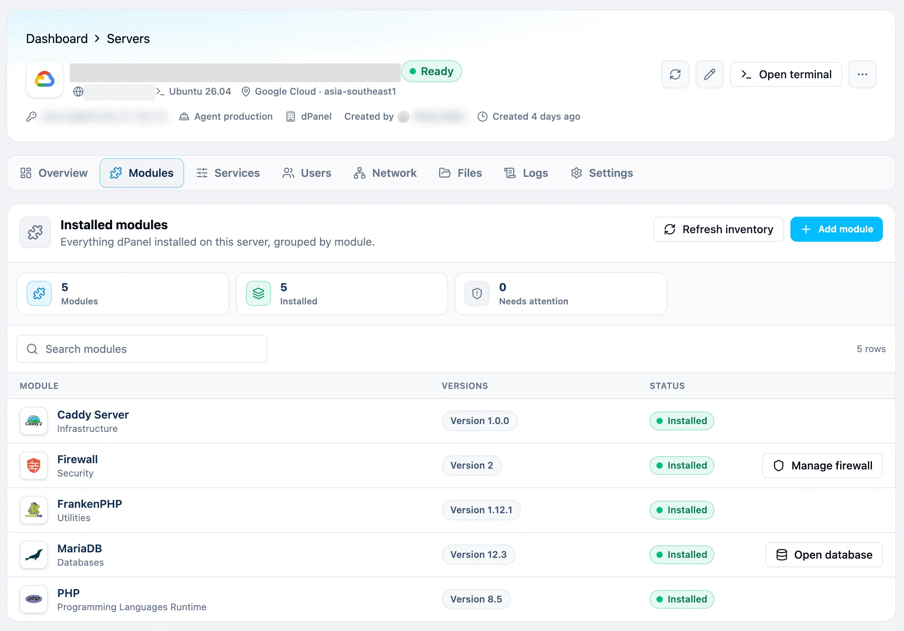
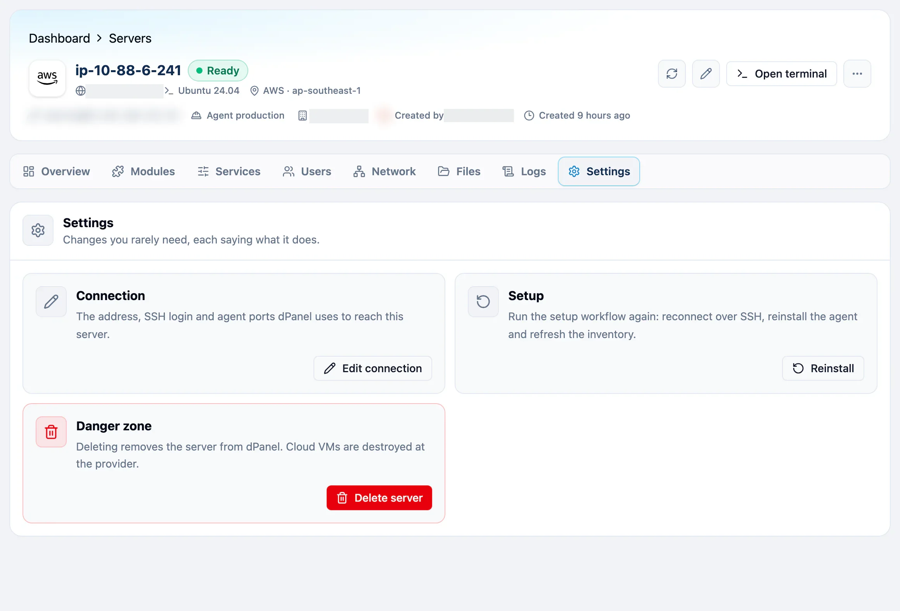

Setiap server di dPanel punya satu halaman, dan semua tindakan terhadap server itu ada di sana: pemakaian langsung, modul terpasang, layanan systemd, pengguna Linux, port terbuka, berkas, log, dan pengaturan. Buka dari **Server** dengan memilih baris server tersebut.

## Bagian kepala

Bagian kepala menampilkan nama, status, alamat, versi Ubuntu, dan lokasi server, lalu sebaris keterangan: login SSH yang dipakai dPanel (misalnya `ubuntu@203.0.113.10:22`), versi agen, workspace, siapa yang membuat server, dan kapan.

| Kontrol               | Fungsinya                                                                                            |
| --------------------- | ---------------------------------------------------------------------------------------------------- |
| Segarkan (↻)          | Membaca ulang status, pemakaian, layanan, dan modul server.                                          |
| **Ubah server** (✎)   | Mengubah alamat, login SSH, dan port agen yang dipakai dPanel.                                       |
| **Buka terminal**     | Membuka shell di browser. Lihat [Terhubung lewat SSH](./connect-over-ssh.md).                        |
| **Tindakan lain** (⋯) | **Pasang ulang server** menjalankan setup lagi; **Hapus server** menghapusnya. Lihat tabel di bawah. |

Pilih lencana status untuk melihat arti status tersebut. Selama dPanel menyiapkan server, banner biru memberi tahu hal itu, dengan tombol **Ikuti log**. Jika setup gagal, banner merah **Penyiapan tidak selesai** menawarkan **Lihat penyebabnya**.

## Pemberitahuan agen

Agen adalah program kecil dPanel di server. Agen melaporkan pemakaian dan menjalankan tugas yang Anda mulai. Saat agen butuh bantuan Anda, sebuah pemberitahuan muncul di bawah bagian kepala halaman server dan di kartu server pada **Server**. Pemberitahuan hanya muncul pada server yang berstatus **Siap**.

| Pemberitahuan                                                          | Artinya                                                                                                                                                                        | Yang perlu dilakukan                                                                                            |
| ---------------------------------------------------------------------- | ------------------------------------------------------------------------------------------------------------------------------------------------------------------------------ | --------------------------------------------------------------------------------------------------------------- |
| **Agen berhenti melapor**                                              | dPanel tidak menerima kabar dari agen selama lebih dari 5 menit. Pemakaian langsung, daftar modul, deployment, dan tugas lain di server ini menunggu sampai agen melapor lagi. | Masuk ke server dan jalankan ulang agen: `sudo systemctl restart dpanel-agent`. **Salin perintah** menyalinnya. |
| **Pembaruan agen tersedia** (misalnya `v0.1.15 → v0.1.21`)             | Agen yang lebih baru sudah dirilis. Fitur dPanel yang baru bisa membutuhkannya.                                                                                                | Tekan **Perbarui ke** versi baru. Agen memulai ulang dan menampilkan versi baru dalam beberapa menit.           |
| **Pembaruan agen tersedia**, dengan permintaan menjalankan ulang setup | Agen ini build lama yang tidak bisa memperbarui dirinya sendiri.                                                                                                               | Jalankan ulang setup dengan **Instal ulang** di tab **Pengaturan**.                                             |

Pembaruan aman dicoba: server menyimpan agen sebelumnya, dan jika agen baru tidak bisa menjangkau dPanel dalam 3 menit, agen sebelumnya kembali dengan sendirinya. Agen harus berjalan agar bisa diperbarui, jadi jalankan ulang agen yang berhenti lebih dulu.

Jika agen belum kembali setelah dijalankan ulang, periksa di server:

```bash
sudo systemctl status dpanel-agent
sudo journalctl -u dpanel-agent -n 50
```

Pastikan juga server bisa menjangkau internet lewat HTTPS (port 443): agen terhubung keluar ke dPanel.

## Ringkasan

**Pemakaian langsung** membaca CPU, memori, dan disk dari agen setiap beberapa detik selama halaman terbuka. Di bawahnya ada jumlah aplikasi, load balancer, basis data, dan modul, lalu **Detail server** (alamat, login SSH, sistem operasi, agen, penyedia, kepemilikan, **Dibuat oleh**, dan kapan server ditambahkan) dan **Yang berjalan di sini**.



## Modul

Semua yang dipasang dPanel, satu baris per modul, dengan versi dan statusnya: **Terpasang**, **Memasang**, **Gagal**, atau **Campuran**. **Tambah modul** membuka katalog. **Segarkan inventaris** meminta data terbaru dari agen dan membuang modul yang tidak lagi dilaporkannya. Hitungannya hanya mencakup modul tingkat atas; basis data yang Anda buat di MariaDB atau PostgreSQL ada di tampilan **Kelola** modul tersebut.

Beberapa baris punya pintasan: **Buka database** pada MariaDB, PostgreSQL, dan MongoDB membuka DB Manager, alat basis data di browser, langsung mengarah ke server ini; **Kelola firewall** pada modul Firewall membuka tampilan [Firewall](./firewall.md). Lihat [Memasang perangkat lunak](./install-software.md).



## Layanan

Semua unit systemd yang terlihat oleh agen. Layanan adalah program yang dijaga Linux tetap berjalan di latar belakang, misalnya basis data atau web server. Pakai tombol di barisnya untuk menyalakan, menghentikan, memulai ulang, atau me-reload layanan.

Kebanyakan server punya lebih dari seratus unit, dan banyak yang memang berstatus **Dead** atau **Exited**. Jadi angka "perlu perhatian" pada mesin baru itu wajar.


## Pengguna

Akun Linux di mesin itu, dengan UID (nomor yang dipakai Linux untuk mengenali akun), direktori home, dan shell-nya. Sebagian besar entri di server baru milik sistem, jadi biarkan saja.

**Tambah pengguna** membuat akun terkelola. Atur **Add for** untuk memilih pemiliknya:

- **dPanel user**: seseorang. Di server milik tim, orang itu harus anggota tim tersebut.
- **Service account**: [akun layanan](../teams/service-accounts.md) tim, untuk skrip dan otomatisasi. Akun ini tidak punya kata sandi, jadi tidak ada yang bisa masuk dengan kata sandi.

Dari terminal:

```bash
dnocs server user list --id 140
dnocs server user add --id 140 --service-account deploy-bot
dnocs server user remove --id 140 --username deploy-bot --dry-run
```

`remove` berlaku untuk pengguna yang dikelola dPanel. Folder home-nya tetap ada, jadi tidak ada yang hilang tanpa sengaja. Tambahkan `--remove-home` untuk ikut menghapus `/home/USERNAME`; salin dulu yang ingin disimpan, karena ini tidak bisa dibatalkan. Penghapusan gagal dengan aman selama pengguna itu masih menjalankan program.


## Jaringan

Tiga kotak di atas mengganti tampilannya:

- **Port aktif**: port mana yang terbuka, proses mana yang memakainya, dari mana koneksi datang (**Allow from**), statusnya, dan kolom **Firewall** yang menunjukkan apakah aturan firewall membuat port itu bisa dijangkau dari luar. Aplikasi yang sedang mendengarkan port-nya muncul di sini sebagai **LISTEN**. Buka tampilan ini kalau ada yang tidak bisa dijangkau.
- **Antarmuka**: kartu jaringan server beserta alamat IPv4 dan IPv6-nya.
- **Firewall**: apakah firewall **Nyala** atau **Mati**, aturannya, dan **Tinjau dan terapkan**. Lihat [Firewall](./firewall.md).


## Berkas

**Buka pengelola berkas** untuk menjelajah folder dalam bentuk pohon atau tabel, mengunggah berkas, membuat folder, dan melihat isi berkas teks.


## Log

Baris terbaru dari satu berkas log, diurai menjadi waktu, level, sumber, dan pesan.

1. Pilih berkas di **Sumber log**. **Auth** ada di urutan pertama.
2. Pilih jumlah baris: 20, 50, 100, 200, atau 500.
3. Ketik di **Saring baris log** untuk mempersempit hasil.
4. Pilih satu baris untuk membuka panel **Entri log**, berisi pesan lengkap dan tombol **Salin baris mentah**.

**Segarkan** membaca ulang berkasnya. Menu di sebelahnya mengatur **Muat ulang otomatis**: **Mati** secara bawaan, atau **Setiap 30 detik**, **Setiap menit**, dan **Setiap 5 menit**.


:::note[Log server tidak punya rentang waktu]
Tab ini membaca baris terbaru dari sebuah berkas. Rentang waktu, halaman, dan unduhan ada di log aplikasi dan log load balancer. Lihat [Membaca log](../logs/reading-logs.md).
:::

## Pengaturan

Perubahan yang jarang dibutuhkan, masing-masing dengan penjelasan.

| Kartu          | Tombol           | Fungsinya                                                                                                                                                                                                                                 |
| -------------- | ---------------- | ----------------------------------------------------------------------------------------------------------------------------------------------------------------------------------------------------------------------------------------- |
| Koneksi        | **Edit koneksi** | Mengubah alamat, login SSH, dan port agen yang dipakai dPanel.                                                                                                                                                                            |
| Penyiapan      | **Instal ulang** | Menjalankan penyiapan server lagi: masuk ulang lewat SSH, memasang ulang agen, dan menyegarkan inventaris. Modul terpasang dan data Anda tetap ada. Pada [mesin privat](./register-a-private-machine.md), hanya agen yang dipasang ulang. |
| Zona berbahaya | **Hapus server** | Menghapus server. Lihat [Menghapus server](./delete-a-server.md).                                                                                                                                                                         |

**Penyiapan** disembunyikan selama server sedang disiapkan atau dihapus, dan pada server yang sudah dihapus, karena saat itu tidak ada yang bisa dipasang ulang. Server tetap berada di workspace tempat ia dibuat; server tidak bisa dipindahkan ke workspace lain.

Dari terminal, `dnocs server setup --id 140` sama dengan **Instal ulang**. Tambahkan `--force` untuk menjalankannya walaupun server masih berstatus sedang diproses, misalnya saat penyiapan macet. Lihat [AI di terminal](../ai/ai-in-the-terminal.md) untuk memasang `dnocs`.



## Pertanyaan yang sering diajukan

### Bagaimana cara menemukan server dengan cepat?

Ketik di kotak pencarian di **Servers**. Pencariannya tidak membedakan huruf besar dan kecil, jadi `WEB` menemukan `web-01`.

### Kenapa bagian kepala menampilkan nama seseorang?

**Dibuat oleh** menyebut orang yang menambahkan server, supaya tim tahu harus bertanya ke siapa. Pilih namanya untuk membuka profil publiknya.

### Apa yang diubah Instal ulang di server saya?

Fitur ini masuk ulang lewat SSH, memasang ulang agen dPanel, dan menyegarkan inventaris. Modul, aplikasi, dan data yang terpasang tetap seperti semula.

### Apa yang harus saya lakukan saat agen berhenti melapor?

Masuk ke server dan jalankan `sudo systemctl restart dpanel-agent`. Jika server mati atau tidak bisa dijangkau, nyalakan dulu di penyedia Anda. Lihat [Pemberitahuan agen](#pemberitahuan-agen).

### Apakah saya wajib memperbarui agen?

Server Anda tetap berjalan dengan agen lama, tetapi fitur dPanel yang baru bisa membutuhkan agen yang lebih baru. Tekan **Perbarui ke** di pemberitahuan; agen sebelumnya kembali dengan sendirinya jika agen baru gagal.

### Di mana saya membuka basis data yang berjalan di server ini?

Di tab **Modul**, tekan **Buka database** pada baris MariaDB, PostgreSQL, atau MongoDB. Lihat [Memasang perangkat lunak](./install-software.md#mengelola-basis-data).

### Kenapa port yang saya buka tidak bisa dijangkau dari luar?

Periksa kolom **Firewall** di **Jaringan → Port aktif**. **Tidak ada aturan izin** berarti firewall memblokirnya; tambahkan aturan di [Firewall](./firewall.md). Periksa juga bahwa programnya mendengarkan di `0.0.0.0`, bukan `127.0.0.1`.
