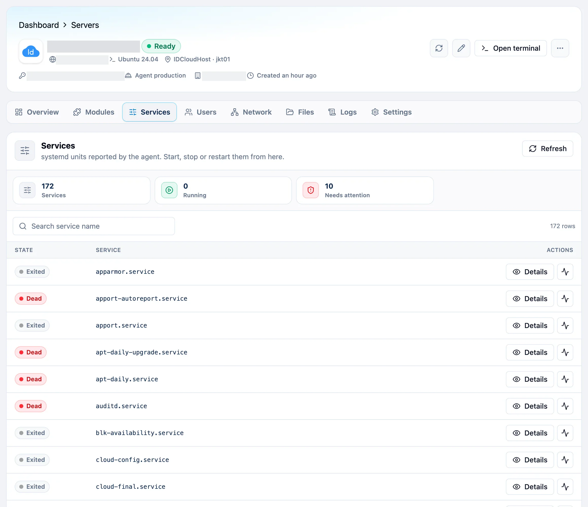
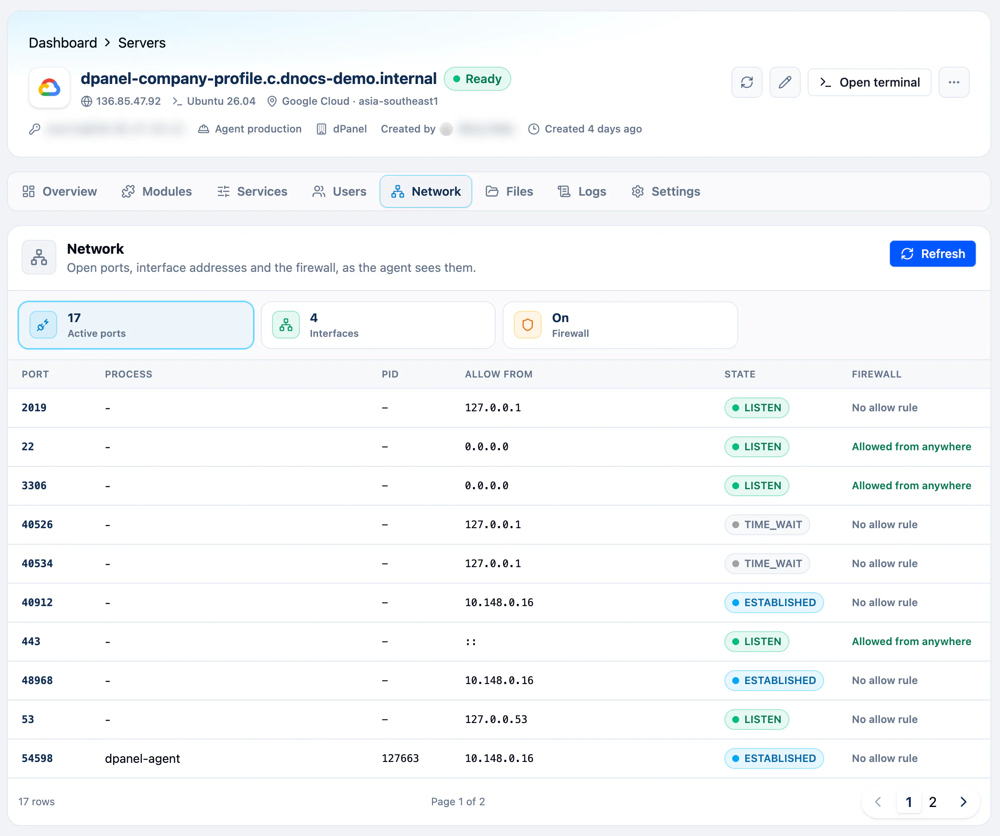

Setiap server punya satu halaman, dan semua tindakan terhadap server itu ada di sana.

Bagian kepalanya menampilkan nama, status, alamat, versi Ubuntu, lokasi, login SSH yang dipakai dPanel, agen, workspace pemiliknya, dan waktu pembuatannya. Tombol **Buka terminal** juga ada di sana. Lihat [Terhubung lewat SSH](./connect-over-ssh.md).

## Ringkasan

**Pemakaian langsung** membaca CPU, memori, dan disk dari agen setiap beberapa detik selama halaman terbuka. Di bawahnya ada jumlah aplikasi, load balancer, basis data, dan modul, lalu **Detail server** dan **Yang berjalan di sini**.

## Modul

Semua yang dipasang dPanel, dengan versi dan statusnya: **Terpasang**, **Memasang**, atau **Gagal**. **Tambah modul** membuka katalog. **Segarkan inventaris** meminta data terbaru dari agen. Lihat [Memasang perangkat lunak](./install-software.md).

## Layanan

Semua unit systemd yang terlihat oleh agen. Layanan adalah program yang dijaga Linux tetap berjalan di latar belakang, misalnya basis data atau web server. Pakai tombol di barisnya untuk menyalakan, menghentikan, memulai ulang, atau me-reload layanan.

Kebanyakan server punya lebih dari seratus unit, dan banyak yang memang berstatus **Dead** atau **Exited**. Jadi angka "perlu perhatian" pada mesin baru itu wajar.

## Pengguna

Akun Linux di mesin itu, dengan UID, direktori home, dan shell-nya. **Tambah pengguna** membuat akun terkelola. Sebagian besar entri di server baru milik sistem, jadi biarkan saja.

## Jaringan

Port mana yang terbuka, proses mana yang memakainya, dari mana koneksi diizinkan, dan statusnya. Buka tab ini kalau ada yang tidak bisa dijangkau. Aplikasi yang sedang mendengarkan port-nya muncul di sini sebagai **LISTEN**.

## Berkas

**Buka pengelola berkas** untuk menjelajah folder dalam bentuk pohon atau tabel, mengunggah berkas, membuat folder, dan melihat isi berkas teks.

## Log

Baris terbaru dari satu berkas log, diurai menjadi waktu, level, sumber, dan pesan.

1. Pilih berkas di **Sumber log**. **Auth** ada di urutan pertama.
2. Pilih jumlah baris: 20, 50, 100, 200, atau 500.
3. Ketik di **Saring baris log** untuk mempersempit hasil.
4. Pilih satu baris untuk membuka panel **Entri log**, berisi pesan lengkap dan tombol **Salin baris mentah**.

**Segarkan** membaca ulang berkasnya. Menu di sebelahnya mengatur **Muat ulang otomatis**: **Mati** secara bawaan, atau **Setiap 30 detik**, **Setiap menit**, dan **Setiap 5 menit**.

:::note[Log server tidak punya rentang waktu]
Tab ini membaca baris terbaru dari sebuah berkas. Rentang waktu, halaman, dan unduhan ada di log aplikasi dan log load balancer. Lihat [Membaca log](../logs/reading-logs.md).
:::

## Pengaturan

Perubahan yang jarang dibutuhkan, masing-masing dengan penjelasan.

| Kartu          | Tombol                    | Fungsinya                                                               |
| -------------- | ------------------------- | ----------------------------------------------------------------------- |
| Koneksi        | **Edit koneksi**          | Mengubah alamat, login SSH, dan port agen yang dipakai dPanel.          |
| Penyiapan      | **Instal ulang**          | Masuk ulang lewat SSH, memasang ulang agen, dan menyegarkan inventaris. |
| Kepemilikan    | **Pindahkan kepemilikan** | Memindahkan server ke workspace lain atau ke ruang pribadi Anda.        |
| Zona berbahaya | **Hapus server**          | Menghapus server. Lihat [Menghapus server](./delete-a-server.md).       |

