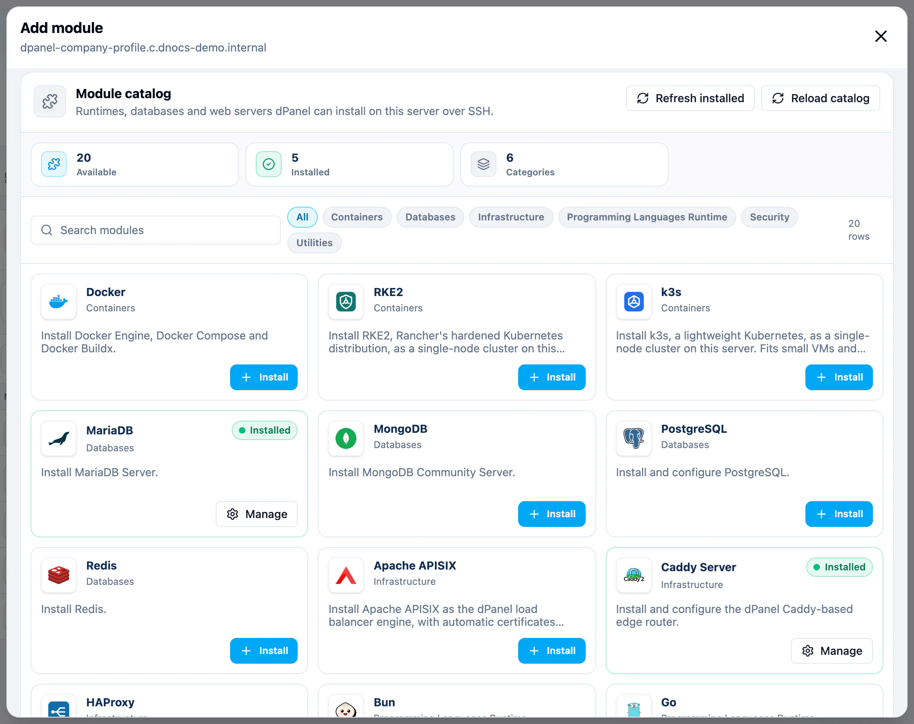
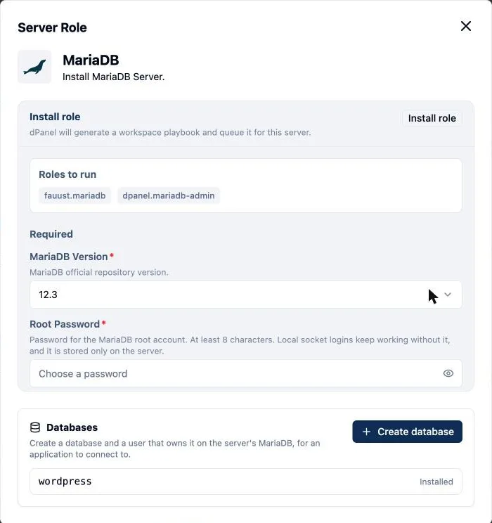

Tutorial ini membawa Anda dari akun dPanel yang masih kosong sampai aplikasi Laravel yang menjawab di domain Anda sendiri dengan HTTPS. Anda meluncurkan server Ubuntu, memasang PostgreSQL, PHP, FrankenPHP, dan Node.js di sana, membuat basis data, merilis repositori [dPanel-ID/laravel-example](https://github.com/dPanel-ID/laravel-example), lalu memasang load balancer di depannya.

Ada dua hal yang membedakan Laravel dari WordPress di sini:

- **Laravel butuh dua runtime.** Build menjalankan Composer dengan PHP, lalu `npm` untuk membangun front end dengan Vite. Aplikasi mendeklarasikan PHP dan Node.js, dan dPanel hanya menaruh runtime yang dideklarasikan di path build.
- **Build mengakses basis data.** Build menjalankan migrasi, jadi variabel basis data dibutuhkan saat build maupun saat berjalan.

Waktunya sekitar 45 menit, sebagian besar untuk menunggu server dan pemasangan. Semua langkah dilakukan di aplikasi web dPanel; Anda tidak perlu SSH.

:::tip[Baru mengenal server?]
Baca [Cara situs web berjalan di server Anda](./how-a-website-runs.md) terlebih dulu. Halaman itu menjelaskan setiap istilah di sini, seperti modul, build, port, dan load balancer, dalam beberapa menit. Istilah lainnya ada di [Glosarium](../getting-started/glossary.md).
:::

## Yang perlu disiapkan

- Akun dPanel yang sudah masuk, di workspace yang ingin Anda pakai. Lihat [Masuk](../getting-started/sign-in.md).
- GitHub sudah terhubung dan punya akses ke repositori yang akan dirilis. Agar sama persis dengan tutorial ini, fork **dPanel-ID/laravel-example** ke akun Anda. Lihat [Hubungkan GitHub](../getting-started/connect-github.md).
- SSH key dan akun cloud di dPanel, atau server milik Anda sendiri. Lihat [Sebelum memulai](../servers/before-you-start.md).
- Domain di **Domain & DNS**, supaya dPanel bisa membuat record DNS-nya. Lihat [Domain dan DNS](../networking/domains-and-dns.md).

## Langkah 1: Luncurkan server

1. Buka **Server**, tekan **Buat Server**, lalu **Luncurkan server**.
2. Pilih **Provider**, **Cloud project**, dan **SSH key**, lalu **Region** yang dekat dengan pengguna Anda.
3. Isi **Server name**, misalnya `laravel-1`, biarkan **Ubuntu release** 24.04 LTS, lalu geser slider ke minimal **2 vCPU** dan RAM **4 GB**. Storage 30 GB sudah cukup.
4. Saat panel Review bertuliskan **Ready to launch**, tekan **Launch server**.

Tunggu sampai status server **Ready**, biasanya 10 sampai 20 menit. Lihat [Membuat server cloud](../servers/cloud-providers/create-a-cloud-server.md), atau [hubungkan server Anda sendiri](../servers/connect-your-own-server.md).

**Yang seharusnya Anda lihat:** server muncul di **Server** dengan status **Ready**.

## Langkah 2: Pasang PostgreSQL, PHP, FrankenPHP, dan Node.js

1. Buka server, lalu tab **Modul**. Tekan **Add module**.
2. Tekan **Install** pada **PostgreSQL**. Catat pengguna administratornya dan isi kata sandinya, lalu simpan di tempat aman. Tekan **Install role** dan konfirmasi.
3. Setelah PostgreSQL berstatus **Terpasang**, pasang **PHP** dengan **PHP Version** `8.5`.
4. Lalu pasang **FrankenPHP**, yang menyajikan aplikasi lewat Laravel Octane.
5. Lalu pasang **Node.js**. Catat versi yang dipasang, misalnya `26.13.0`.



Pasang satu modul setiap kali dan biarkan selesai. Lihat [Pasang perangkat lunak](../servers/install-software.md).

**Yang seharusnya Anda lihat:** PostgreSQL, PHP, FrankenPHP, dan Node.js di tab **Modul**, masing-masing berstatus **Terpasang**.

## Langkah 3: Buat basis data Laravel

1. Di tab **Modul**, tekan **Add module**, lalu **Manage** pada **PostgreSQL**.
2. Di bagian **Databases**, tekan **Create database**.
3. Isi **Database Name** `laravel`, **Database User** `laravel`, dan **Database Password** minimal 8 karakter. Salin kata sandinya: Anda membutuhkannya di langkah 4. Nama di PostgreSQL memakai huruf kecil, angka, dan garis bawah.
4. Tekan **Install role**.



**Yang seharusnya Anda lihat:** `laravel` tampil di **Databases**, dan kata sandinya sudah tersimpan di tempat aman.

## Langkah 4: Buat dan rilis aplikasi

1. Buka **Aplikasi**, lalu tekan **Buat Aplikasi**.
2. **Repositori**: pilih akun GitHub Anda, cari `laravel-example`, pilih repositorinya, biarkan branch **main**, lalu tekan **Lanjut**.
3. **Server & modul**: pilih server Anda. Di **Terinstal di server terpilih**, pilih **PHP**, **FrankenPHP**, dan **Node.js** agar dipakai ulang, bukan dipasang lagi. Tekan **Lanjut**.
4. **Setup aplikasi**:
   - **Nama aplikasi**: `Laravel` (huruf, angka, dan spasi saja).
   - **Binary yang dibutuhkan**: pastikan PHP 8.5 **dan** Node.js sama-sama terpilih. dPanel memilih setiap modul bahasa yang Anda pilih di langkah 2 dan menyimpan semuanya di aplikasi, yang membuat `npm` ada di path build. FrankenPHP muncul di **Other dependencies**.
   - **Langkah build**: `./scripts/build.sh`. Skrip ini memasang paket Composer dan npm, membangun front end, membuat application key, dan menjalankan migrasi.
   - **Perintah runtime**: `./scripts/start.sh`. Skrip ini menjalankan Laravel Octane di FrankenPHP, pada port yang diberikan dPanel.
   - **Port aplikasi**: biarkan port kosong yang disarankan dPanel.
5. **Environment**: tempel daftar basis data ini di **Variabel build-time** **dan** **Variabel runtime**, dengan kata sandi dan domain Anda:

   ```text
   APP_ENV=production
   APP_DEBUG=false
   APP_URL=https://app.example.com
   DB_CONNECTION=pgsql
   DB_HOST=127.0.0.1
   DB_PORT=5432
   DB_DATABASE=laravel
   DB_USERNAME=laravel
   DB_PASSWORD=kata-sandi-dari-langkah-3
   ```

   Lalu tambahkan ini di **Variabel runtime** saja:

   ```text
   OCTANE_SERVER=frankenphp
   OCTANE_DISABLE_CADDY_ADMIN=true
   LOG_CHANNEL=stderr
   ```

6. **Pratinjau**: periksa ringkasannya, lalu tekan **Rilis aplikasi**.


Build pertama memakan waktu 3 sampai 6 menit. Buka aplikasinya untuk memantau; statusnya **Running** saat rilis sudah aktif. Lihat [Membuat aplikasi](../applications/create-an-application.md) dan [Variabel environment](../applications/environment-variables.md).

:::warning[npm: command not found]
Kalau log build berhenti di `npm: command not found`, Node.js belum dideklarasikan di aplikasi. Buka pengaturan aplikasi, tambahkan **nodejs** dengan versi yang terpasang di bagian bahasa tambahan, simpan, lalu rilis lagi.
:::

**Yang seharusnya Anda lihat:** aplikasi berstatus **Running**. Aplikasi belum ada di internet: itu langkah berikutnya.

## Langkah 5: Publikasikan di domain Anda dengan HTTPS

1. Buka **Load Balancer**, lalu tekan **Buat load balancer**. Formulirnya punya empat langkah: **Gateway**, **Domain**, **Routing**, dan **Review**.
2. **Gateway**: di **Server gateway**, pilih server yang sama. Di **Engine web server**, pilih **Caddy Server**, lalu tekan **Instal** kalau belum terpasang.
3. **Domain**: di **Nama Domain**, pilih **Terkelola**, ketik **Subdomain** (misalnya `app`), lalu **Pilih domain**. Kalau DNS domain Anda tidak berada di Cloudflare atau DigitalOcean, pilih **Eksternal**, ketik hostname Anda, dan tambahkan record yang ditampilkan formulir di penyedia DNS Anda.
4. **Routing**: biarkan **L7** di **Mode routing**, serta **HTTP / HTTPS** dengan **HTTPS** menyala di **Protokol dan HTTPS**. Di aturan pertama, atur **Tipe** ke **Aplikasi**, **Pola Jalur URL** ke `/*`, lalu pilih aplikasi **Laravel**.
5. **Review**: saat panel tinjauan bertuliskan **Siap dibuat**, tekan **Buat load balancer**.

Setelah satu atau dua menit, buka `https://app.example.com/`: halaman sambutan Laravel muncul. Lihat [Load balancer](../networking/load-balancers.md).

## Kalau ada yang tidak berjalan

| Yang Anda lihat                       | Yang perlu diperiksa                                                                                                                                                                     |
| ------------------------------------- | ---------------------------------------------------------------------------------------------------------------------------------------------------------------------------------------- |
| `npm: command not found` di log build | Deklarasikan Node.js di aplikasi, seperti pada peringatan di atas.                                                                                                                       |
| Build gagal di `php artisan migrate`  | Variabel `DB_*` juga harus ada di **Variabel build-time**, dan cocok dengan basis data dari langkah 3.                                                                                   |
| Aplikasi berjalan lalu berhenti       | Baca log runtime-nya. Lihat [Log aplikasi](../applications/application-logs.md).                                                                                                         |
| Domain tidak menjawab                 | Tunggu beberapa menit untuk DNS dan sertifikat, lalu periksa halaman detail dan log load balancer. Banner merah **Perubahan load balancer gagal** punya tombol **Lihat penyebab gagal**. |
| Masalah lain                          | Lihat [Masalah umum dan solusinya](../troubleshooting/faq.md).                                                                                                                           |

Perubahan variabel berlaku mulai rilis berikutnya: rilis lagi setelah mengubahnya.

## Lebih suka mengobrol? Lakukan hal yang sama dengan Ask dPanel

[Ask dPanel](../ai/overview.md) bisa menyiapkan setiap langkah untuk Anda setujui. Sebutkan kedua runtime saat meminta asisten membuat aplikasi, misalnya:

> Buat aplikasi bernama Laravel dari github.com/my-org/laravel-example di server laravel-1. Bahasa PHP 8.5 dengan Node.js sebagai runtime tambahan, perintah build ./scripts/build.sh, perintah start ./scripts/start.sh.

Asisten meminta `DB_PASSWORD` sebagai kolom di kartu persetujuan, jadi kata sandinya tidak pernah masuk ke percakapan. Contoh permintaan lain ada di [Prompt cookbook](../ai/prompt-cookbook.md).

## Membersihkan

Hapus dengan urutan ini: load balancer, aplikasi, lalu server. Lihat [Load balancer](../networking/load-balancers.md#menghapus-load-balancer), [Mengubah atau menghapus aplikasi](../applications/update-or-delete.md), dan [Menghapus server](../servers/delete-a-server.md).

## Pertanyaan yang sering diajukan

### Mengapa aplikasinya butuh Node.js padahal Laravel memakai PHP?

Build menjalankan `npm` untuk membundel front end dengan Vite. dPanel hanya menaruh runtime yang dideklarasikan pada aplikasi di path build, jadi Node.js harus dideklarasikan di samping PHP.

### Mengapa variabel basis data dimasukkan ke dua daftar?

Build menjalankan migrasi, jadi build butuh basis data. Aplikasi yang berjalan juga membutuhkannya. **Variabel build-time** hanya sampai ke build; **Variabel runtime** hanya sampai ke layanan yang berjalan.

### Bisakah memakai MariaDB, bukan PostgreSQL?

Bisa. Pasang **MariaDB**, buat basis data dari halaman **Kelola**-nya, lalu atur `DB_CONNECTION=mysql` dan `DB_PORT=3306`.
