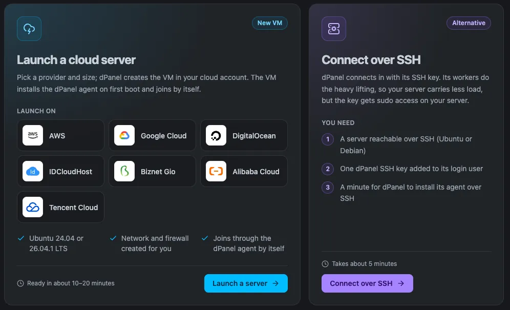
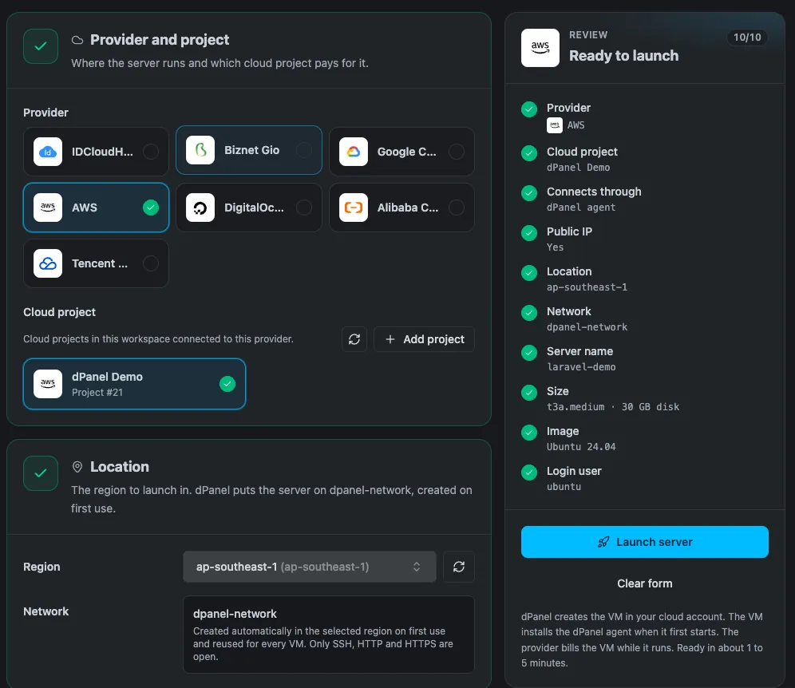
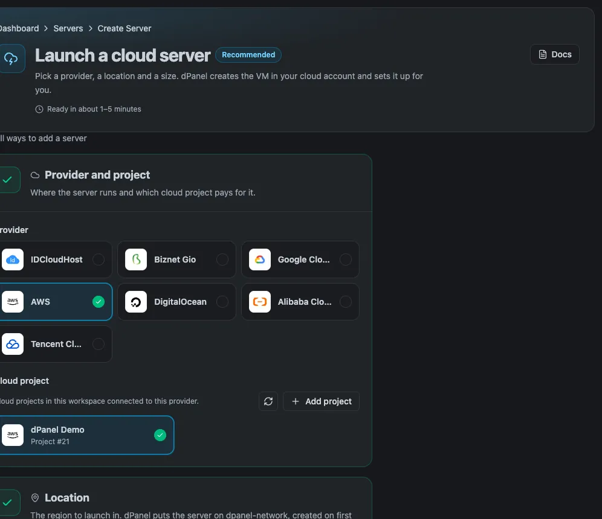
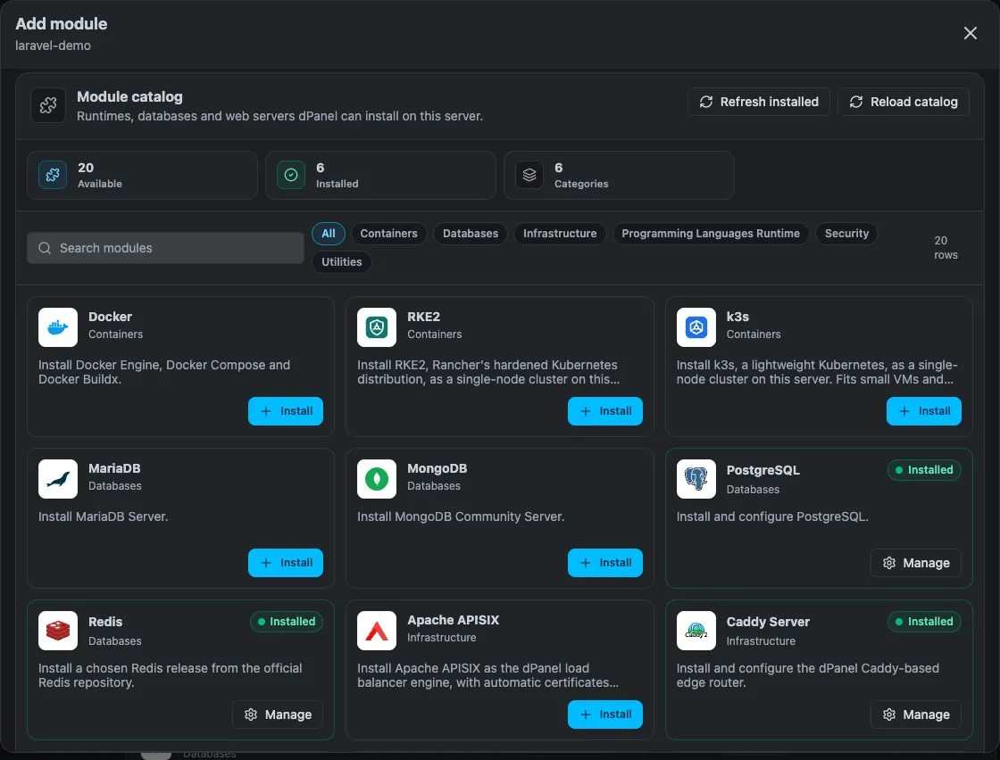
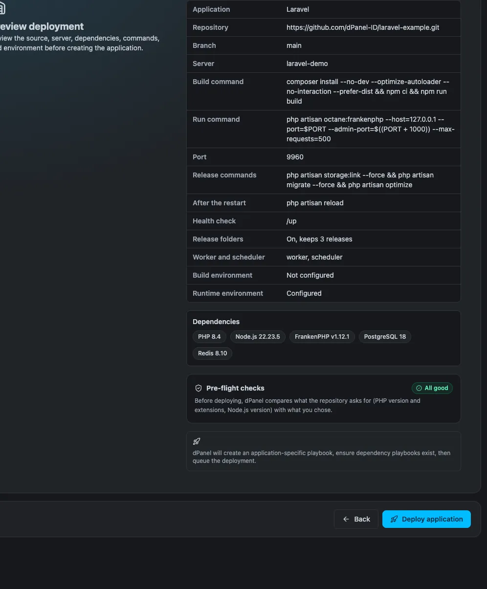
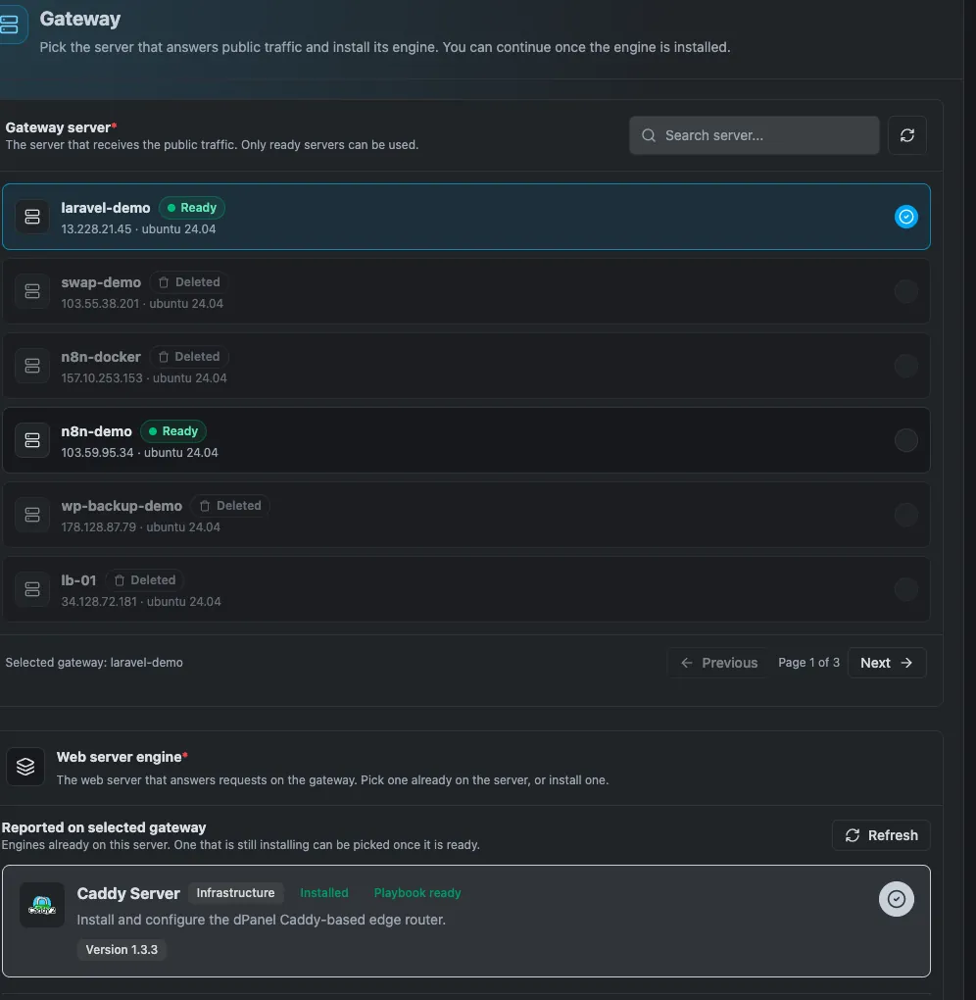
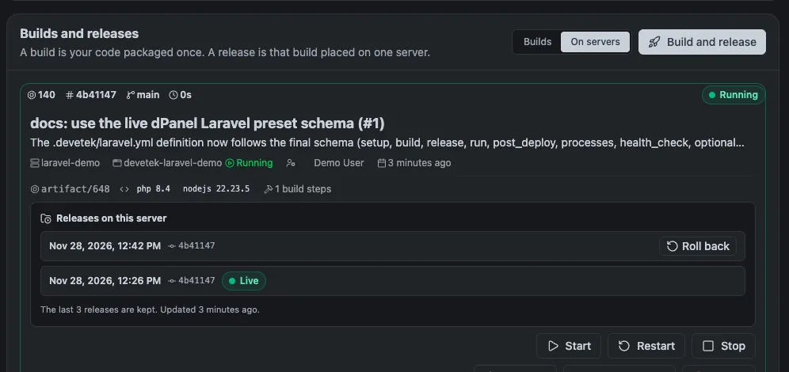
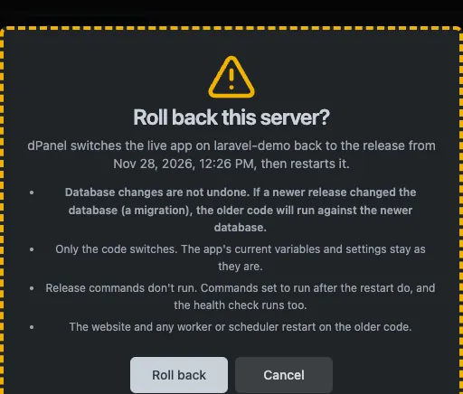
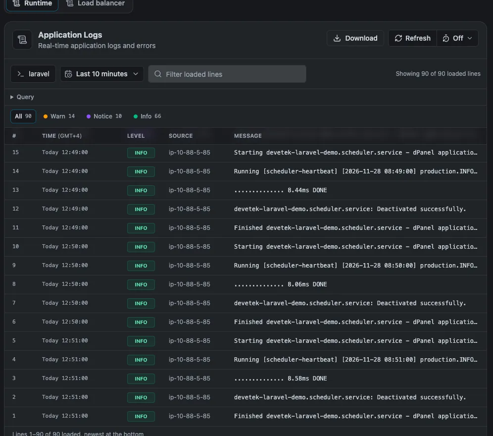

Tutorial ini membawa Anda dari akun dPanel yang masih kosong sampai aplikasi Laravel yang menjawab di domain Anda sendiri dengan HTTPS. Anda meluncurkan server Ubuntu, memasang PostgreSQL dan Redis di sana, membuat aplikasi dari GitHub, lalu memasang load balancer di depannya. Setelah itu Anda mempelajari pekerjaan sehari-hari: mengubah pengaturan, merilis ulang, rollback, dan membaca log.

Setiap tangkapan layar di halaman ini berasal dari satu kali menjalankan langkah-langkah ini dengan repositori [dPanel-ID/laravel-example](https://github.com/dPanel-ID/laravel-example), yang dipublikasikan di `laravel.terpusat.me`. Waktunya sekitar 30 menit, sebagian besar untuk menunggu pemasangan. Semua dilakukan di aplikasi web dPanel; Anda tidak perlu SSH.

:::tip[Baru mengenal server?]
Baca [Cara situs web berjalan di server Anda](./how-a-website-runs.md) terlebih dulu. Halaman itu menjelaskan istilah yang dipakai di sini, seperti modul, build, port, dan load balancer, dalam beberapa menit. Istilah lainnya ada di [Glosarium](../getting-started/glossary.md).
:::

## Yang dikerjakan dPanel untuk aplikasi Laravel

dPanel mengenali repositori Laravel dari file `artisan` di dalamnya dan mengisi pengaturannya untuk Anda. Ini disebut **preset Laravel**. Anda memeriksanya dan boleh mengubah apa saja. Ada empat hal yang perlu diketahui sebelum mulai:

- **Dua runtime.** Runtime adalah program yang menjalankan kode Anda. Build menjalankan Composer dengan **PHP**, lalu `npm` dengan **Node.js** untuk membangun front end, jadi aplikasi memakai keduanya. **FrankenPHP**, server web yang dibuat untuk PHP, menjawab permintaan ke situs.
- **Perintah rilis.** Setelah build dan sebelum versi baru aktif, dPanel menjalankan `php artisan migrate --force` dan perintah rilis lainnya dengan **variabel runtime** Anda (pengaturan yang dibaca aplikasi saat berjalan, misalnya password database). Jika satu perintah gagal, versi yang sudah berjalan tetap melayani.
- **Folder rilis.** Setiap rilis masuk ke folder baru di server. Situs Anda baru berpindah ke folder itu setelah perintah rilis dan pemeriksaan kesehatan berhasil, jadi rilis yang gagal tidak pernah membuat situs mati, dan Anda bisa rollback dengan satu klik.
- **Application key.** Laravel mengenkripsi sesi dan cookie dengan `APP_KEY`. dPanel membuatnya saat aplikasi dibuat dan menyimpannya, jadi Anda tidak perlu mengisinya sendiri.

## Yang perlu disiapkan

- Akun dPanel yang sudah masuk, di workspace yang ingin Anda pakai. Lihat [Masuk](../getting-started/sign-in.md).
- GitHub sudah terhubung dan punya akses ke repositori yang akan dirilis. Agar sama persis dengan tutorial ini, fork **dPanel-ID/laravel-example** ke akun Anda. Lihat [Hubungkan GitHub](../getting-started/connect-github.md).
- Akun cloud di dPanel untuk meluncurkan server (lihat [Sebelum memulai](../servers/before-you-start.md)), atau server yang sudah Anda punya dengan IP publik, yang dihubungkan dengan [agen dPanel](../servers/register-a-private-machine.md). Jika memakai server sendiri, lewati langkah 1.
- Domain di **Domain & DNS**, supaya dPanel bisa membuat record DNS-nya. Lihat [Domain dan DNS](../networking/domains-and-dns.md).

## Langkah 1: Luncurkan server

1. Buka **Server** dan tekan **Buat Server**.
2. Di kartu **Luncurkan server cloud**, pilih provider Anda, misalnya **AWS**.

   

3. **Provider and project**: provider Anda sudah terpilih. Di **Cloud project**, pilih proyek yang membayar server ini. Di **Location**, pilih **Region** yang dekat dengan pengunjung Anda. **Network** dibuat otomatis.

   

4. **Cara dPanel terhubung**: biarkan **Agen dPanel** dan biarkan **Beri VM IP publik** menyala. Pengunjung mencapai situs lewat IP publik itu.
5. **Size and image**: isi **Server name**, misalnya `laravel-demo`, biarkan **Ubuntu 24.04 LTS**, lalu geser **RAM** ke **4 GB** dan **Storage** ke **30 GB**. dPanel menampilkan ukuran termurah yang cocok, di sini `t3a.medium` (2 vCPU, 4 GB). 2 GB cukup untuk aplikasi kecil, tetapi build front end lebih cepat dengan 4 GB.

   

6. Panel **Review** di sebelah kanan berubah menjadi **Ready to launch**. Tekan **Launch server**.

   

7. dPanel menampilkan **Server Anda sedang menyala**. Tekan **Buka server**.

   

Server berstatus **Ready** begitu agennya terhubung, biasanya dalam 5 menit. Halamannya menampilkan pemakaian CPU, memori, dan disk secara langsung.


**Yang seharusnya Anda lihat:** server dengan lencana hijau **Ready**.

:::note[Lebih suka baris perintah?]
`dnocs server create-cloud` meluncurkan server yang sama dari terminal. Perintah ini menanyakan cloud project, region, dan ukuran, atau menerimanya lewat flag. Lihat [Membuat server cloud](../servers/cloud-providers/create-a-cloud-server.md).
:::

## Langkah 2: Pasang PostgreSQL dan Redis

**Modul** adalah perangkat lunak yang dipasang dPanel di server Anda. Database adalah salah satunya: **PostgreSQL** menyimpan data Anda. **Redis** bersifat opsional: penyimpanan cepat untuk cache, antrean job, dan sesi Laravel.

PHP, Node.js, dan FrankenPHP tidak dipasang di sini: formulir aplikasi menambahkannya di langkah 3, dengan versi yang diminta repositori Anda.

1. Di halaman server, buka tab **Modul** lalu tekan **Tambah modul**.

   

2. Tekan **Pasang** pada **PostgreSQL**. Biarkan **PostgreSQL Version** (yang terbaru) dan kolom lainnya. Untuk **Administrator Password**, tekan **Buat**, lalu salin password itu ke tempat aman: dPanel hanya menampilkannya sekali. Aplikasi Anda tidak memakainya; aplikasi mendapat user database sendiri di langkah 3.
3. Tekan **Install role**, lalu **Ya**.

   

4. Opsional: tekan **Pasang** pada **Redis**, biarkan **Bind Interface** `127.0.0.1` (hanya aplikasi di server ini yang bisa menjangkaunya, jadi tidak perlu password), tekan **Install role**, lalu **Ya**.

Setiap pemasangan butuh satu sampai dua menit. Tab **Modul** menampilkan **Memasang**, lalu **Terpasang**.

**Yang seharusnya Anda lihat:** PostgreSQL dan Redis bertanda **Terpasang**. Setelah langkah 3, PHP, Node.js, dan FrankenPHP ikut muncul.


:::note[Lebih suka baris perintah?]
`dnocs module install postgresql --server-id <ID server> --generate-secrets` dan `dnocs module install redis --server-id <ID server>`. Lihat [Memasang perangkat lunak](../servers/install-software.md).
:::

## Langkah 3: Buat aplikasi dengan preset Laravel

Buka **Aplikasi** dan tekan **Buat Aplikasi**. Formulirnya punya lima langkah: **Repositori**, **Server & modul**, **Setup aplikasi**, **Environment**, dan **Pratinjau**.

### Repositori

1. Pilih akun atau organisasi GitHub Anda di daftar pertama, cari `laravel`, lalu pilih **laravel-example**. Biarkan branch **main**.
2. Panel **Laravel terdeteksi** muncul. dPanel membaca repositori dan menampilkan temuannya: versi Laravel, versi PHP yang diminta, server web (Octane di FrankenPHP untuk repositori ini), build front end, dan pemeriksaan kesehatan. Catatannya memberi tahu bahwa dPanel mengelola `APP_KEY` dan bahwa `APP_URL` belum ada (Anda menambahkannya di **Environment**).
3. Tekan **Lanjut**.


### Server & modul

1. Pilih server Anda.
2. **Yang dibutuhkan aplikasi Laravel ini** berisi **PHP 8.4**, **Node.js 22**, dan **FrankenPHP**. Tekan **Tambah** pada masing-masing (atau **Gunakan … di server ini** jika versi itu sudah terpasang). Tidak ada yang ditambahkan sebelum Anda menekan tombol.
3. Di **Terinstal di server terpilih**, tekan **PostgreSQL** dan **Redis** agar aplikasi mencatatnya sebagai yang dipakai.
4. Tekan **Lanjut**.


### Setup aplikasi

Formulir sudah terisi. Periksa:

1. **Nama aplikasi**: ketik `Laravel` (huruf, angka, dan spasi saja).
2. **Binary yang dibutuhkan**: **PHP** dan **Node.js** sama-sama terpilih. **Dependency lainnya** berisi FrankenPHP, PostgreSQL, dan Redis.

   

3. **Langkah build**: `composer install --no-dev --optimize-autoloader --no-interaction --prefer-dist`, lalu `npm ci && npm run build`. Build tidak butuh database maupun `APP_KEY`.
4. **Perintah runtime**: Laravel Octane di FrankenPHP, karena repositori ini memakai Octane. Aplikasi tanpa Octane mendapat mode klasik FrankenPHP (`frankenphp php-server`), yang tidak butuh perubahan pada kode Anda.
5. **Port aplikasi**: biarkan port kosong yang disarankan dPanel. Aplikasi mendengarkan di port itu di server; pengunjung tidak pernah melihatnya.

   

6. **Rilis dan proses**:
   - **Perintah rilis**: `php artisan storage:link --force`, `php artisan migrate --force`, dan `php artisan optimize`.
   - **Setelah restart**: `php artisan reload`, yang me-restart queue worker, scheduler, dan Octane dengan kode baru.
   - **Pemeriksaan kesehatan**: `/up`. dPanel meminta halaman ini setelah setiap restart dan menandai rilis gagal jika jawabannya bukan `200`.
   - **Folder rilis**: menyala. `storage`, `.env`, dan `database/database.sqlite` dipertahankan antar-rilis, dan 3 rilis terakhir tetap ada di server.

   

7. **Worker dan scheduler**: nyalakan **Queue worker** (menjalankan job di antrean, misalnya email) dan **Scheduler** (menjalankan `php artisan schedule:run` setiap menit). Aplikasi contoh punya demo untuk keduanya. Masing-masing memakai memori, jadi untuk aplikasi Anda sendiri nyalakan hanya yang dibutuhkan.

   

8. Tekan **Lanjut**.

### Environment

Langkah ini berisi **variabel runtime**, yaitu pengaturan yang dibaca aplikasi saat berjalan.

1. Di **Database untuk aplikasi ini**, tekan **Buat database**. Biarkan **Laravel (DB\_\*)**. dPanel menyarankan nama database dan user dari nama aplikasi; pakai saja atau ketik sendiri (contoh ini memakai `laravel_app`). Tekan **Buat database**, lalu **Ya**. dPanel membuat database dan user-nya di PostgreSQL server Anda dengan password yang kuat, lalu menulis `DB_CONNECTION`, `DB_HOST`, `DB_PORT`, `DB_DATABASE`, `DB_USERNAME`, dan `DB_PASSWORD` ke variabel runtime. Anda tidak pernah mengetik atau melihat password itu.

   

2. Opsional, jika Anda memasang Redis: di **Redis untuk aplikasi ini**, tekan **Hubungkan Redis**. Biarkan **Prefix kunci** dan ketiga kotak (cache, antrean job, dan sesi), lalu tekan **Isi variabel**. Lihat [Menghubungkan Redis](../applications/environment-variables.md#menghubungkan-redis).

   

3. Di **Variabel runtime**, tambahkan alamat situs Anda di baris baru, dengan domain Anda sendiri:

   ```dotenv
   APP_URL="https://laravel.example.com"
   ```

   Laravel memakainya untuk tautan dan email.

4. Biarkan **Variabel build-time** kosong, dan jangan menambahkan `APP_KEY`: dPanel yang membuatnya.
5. Tekan **Lanjut**.


### Pratinjau

Periksa ringkasannya. **Pemeriksaan awal** membandingkan apa yang diminta repositori (versi dan ekstensi PHP, versi Node.js) dengan pilihan Anda, dan seharusnya bertuliskan **Semua aman**. Error, misalnya versi PHP yang tidak didukung aplikasi, menahan tombol sampai Anda memperbaikinya. Tekan **Rilis aplikasi**, lalu **OK**.



Rilis pertama butuh sekitar 5 menit, karena dPanel memasang PHP, Node.js, dan FrankenPHP terlebih dulu. Buka **Aplikasi**, lalu **Laravel**, untuk mengikutinya. Statusnya **Releasing**, lalu **Berjalan**.

**Yang seharusnya Anda lihat:** aplikasi bertanda **Berjalan**, dengan **1 Serving now**.


Aplikasi belum bisa dibuka dari internet: itu langkah berikutnya.

:::note[Lebih suka baris perintah?]
`dnocs application create` mendaftarkan repositori; dPanel mengenali Laravel dengan cara yang sama dan membuat `APP_KEY`. Lalu `dnocs application deploy --id <ID aplikasi> --server-id <ID server>`. Lihat [Membuat aplikasi](../applications/create-an-application.md).
:::

## Langkah 4: Publikasikan di domain Anda dengan HTTPS

**Load balancer** adalah pintu depan situs Anda: ia menjawab pengunjung di port 80 dan 443, mengurus HTTPS, dan meneruskan setiap permintaan ke aplikasi.

1. Buka **Load Balancer** dan tekan **Buat load balancer**. Formulirnya punya empat langkah: **Gateway**, **Domain**, **Routing**, dan **Tinjau**.
2. **Gateway**: di **Server gateway**, pilih server Anda. Di **Instal engine**, tekan **Pasang** pada **Caddy Server**, lalu **Install role** dan **Ya**. Sekitar semenit kemudian statusnya **Terpasang**; pilih lalu tekan **Lanjut**.

   

3. **Domain**: pilih **Terkelola**, ketik subdomain (`laravel`), lalu pilih domain Anda. dPanel menampilkan record DNS yang dibuatnya, yaitu record **A** yang mengarah ke IP publik server. Biarkan **Proxy lewat Cloudflare** mati kecuali Anda menginginkannya. Tekan **Lanjut**.

   

4. **Routing**: biarkan **L7**. Di **Rule #01**, set **Jenis** ke **Aplikasi**, **Pola Jalur** ke `/*`, lalu pilih **Laravel**. Karena aplikasi berjalan di server yang sama, dPanel menjangkaunya lewat `localhost`. Biarkan **HTTPS** menyala. Tekan **Lanjut**.

   

5. **Tinjau**: tekan **Buat load balancer**.

   

Record DNS dan sertifikat siap dalam sekitar satu menit. Lihat [Load balancer](../networking/load-balancers.md).

## Langkah 5: Periksa situs Anda

1. Buka `https://laravel.example.com/up` (dengan domain Anda). Muncul halaman pendek **Application up**: inilah pemeriksaan kesehatan yang dipakai dPanel.
2. Buka `https://laravel.example.com/`. Halaman sambutan Laravel muncul lewat HTTPS.

   

3. Tekan **Register** dan buat akun. Aplikasi contoh meminta Anda mengonfirmasi alamat email sebelum membuka dasbor; selama pengiriman email belum diatur, pesan itu hanya masuk ke log aplikasi. Untuk demo, Anda tidak memerlukannya: buka `/background-demo`, tekan tombolnya untuk memasukkan job ke antrean, dan queue worker menjalankannya dalam beberapa detik. Scheduler menulis `scheduler alive` ke log setiap menit.

**Yang seharusnya Anda lihat:** halaman terbuka dengan ikon gembok di bilah alamat, dan job demo tampil sudah diproses.

## Hari kedua: Ubah pengaturan dan rilis ulang

Variabel dibaca saat aplikasi mulai, jadi perubahan berlaku pada rilis berikutnya.

1. Buka aplikasi, lalu **Pengaturan**. Di bagian **Run**, tekan **Ubah** di samping **Environment variables**. Nilainya disembunyikan; nilai yang tidak Anda ubah tetap memakai nilai tersimpan.
2. Tekan **Tambah Variabel**, lalu ketik misalnya `APP_NAME` dan `Laravel on dPanel`. Tekan **Simpan**.

   

3. Buka **Ringkasan** dan tekan **Rilis ulang**. Panel **Buat Artefak** langsung memilih branch Anda (`main`) dan server Anda. Tekan **Simpan**.

   

Rilis butuh sekitar 2 menit. Situs Anda tetap menjawab selama itu: rilis baru aktif hanya setelah perintah rilis dan pemeriksaan kesehatannya berhasil.

**Yang seharusnya Anda lihat:** tab browser situs Anda kini bertuliskan **Laravel on dPanel**.

:::note[Lebih suka baris perintah?]
`dnocs application env set --id <ID aplikasi> APP_NAME="Laravel on dPanel"`, lalu `dnocs application deploy --id <ID aplikasi> --server-id <ID server>`. Lihat [Variabel environment](../applications/environment-variables.md).
:::

## Hari kedua: Rollback rilis yang bermasalah

1. Buka aplikasi, lalu **Rilis**, dan pindah ke **Di server**.
2. **Rilis di server ini** menampilkan 3 rilis terakhir. Rilis yang sedang melayani bertanda **Aktif**. Tekan **Kembalikan** pada rilis yang Anda inginkan.

   

3. Baca dialognya lalu tekan **Kembalikan**. Hanya kode yang berpindah: variabel Anda tetap, dan migrasi database tidak dibatalkan.

   

Prosesnya sekitar satu menit. Worker dan scheduler juga di-restart dengan kode yang lebih lama. Lihat [Rollback ke rilis sebelumnya](../applications/deployments-and-rollback.md#rollback-ke-rilis-sebelumnya).

**Yang seharusnya Anda lihat:** rilis yang lebih lama bertanda **Aktif**.

:::note[Lebih suka baris perintah?]
`dnocs application rollback --id <ID aplikasi> --list` menampilkan rilis; `dnocs application rollback --id <ID aplikasi>` berpindah ke rilis sebelum yang aktif.
:::

## Hari kedua: Membaca log

Buka aplikasi, lalu **Log**. **Runtime** menampilkan apa yang dicetak aplikasi, worker, dan scheduler, yang terbaru di atas, dengan filter level dan waktu. Baris job dari antrean dan `scheduler alive` muncul di sini. **Load balancer** menampilkan setiap permintaan pengunjung beserta statusnya.



Lihat [Log aplikasi](../applications/application-logs.md). Dari terminal: `dnocs application logs --id <ID aplikasi> --since 1h`.

## Jika ada yang tidak berjalan

| Yang Anda lihat                                               | Yang perlu diperiksa                                                                                                                                                             |
| ------------------------------------------------------------- | -------------------------------------------------------------------------------------------------------------------------------------------------------------------------------- |
| **Pemeriksaan awal** menampilkan error                        | Baca pesannya: ia menyebut masalahnya, misalnya versi PHP yang tidak diizinkan `composer.json`. Pilih versi yang diminta di **Server & modul**.                                  |
| **Redis untuk aplikasi ini** meminta Anda memasang Redis dulu | Redis masih dipasang. Tunggu sampai tab **Modul** menampilkannya **Terpasang**; langkah ini diperbarui sendiri.                                                                  |
| `npm: command not found` di log build                         | Node.js belum ada di aplikasi. Buka **Pengaturan**, ubah **Language** di bagian **Build**, tambahkan **Node.js**, lalu rilis ulang.                                              |
| Perintah rilis gagal                                          | Log rilis menampilkan perintah dan keluarannya, dan versi sebelumnya tetap melayani. Untuk `php artisan migrate`, periksa variabel runtime `DB_*`.                               |
| Rilis gagal di pemeriksaan kesehatan                          | Log menampilkan jawaban terakhir dari `/up` dan baris terakhir aplikasi. `500` sering berarti ada variabel yang kurang; baca [log runtime](../applications/application-logs.md). |
| `MissingAppKeyException`                                      | `APP_KEY` terhapus dari variabel. Rilis ulang: dPanel membuatnya jika tidak ada. Pengunjung akan keluar dari sesinya.                                                            |
| Domain tidak menjawab                                         | Tunggu beberapa menit untuk DNS dan sertifikat, lalu buka halaman load balancer dan log-nya.                                                                                     |
| Job di antrean tidak pernah berjalan                          | Nyalakan **Queue worker** di **Pengaturan**, bagian **Rilis dan proses**, lalu rilis ulang.                                                                                      |
| Masalah lain                                                  | Lihat [Masalah umum dan solusinya](../troubleshooting/faq.md).                                                                                                                   |

## Lebih suka mengobrol? Lakukan hal yang sama dengan Ask dPanel

[Ask dPanel](../ai/overview.md) bisa menyiapkan setiap langkah untuk Anda setujui, misalnya:

> Buat aplikasi bernama Laravel dari github.com/my-org/laravel-example di server laravel-demo.

dPanel membuat `APP_KEY` untuk repositori Laravel dengan cara apa pun aplikasi dibuat. Contoh permintaan lainnya ada di [Kumpulan prompt](../ai/prompt-cookbook.md).

## Membersihkan

Hapus dengan urutan ini: load balancer, aplikasi, lalu server. Lihat [Load balancer](../networking/load-balancers.md), [Memperbarui atau menghapus aplikasi](../applications/update-or-delete.md), dan [Menghapus server](../servers/delete-a-server.md).

## Pertanyaan yang sering diajukan

### Mengapa aplikasi butuh Node.js kalau Laravel adalah PHP?

Build menjalankan `npm` untuk membundel front end dengan Vite. dPanel hanya menaruh runtime yang dideklarasikan aplikasi di path build, jadi Node.js dideklarasikan di samping PHP. PHP tetap bahasa utama aplikasi.

### Apakah variabel database juga dimasukkan ke variabel build-time?

Tidak. Build hanya memasang paket dan membangun front end. Migrasi berjalan sebagai perintah rilis dengan variabel runtime, jadi pengaturan `DB_*` cukup ada di sana.

### Octane atau FrankenPHP klasik: mana yang saya dapat?

Octane jika aplikasi Anda membutuhkan `laravel/octane`, seperti contoh ini: aplikasi tetap dimuat di memori dan menjawab lebih cepat. Aplikasi Laravel lainnya mendapat mode klasik FrankenPHP, yang menjalankan `public/index.php` untuk setiap permintaan seperti PHP-FPM dan tidak butuh perubahan pada kode. Keduanya bekerja dengan folder rilis dan rollback.

### Bisakah saya memakai MariaDB, bukan PostgreSQL?

Bisa. Pasang **MariaDB** di langkah 2. Di **Database untuk aplikasi ini**, bantuan itu membuat database di MariaDB dan menulis pengaturan `DB_*` yang sesuai.

### Bisakah saya mengubah preset?

Bisa. Setiap kolom yang diisi preset tetap bisa diubah di formulir, dan nanti di **Pengaturan** aplikasi. dPanel menerapkan preset sekali, saat Anda memilih repositori dan branch.

### Bisakah saya menambahkan queue worker atau scheduler nanti?

Bisa. Buka **Pengaturan**, tekan **Ubah** pada **Rilis dan proses**, nyalakan keduanya, lalu rilis ulang.

### Ke mana file yang diunggah disimpan?

Ke `storage`, yang dipertahankan folder rilis antar-rilis, dan `php artisan storage:link` membuat `storage/app/public` bisa dibuka di `/storage`. Untuk menyimpan unggahan di bucket, pakai **Gunakan object storage** di langkah **Environment**. Lihat [Memakai object storage untuk unggahan](../applications/environment-variables.md#memakai-object-storage-untuk-unggahan).
