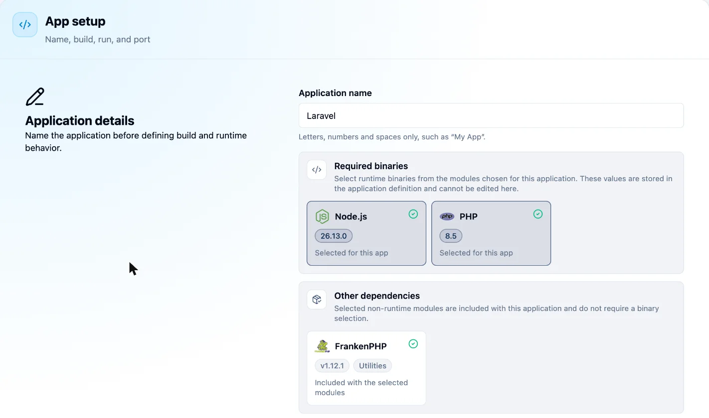

Tutorial ini membawa Anda dari akun dPanel yang masih kosong sampai aplikasi Laravel yang menjawab di domain Anda sendiri dengan HTTPS. Anda meluncurkan server Ubuntu, memasang PostgreSQL, PHP, FrankenPHP, dan Node.js di sana, membuat basis data, merilis repositori [dPanel-ID/laravel-example](https://github.com/dPanel-ID/laravel-example), lalu memasang load balancer di depannya.

dPanel mengenali repositori Laravel (ada file `artisan`) dan mengisi pengaturannya untuk Anda: runtime, build, perintah rilis, perintah start, dan pemeriksaan kesehatan. Anda memeriksanya dan mengubah yang perlu. Ada tiga hal yang perlu diketahui:

- **Laravel butuh dua runtime.** Build menjalankan Composer dengan PHP, lalu `npm` untuk membangun front end dengan Vite, jadi aplikasi mendeklarasikan PHP dan Node.js.
- **Migrasi berjalan di tahap rilis, bukan di build.** Setelah build dan sebelum restart, dPanel menjalankan `php artisan migrate --force` dan perintah rilis lainnya dengan variabel **runtime**, jadi pengaturan basis data cukup ada di satu tempat. Jika satu perintah rilis gagal, versi yang sudah berjalan tetap melayani.
- **dPanel menjaga application key.** dPanel membuat `APP_KEY` saat aplikasi dibuat dan tidak pernah menggantinya, jadi sesi dan data terenkripsi tetap aman di setiap rilis.

Waktunya sekitar 45 menit, sebagian besar untuk menunggu server dan pemasangan. Semua langkah dilakukan di aplikasi web dPanel; Anda tidak perlu SSH.

:::tip[Baru mengenal server?]
Baca [Cara situs web berjalan di server Anda](./how-a-website-runs.md) terlebih dulu. Halaman itu menjelaskan setiap istilah di sini, seperti modul, build, port, dan load balancer, dalam beberapa menit. Istilah lainnya ada di [Glosarium](../getting-started/glossary.md).
:::

## Yang perlu disiapkan

- Akun dPanel yang sudah masuk, di workspace yang ingin Anda pakai. Lihat [Masuk](../getting-started/sign-in.md).
- GitHub sudah terhubung dan punya akses ke repositori yang akan dirilis. Agar sama persis dengan tutorial ini, fork **dPanel-ID/laravel-example** ke akun Anda. Lihat [Hubungkan GitHub](../getting-started/connect-github.md).
- Sebuah server: akun cloud di dPanel untuk meluncurkannya, atau server milik Anda sendiri (VPS dengan IP publik, agar pengunjung bisa menjangkaunya) yang dihubungkan dengan [agen dPanel](../servers/register-a-private-machine.md). Lihat [Sebelum memulai](../servers/before-you-start.md).
- Domain di **Domain & DNS**, supaya dPanel bisa membuat record DNS-nya. Lihat [Domain dan DNS](../networking/domains-and-dns.md).

## Langkah 1: Luncurkan server

1. Buka **Server**, tekan **Buat Server**, lalu **Luncurkan server**.
2. Pilih **Provider** dan **Cloud project**, lalu **Region** yang dekat dengan pengguna Anda. Di **Cara dPanel terhubung**, biarkan **Agen dPanel** terpilih dan **Beri VM IP publik** menyala: situsnya butuh IP publik.
3. Isi **Server name**, misalnya `laravel-1`, biarkan **Ubuntu release** 24.04 LTS, lalu geser slider ke minimal **2 vCPU** dan RAM **4 GB**. Storage 30 GB sudah cukup.
4. Saat panel Review bertuliskan **Ready to launch**, tekan **Launch server**.

Tunggu sampai status server **Ready**, biasanya 10 sampai 20 menit. Lihat [Membuat server cloud](../servers/cloud-providers/create-a-cloud-server.md), atau [hubungkan server yang sudah Anda punya dengan agen dPanel](../servers/register-a-private-machine.md).

**Yang seharusnya Anda lihat:** server muncul di **Server** dengan status **Ready**.

## Langkah 2: Pasang PostgreSQL

1. Buka server, lalu tab **Modul**. Tekan **Add module**.
2. Tekan **Install** pada **PostgreSQL**. Catat pengguna administratornya dan isi kata sandinya, lalu simpan di tempat aman. Tekan **Install role** dan konfirmasi.

PHP, Node.js, dan FrankenPHP tidak perlu dipasang di sini: formulir aplikasi menawarkannya di langkah 3 dengan versi yang diminta repositori Anda. Lihat [Pasang perangkat lunak](../servers/install-software.md).

**Yang seharusnya Anda lihat:** PostgreSQL di tab **Modul**, berstatus **Terpasang**.

## Langkah 3: Buat dan rilis aplikasi

1. Buka **Aplikasi**, lalu tekan **Buat Aplikasi**.
2. **Repositori**: pilih akun GitHub Anda, cari `laravel-example`, pilih repositorinya, dan biarkan branch **main**. Panel **Laravel terdeteksi** muncul: dPanel membaca repositorinya (versi Laravel, versi PHP yang diminta, apakah memakai Octane, cara membangun front end) dan mengisi pengaturannya. Tekan **Lanjut**.
3. **Server & modul**: pilih server Anda. **Yang dibutuhkan aplikasi Laravel ini** berisi PHP (8.4, atau versi yang diminta `composer.json`), Node.js 22, dan FrankenPHP. Tekan **Pakai … di server ini** untuk yang sudah terpasang, atau **Tambah** untuk yang belum. Tidak ada yang ditambahkan sebelum Anda menekan tombol. Tekan **Lanjut**.
4. **Setup aplikasi**: formulirnya sudah terisi. Periksa:
   - **Nama aplikasi**: `Laravel` (huruf, angka, dan spasi saja).
   - **Binary yang dibutuhkan**: PHP dan Node.js sama-sama terpilih, yang membuat `npm` ada di path build. FrankenPHP muncul di **Other dependencies**.
   - **Langkah build**: `composer install --no-dev --optimize-autoloader --no-interaction --prefer-dist`, lalu `npm ci && npm run build` (pnpm atau yarn jika repositori memakainya). Build tidak butuh basis data maupun application key.
   - **Perintah runtime**: Laravel Octane di FrankenPHP untuk repositori ini (`php artisan octane:frankenphp …`). Aplikasi Laravel tanpa Octane memakai mode klasik FrankenPHP, yang menyajikan folder `public/`.
   - **Port aplikasi**: biarkan port kosong yang disarankan dPanel.
   - **Rilis dan proses**: **Perintah rilis** berisi `php artisan storage:link --force`, `php artisan migrate --force`, dan `php artisan optimize`. **Setelah restart** menjalankan `php artisan reload`. **Pemeriksaan kesehatan** membuka `/up`, halaman yang dijawab Laravel 11 ke atas. **Queue worker** dan **Scheduler** mati: nyalakan worker jika aplikasi Anda memakai antrean (antrean database bawaan Laravel membutuhkannya), dan scheduler jika aplikasi menjadwalkan tugas. Masing-masing memakai memori, jadi biarkan mati sampai Anda membutuhkannya.
   - **Folder rilis**: aktif. Setiap deploy dibangun di folder baru, dan situs Anda baru pindah ke folder itu setelah perintah rilis dan health check berhasil. `storage`, `.env`, dan `database/database.sqlite` disimpan di antara rilis, dan 3 rilis terakhir tetap ada di server untuk rollback satu klik. Lihat [Folder rilis](../applications/deployments-and-rollback.md#folder-rilis-deploy-tanpa-downtime).
5. **Environment**: **Variabel runtime** sudah berisi `APP_ENV=production`, `APP_DEBUG=false`, dan `LOG_CHANNEL=stderr` (serta pengaturan Octane). Lalu:
   - Tekan **Buat database** di **Database untuk aplikasi ini**, pilih **PostgreSQL**, biarkan nama yang disarankan dPanel, dan konfirmasi. dPanel membuat basis data dan penggunanya dengan kata sandi kuat, lalu menulis `DB_CONNECTION=pgsql` dan pengaturan `DB_*` lainnya ke **Variabel runtime**. Anda tidak pernah mengetik kata sandinya.
   - Tambahkan alamat Anda: `APP_URL=https://app.example.com`.
   - Biarkan **Variabel build-time** kosong, dan jangan tambahkan `APP_KEY`: dPanel yang membuatnya.
   - Opsional: tekan **Hubungkan Redis** jika Redis terpasang di server, untuk cache, antrean, dan sesi yang lebih cepat, atau **Gunakan object storage** untuk menyimpan unggahan di bucket. Lihat [Variabel environment](../applications/environment-variables.md#menghubungkan-redis).
6. **Pratinjau**: periksa ringkasannya. **Pemeriksaan awal** membandingkan yang diminta repositori (versi dan ekstensi PHP di `composer.json` dan `composer.lock`, versi Node.js di `package.json`) dengan pilihan Anda. Error, misalnya versi PHP yang tidak didukung aplikasi, menahan tombol rilis: perbaiki, atau centang **Tetap deploy** jika Anda yakin. Peringatan tidak menahan apa pun. Tekan **Rilis aplikasi**.

Build pertama memakan waktu 3 sampai 6 menit, lebih lama jika dPanel memasang PHP, Node.js, dan FrankenPHP dulu. Buka aplikasinya untuk memantau; statusnya **Running** saat rilis sudah aktif dan `/up` sudah menjawab. Lihat [Membuat aplikasi](../applications/create-an-application.md) dan [Variabel environment](../applications/environment-variables.md).

:::warning[npm: command not found]
Kalau log build berhenti di `npm: command not found`, Node.js belum dideklarasikan di aplikasi. Buka pengaturan aplikasi, tambahkan **nodejs** dengan versi yang terpasang di bagian bahasa tambahan, simpan, lalu rilis lagi.
:::

**Yang seharusnya Anda lihat:** aplikasi berstatus **Running**. Aplikasi belum ada di internet: itu langkah berikutnya.

## Langkah 4: Publikasikan di domain Anda dengan HTTPS

1. Buka **Load Balancer**, lalu tekan **Buat load balancer**. Formulirnya punya empat langkah: **Gateway**, **Domain**, **Routing**, dan **Review**.
2. **Gateway**: di **Server gateway**, pilih server yang sama. Di **Engine web server**, pilih **Caddy Server**, lalu tekan **Instal** kalau belum terpasang.
3. **Domain**: di **Nama Domain**, pilih **Terkelola**, ketik **Subdomain** (misalnya `app`), lalu **Pilih domain**. Kalau DNS domain Anda tidak berada di Cloudflare atau DigitalOcean, pilih **Eksternal**, ketik hostname Anda, dan tambahkan record yang ditampilkan formulir di penyedia DNS Anda.
4. **Routing**: biarkan **L7** di **Mode routing**, serta **HTTP / HTTPS** dengan **HTTPS** menyala di **Protokol dan HTTPS**. Di aturan pertama, atur **Tipe** ke **Aplikasi**, **Pola Jalur URL** ke `/*`, lalu pilih aplikasi **Laravel**.
5. **Review**: saat panel tinjauan bertuliskan **Siap dibuat**, tekan **Buat load balancer**.

Setelah satu atau dua menit, buka `https://app.example.com/`: halaman sambutan Laravel muncul. Lihat [Load balancer](../networking/load-balancers.md).

## Kalau ada yang tidak berjalan

| Yang Anda lihat                           | Yang perlu diperiksa                                                                                                                                                                     |
| ----------------------------------------- | ---------------------------------------------------------------------------------------------------------------------------------------------------------------------------------------- |
| `npm: command not found` di log build     | Deklarasikan Node.js di aplikasi, seperti pada peringatan di atas.                                                                                                                       |
| Perintah rilis gagal                      | Log deployment menampilkan perintah dan keluarannya; versi sebelumnya tetap melayani. Untuk `php artisan migrate`, pastikan **Variabel runtime** `DB_*` cocok dengan basis datanya.      |
| Deployment gagal di pemeriksaan kesehatan | Log menampilkan jawaban terakhir `/up` dan baris terakhir aplikasi. Status 500 sering berarti ada variabel yang kurang; baca [log runtime](../applications/application-logs.md).         |
| `MissingAppKeyException`                  | `APP_KEY` terhapus dari variabel runtime. Rilis lagi: dPanel membuatnya jika tidak ada. Sesi yang ditandatangani kunci lama berakhir.                                                    |
| Aplikasi berjalan lalu berhenti           | Baca log runtime-nya. Lihat [Log aplikasi](../applications/application-logs.md).                                                                                                         |
| Domain tidak menjawab                     | Tunggu beberapa menit untuk DNS dan sertifikat, lalu periksa halaman detail dan log load balancer. Banner merah **Perubahan load balancer gagal** punya tombol **Lihat penyebab gagal**. |
| Masalah lain                              | Lihat [Masalah umum dan solusinya](../troubleshooting/faq.md).                                                                                                                           |

Perubahan variabel berlaku mulai rilis berikutnya: rilis lagi setelah mengubahnya.

## Lebih suka mengobrol? Lakukan hal yang sama dengan Ask dPanel

[Ask dPanel](../ai/overview.md) bisa menyiapkan setiap langkah untuk Anda setujui. Sebutkan kedua runtime saat meminta asisten membuat aplikasi, misalnya:

> Buat aplikasi bernama Laravel dari github.com/my-org/laravel-example di server laravel-1. Bahasa PHP 8.5 dengan Node.js sebagai runtime tambahan, perintah build ./scripts/build.sh, perintah start ./scripts/start.sh.

Asisten meminta `DB_PASSWORD` sebagai kolom di kartu persetujuan, jadi kata sandinya tidak pernah masuk ke percakapan. dPanel membuat `APP_KEY` untuk repositori Laravel, dengan cara apa pun aplikasinya dibuat. Contoh permintaan lain ada di [Prompt cookbook](../ai/prompt-cookbook.md).

## Membersihkan

Hapus dengan urutan ini: load balancer, aplikasi, lalu server. Lihat [Load balancer](../networking/load-balancers.md#menghapus-load-balancer), [Mengubah atau menghapus aplikasi](../applications/update-or-delete.md), dan [Menghapus server](../servers/delete-a-server.md).

## Pertanyaan yang sering diajukan

### Mengapa aplikasinya butuh Node.js padahal Laravel memakai PHP?

Build menjalankan `npm` untuk membundel front end dengan Vite. dPanel hanya menaruh runtime yang dideklarasikan pada aplikasi di path build, jadi Node.js harus dideklarasikan di samping PHP.

### Apakah variabel basis data juga dimasukkan ke variabel build-time?

Tidak. Build hanya memasang paket dan membangun front end. Migrasi berjalan sebagai perintah rilis, dengan **Variabel runtime**, jadi pengaturan `DB_*` cukup ada di sana.

### Bisakah saya mengubah presetnya?

Bisa. Setiap kolom yang diisi preset tetap bisa diubah di formulir, dan nanti di **Pengaturan** aplikasi, di bagian **Rilis dan proses**. dPanel menerapkan preset sekali, saat Anda memilih repositori dan branch.

### Bisakah menjalankan queue worker atau scheduler nanti?

Bisa. Buka **Pengaturan** aplikasi, tekan **Ubah** di **Rilis dan proses**, lalu tambahkan proses: **service** untuk `php artisan queue:work`, atau **schedule** untuk `php artisan schedule:run`. Proses mulai berjalan di deployment berikutnya.

### Bisakah memakai MariaDB, bukan PostgreSQL?

Bisa. Pasang **MariaDB**, buat basis data dari halaman **Kelola**-nya, lalu atur `DB_CONNECTION=mysql` dan `DB_PORT=3306`.

### Bagaimana cara rollback deploy yang bermasalah?

Buka tab **Rilis** aplikasi, pindah ke **Di server**, lalu tekan **Rollback** pada rilis sebelumnya di **Rilis di server ini**. Prosesnya hanya beberapa detik. Migrasi database tidak dibatalkan. Lihat [Rollback ke rilis sebelumnya](../applications/deployments-and-rollback.md#rollback-ke-rilis-sebelumnya).
