Tutorial ini membawa Anda dari akun dPanel yang masih kosong sampai situs WordPress yang menjawab di domain Anda sendiri dengan HTTPS. Anda meluncurkan server Ubuntu, memasang MariaDB, PHP, dan FrankenPHP di sana, membuat basis data, merilis WordPress dari repositori GitHub, lalu memasang load balancer di depannya.

Semua tangkapan layar di halaman ini berasal dari satu kali menjalankan langkah-langkah ini sungguhan, yang memublikasikan WordPress di subdomain seperti `blog.example.com`. Waktunya sekitar 30 menit, sebagian besar untuk menunggu server dan pemasangan. Semuanya dilakukan di aplikasi web dPanel; Anda tidak perlu SSH.

:::tip[Baru mengenal server?]
Baca [Cara situs web berjalan di server Anda](./how-a-website-runs.md) terlebih dulu. Halaman itu menjelaskan setiap istilah di sini, seperti modul, build, port, dan load balancer, dalam beberapa menit. Istilah lainnya ada di [Glosarium](../getting-started/glossary.md).
:::

## Repositori yang dirilis tutorial ini

**[github.com/dPanel-ID/wordpress-example](https://github.com/dPanel-ID/wordpress-example)**

Inilah kode yang dipasang dPanel di server Anda. Isinya instalasi WordPress biasa dengan tiga tambahan supaya berjalan baik di belakang dPanel:

| Berkas             | Fungsinya                                                                                                                                                                                                                                                                                                                  |
| ------------------ | -------------------------------------------------------------------------------------------------------------------------------------------------------------------------------------------------------------------------------------------------------------------------------------------------------------------------- |
| `wp-config.php`    | Membaca pengaturan basis data dan alamat situs dari variabel environment (`WORDPRESS_DB_HOST`, `WORDPRESS_HOME`, dan seterusnya), jadi tidak ada kata sandi yang tersimpan di repositori. Berkas ini juga memercayai header `X-Forwarded-Proto` dari load balancer, sehingga WordPress tahu pengunjung datang lewat HTTPS. |
| `scripts/build.sh` | **Langkah build**. Skrip ini menulis konfigurasi FrankenPHP yang menyajikan WordPress di port yang diberikan dPanel, dan menolak permintaan ke berkas `.env`, `.git`, `.sql`, `.sh`, serta berkas PHP di dalam `wp-content/uploads`.                                                                                       |
| `scripts/start.sh` | **Perintah runtime**. Skrip ini menjalankan FrankenPHP dengan konfigurasi tersebut. dPanel menjalankannya sebagai layanan dan menyalakannya lagi kalau berhenti.                                                                                                                                                           |

`.env.example` berisi daftar semua variabel yang dibaca WordPress, dan `docker-compose.yml` menyalakan MariaDB kalau Anda ingin mencoba situsnya di komputer sendiri dulu; dPanel tidak memakai keduanya.

**Fork dulu sebelum mulai.** dPanel hanya bisa merilis repositori yang terlihat oleh koneksi GitHub Anda, jadi tekan **Fork** di halaman repositori untuk menyalinnya ke akun atau organisasi GitHub Anda. Fork itu juga tempat perubahan tema dan plugin Anda nanti.

## Yang perlu disiapkan

- Akun dPanel yang sudah masuk, di workspace yang ingin Anda pakai. Lihat [Masuk](../getting-started/sign-in.md).
- GitHub sudah terhubung, dan fork **wordpress-example** milik Anda. Lihat [Hubungkan GitHub](../getting-started/connect-github.md).
- Sebuah server: akun cloud di dPanel untuk meluncurkannya, atau server milik Anda sendiri (VPS dengan IP publik, agar pengunjung bisa menjangkaunya) yang dihubungkan dengan [agen dPanel](../servers/register-a-private-machine.md). Lihat [Sebelum memulai](../servers/before-you-start.md).
- Domain di **Domain & DNS**, supaya dPanel bisa membuat record DNS-nya. Lihat [Domain dan DNS](../networking/domains-and-dns.md). Tutorial ini memakai subdomain, misalnya `blog.example.com`, dan tidak mengubah domain utamanya.

## Langkah 1: Luncurkan server

1. Buka **Server**, tekan **Buat Server**, lalu **Luncurkan server**.
2. Pilih **Provider**, **Cloud project**, dan **Region** yang dekat dengan pengunjung Anda.
3. Di **Cara dPanel terhubung**, biarkan **Agen dPanel** terpilih. Di **IP publik**, biarkan **Beri VM IP publik** menyala: pengunjung menjangkau situs lewat IP itu.

   

4. Isi **Server name**, misalnya `wordpress-1`, biarkan **Ubuntu 24.04 LTS**, lalu atur ukurannya minimal **2** core CPU dan RAM **4 GB**. Storage **20 GB** cukup untuk memulai.

   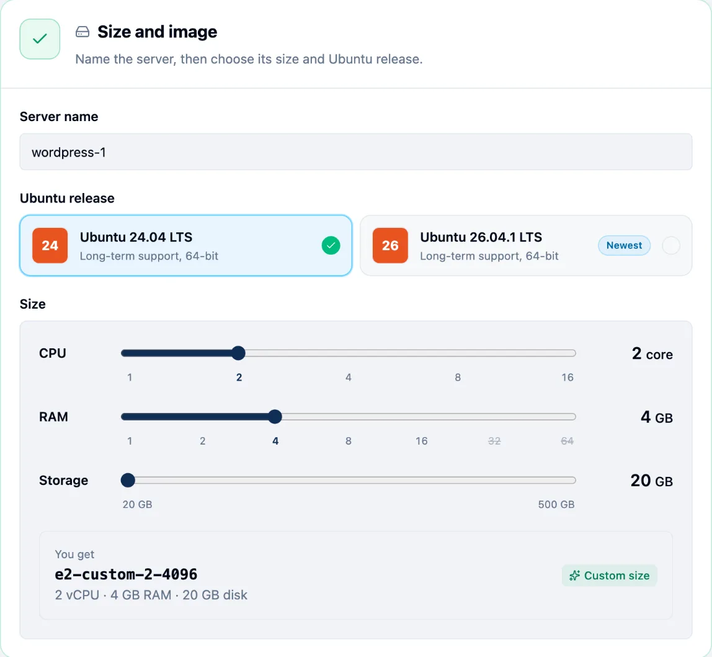

5. Saat panel review bertuliskan **Ready to launch**, tekan **Launch server**.

Server muncul di daftar. Tunggu sampai statusnya **Ready**, biasanya 5 sampai 15 menit. Formulir lengkapnya dijelaskan di [Membuat server cloud](../servers/cloud-providers/create-a-cloud-server.md). Sudah punya mesin sendiri? [Hubungkan dengan agen dPanel](../servers/register-a-private-machine.md) saja, lalu lewati langkah ini.

**Yang seharusnya Anda lihat:** server muncul di **Server** dengan status **Ready**.

## Langkah 2: Pasang MariaDB, PHP, dan FrankenPHP

WordPress butuh tiga perangkat lunak, yang di dPanel disebut **modul**: basis data (MariaDB), bahasa PHP, dan web server yang menjalankan PHP (FrankenPHP).

1. Buka server, lalu tab **Modul**. Tekan **Tambah modul**.
2. Tekan **Install** pada **MariaDB**. Di formulirnya:
   - **MariaDB Version**: biarkan bawaannya.
   - **Root Password**: minimal 8 karakter. Simpan di pengelola kata sandi Anda; dPanel tidak menampilkannya lagi, dan WordPress tidak memakainya.
   - **Bind Address**: ganti menjadi `127.0.0.1`, agar basis data hanya menjawab program di server ini dan tidak pernah terbuka ke internet.

   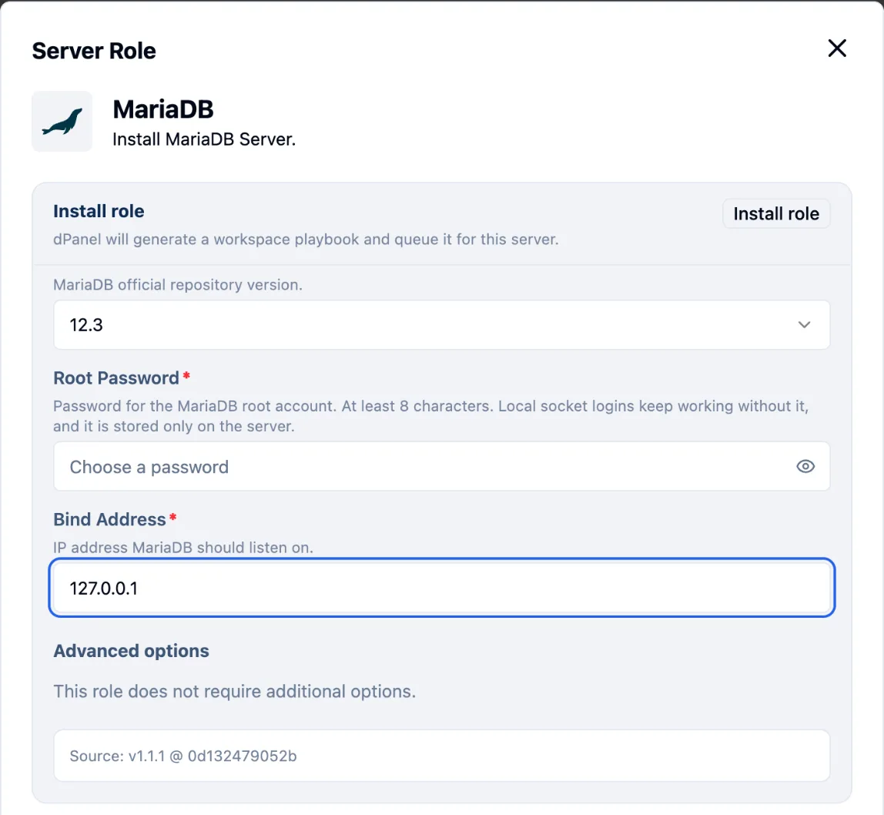

   Tekan **Install role** dan konfirmasi. Butuh sekitar 3 menit.

3. Setelah MariaDB berstatus **Terpasang**, tekan **Tambah modul** lagi dan pasang **PHP** dengan **PHP Version** `8.5`. Sekitar 2 menit.
4. Lalu pasang **FrankenPHP** dengan versi bawaannya. Kurang dari satu menit.

Pasang satu modul setiap kali dan biarkan selesai: dPanel menjalankan pemasangan di sebuah server secara bergantian, dan tab **Modul** menampilkan tiap modul dari proses pemasangan sampai **Terpasang**. Lihat [Pasang perangkat lunak](../servers/install-software.md).

**Yang seharusnya Anda lihat:** MariaDB, PHP, dan FrankenPHP di tab **Modul**, masing-masing berstatus **Terpasang**.

## Langkah 3: Buat basis data WordPress

WordPress menyimpan pos, halaman, pengguna, dan pengaturan di basis datanya sendiri, yang dijangkau dengan penggunanya sendiri, jadi tidak pernah butuh root password.

1. Di tab **Modul**, tekan **Tambah modul**, lalu **Kelola** pada **MariaDB**.
2. Di bagian **Database**, tekan **Create database**.
3. Isi **Database Name** `wordpress`, **Database User** `wp`, dan **Database Password** minimal 8 karakter. Salin kata sandinya: Anda membutuhkannya di langkah 4.

   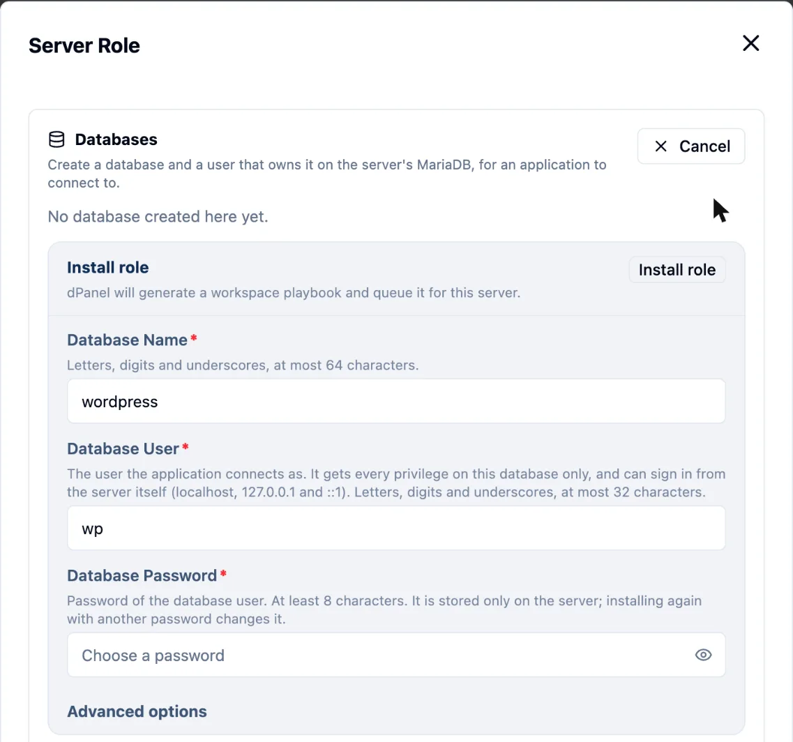

4. Tekan **Install role** dan konfirmasi.

Pengguna `wp` mendapat semua hak atas basis data `wordpress` dan tidak ada yang lain, dan hanya bisa masuk dari server itu sendiri, persis seperti cara WordPress terhubung.

**Yang seharusnya Anda lihat:** `wordpress` tampil di **Database**, dan kata sandinya sudah tersimpan di tempat aman.

## Langkah 4: Buat dan rilis aplikasi

1. Buka **Aplikasi**, lalu tekan **Buat Aplikasi**. Formulirnya punya lima langkah.
2. **Repositori**: pilih akun GitHub tempat fork Anda, cari `wordpress`, pilih **wordpress-example**, dan biarkan branch **main**. Tekan **Lanjut**.

   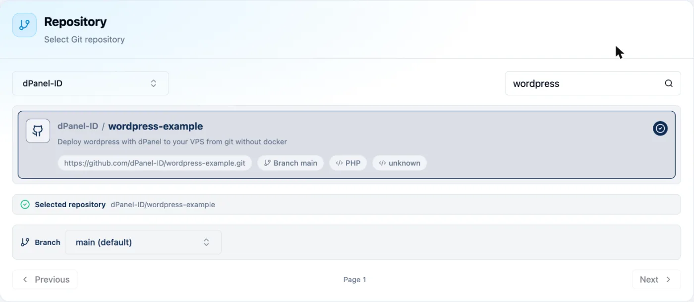

3. **Server & modul**: pilih server Anda. Di **Terinstal di server terpilih**, pilih **PHP** dan **FrankenPHP** agar dipakai aplikasi. Biarkan **MariaDB** tidak terpilih: aplikasi berbicara dengan basis data, tetapi tidak berjalan di dalamnya. Tekan **Lanjut**.

   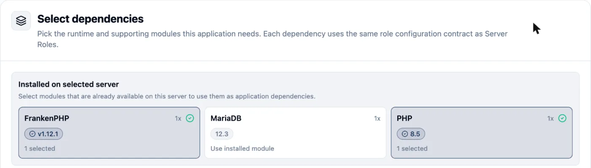

4. **Setup aplikasi**:
   - **Nama aplikasi**: `WordPress` (huruf, angka, dan spasi saja).
   - **Binary yang dibutuhkan** menampilkan **PHP 8.5**, dan **Dependency lainnya** menampilkan **FrankenPHP**, dari langkah sebelumnya.
   - **Langkah build**: `./scripts/build.sh`.
   - **Perintah runtime**: `./scripts/start.sh`.
   - **Port aplikasi**: biarkan port kosong yang disarankan dPanel. **Port yang sudah dipakai** menunjukkan port yang harus dihindari.

   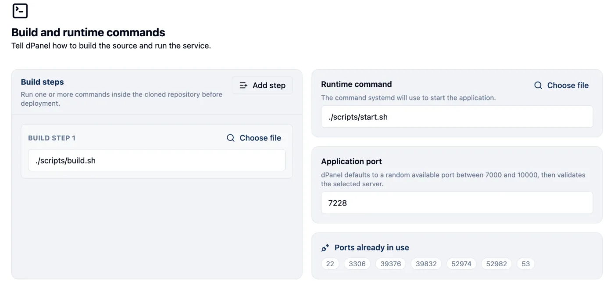

5. **Environment**: biarkan variabel build-time kosong. Di **Variabel runtime**, tempel daftar di bawah, lalu ganti kata sandinya dengan yang dari langkah 3 dan kedua alamatnya dengan domain yang akan Anda publikasikan di langkah 5.

   ```text
   WORDPRESS_DB_HOST=127.0.0.1:3306
   WORDPRESS_DB_NAME=wordpress
   WORDPRESS_DB_USER=wp
   WORDPRESS_DB_PASSWORD=kata-sandi-dari-langkah-3
   WORDPRESS_TABLE_PREFIX=wp_
   WORDPRESS_HOME=https://blog.example.com
   WORDPRESS_SITEURL=https://blog.example.com
   WORDPRESS_MEMORY_LIMIT=256M
   ```

   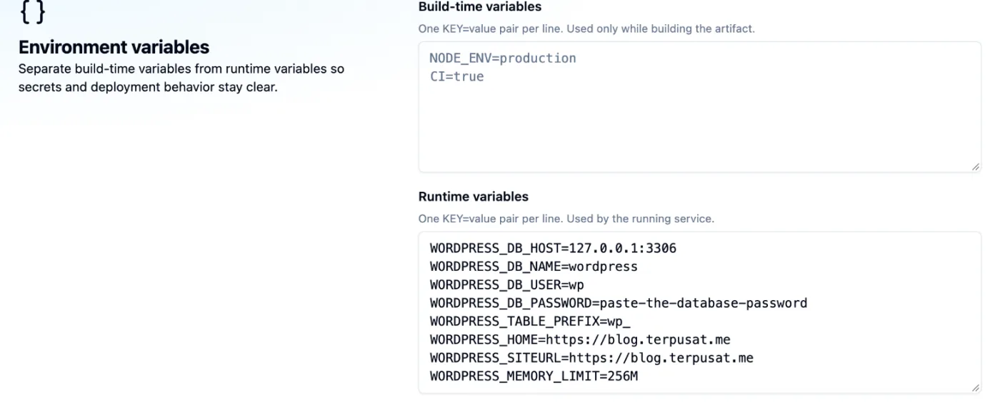

6. **Pratinjau**: periksa ringkasannya, lalu tekan **Rilis aplikasi**.

dPanel menyalin repositori Anda ke server, menjalankan `./scripts/build.sh`, dan menjalankan WordPress sebagai layanan. Buka aplikasinya untuk memantau build; rilisnya aktif dalam sekitar 2 menit. Lihat [Membuat aplikasi](../applications/create-an-application.md) dan [Variabel environment](../applications/environment-variables.md).

**Yang seharusnya Anda lihat:** deployment aplikasi saat ini berstatus siap, dengan **1** di **Serving now**. Aplikasi belum ada di internet: itu langkah berikutnya.

## Langkah 5: Publikasikan di domain Anda dengan HTTPS

Load balancer adalah pintu depan: ia menjawab pengunjung di domain Anda, mengurus HTTPS, dan meneruskan setiap permintaan ke WordPress.

1. Buka **Load Balancer**, lalu tekan **Buat load balancer**. Formulirnya punya empat langkah: **Gateway**, **Domain**, **Routing**, dan **Review**.
2. **Gateway**: di **Server gateway**, pilih server yang sama. Di **Engine web server**, tekan **Install** pada **Caddy Server**, biarkan bawaannya, tekan **Install role**, lalu konfirmasi. Setelah sekitar satu menit, tekan **Segarkan** lalu pilih **Caddy Server**. Tekan **Lanjut**.

   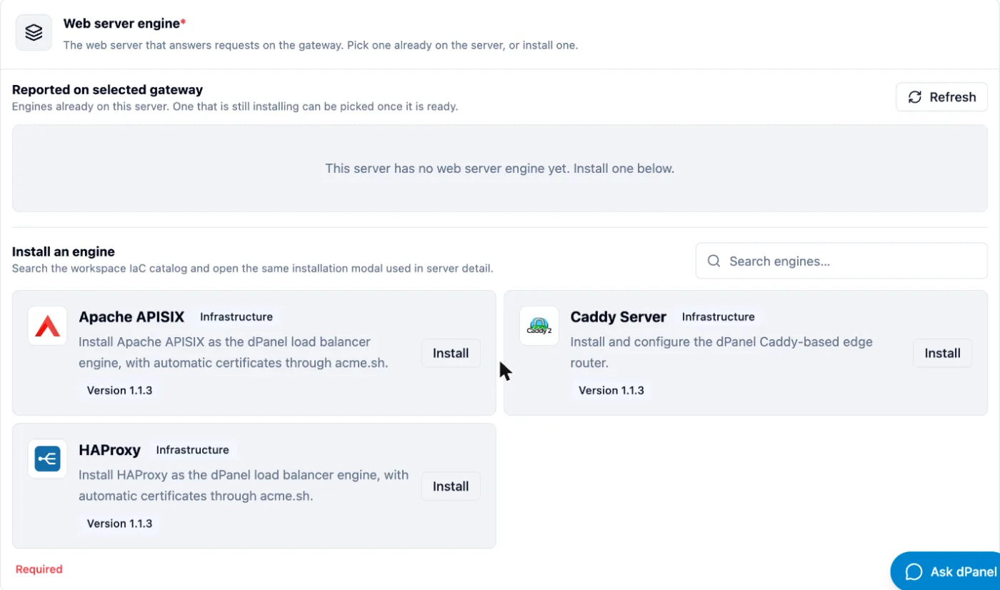

3. **Domain**: pilih **Terkelola**, ketik subdomainnya, misalnya `blog`, lalu pilih domain Anda di **Pilih domain**. Formulir menampilkan record DNS yang akan dibuat dPanel. Biarkan **Proxy lewat Cloudflare** mati. Tekan **Lanjut**.

   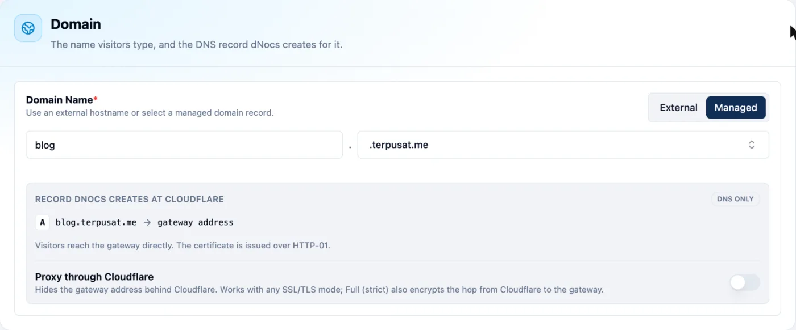

   Kalau DNS domain Anda tidak berada di Cloudflare atau DigitalOcean, pilih **Eksternal**, ketik hostname lengkapnya, dan tambahkan record yang ditampilkan formulir di penyedia DNS Anda.

4. **Routing**: biarkan **L7**. Di **Rule #01**, atur **Tipe** ke **Aplikasi**, biarkan **Pola Jalur URL** `/*`, lalu pilih **WordPress**. Di **Cara gateway menjangkau aplikasi ini**, **Alamat terdaftar** menampilkan `localhost` dan port aplikasi, bertanda **Same server**. Biarkan **HTTPS** menyala. Tekan **Lanjut**.

   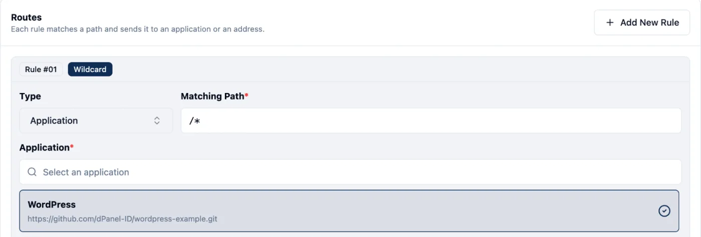

5. **Review**: periksa ringkasannya, lalu tekan **Buat load balancer**.

dPanel membuat record DNS, menulis rute ke Caddy, dan meminta sertifikat Let's Encrypt gratis. Load balancer berstatus **Ready** dalam satu atau dua menit. Lihat [Load balancer](../networking/load-balancers.md).

## Langkah 6: Selesaikan pemasangan WordPress

Buka alamat Anda, misalnya `https://blog.example.com`. WordPress menampilkan penginstalnya, yang membuktikan koneksi basis data berjalan.

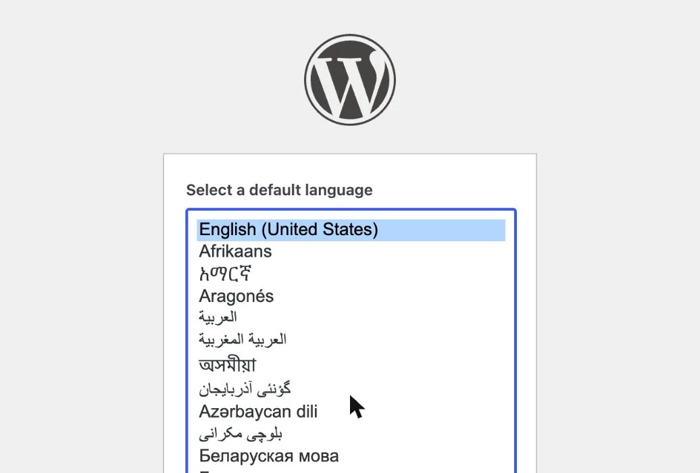

Pilih bahasa, lalu isi judul situs serta nama pengguna, kata sandi, dan email admin Anda. Tekan **Install WordPress**, lalu masuk di `/wp-admin`. Situs Anda sudah aktif.

## Unggahan, plugin, dan tema Anda

WordPress menyimpan dua jenis berkas, dan rilis baru memperlakukannya secara berbeda:

- **Berkas yang ada di repositori Anda** kembali ke versi repositori pada setiap rilis dan rollback. Suntingan di editor tema wp-admin akan hilang kalau berkas itu ada di repositori, jadi lakukan perubahannya di fork Anda.
- **Berkas yang tidak ada di repositori Anda**, seperti `wp-content/uploads`, atau plugin dan tema yang Anda pasang dari wp-admin, tetap di tempatnya. Rilis atau rollback tidak menyentuhnya.

Pos dan pengaturan Anda ada di basis data, yang juga tidak disentuh oleh rilis. Menghapus aplikasi akan menghapus foldernya beserta seluruh isinya, jadi cadangkan dulu `wp-content` dan basis datanya.

## Kalau ada yang tidak berjalan

| Yang Anda lihat                                  | Yang perlu diperiksa                                                                                                                                                                                                   |
| ------------------------------------------------ | ---------------------------------------------------------------------------------------------------------------------------------------------------------------------------------------------------------------------- |
| Modul tidak kunjung selesai dipasang, atau gagal | Buka **Log** server, atau tanyakan ke asisten kenapa job-nya gagal. Pasang ulang modulnya setelah penyebabnya diperbaiki.                                                                                              |
| `wordpress-example` tidak ada di daftar          | Pilih akun GitHub tempat fork Anda. Kalau belum di-fork, fork dulu, lalu cari lagi.                                                                                                                                    |
| Build gagal                                      | Buka aplikasinya dan baca log build dari rilis yang gagal. Lihat [Log aplikasi](../applications/application-logs.md).                                                                                                  |
| "Error establishing a database connection"       | Keempat variabel `WORDPRESS_DB_*` harus cocok dengan basis data dari langkah 3. Perbaiki di **Pengaturan** aplikasi, lalu rilis lagi: variabel yang diubah sampai ke server pada rilis berikutnya, bukan saat restart. |
| Situs mengarahkan ke alamat yang salah           | `WORDPRESS_HOME` dan `WORDPRESS_SITEURL` harus sama persis dengan alamat yang dipakai pengunjung, dengan `https://`. Perbaiki, lalu rilis lagi.                                                                        |
| Domain tidak menjawab                            | Tunggu beberapa menit untuk DNS dan sertifikat. Periksa halaman detail load balancer dan log-nya. Banner merah **Perubahan load balancer gagal** punya tombol **Lihat penyebab gagal**.                                |
| Masalah lain                                     | Lihat [Masalah umum dan solusinya](../troubleshooting/faq.md).                                                                                                                                                         |

## Langkah yang sama dari terminal

[CLI dnocs](../ai/ai-in-the-terminal.md) bisa mengerjakan langkah 2 dan 3 tanpa formulir web, dan membuatkan kata sandinya tanpa menampilkannya:

```bash
dnocs module install mariadb --server-id 304 --var mariadb.mariadb_bind_address=127.0.0.1 --generate-secrets
dnocs module install php frankenphp --server-id 304 --var php.php_version=8.5
dnocs module install mariadb-database --server-id 304 --var mariadb-database.database_name=wordpress --var mariadb-database.database_user=wp --generate-secrets
```

Ganti `304` dengan ID server Anda dan, di bawah, `97` dengan ID aplikasi Anda (`dnocs server list` dan `dnocs application list` menampilkannya). `--generate-secrets` menyimpan setiap kata sandi ke berkas di `~/.devetek/module-secrets/` yang hanya bisa dibaca oleh Anda. Untuk memberikan kata sandi basis data ke aplikasi tanpa mengetiknya, alirkan lewat `--value-stdin`, lalu rilis agar server menerimanya:

```bash
dnocs application env set --id 97 WORDPRESS_DB_PASSWORD --value-stdin < password.txt
dnocs application deploy --id 97 --server-id 304 --branch main
```

## Lebih suka mengobrol? Lakukan hal yang sama dengan Ask dPanel

[Ask dPanel](../ai/overview.md), asisten di kanan bawah setiap halaman, bisa menyiapkan setiap langkah di atas untuk Anda setujui, misalnya:

> Di server wordpress-1, buat basis data MariaDB bernama wordpress dengan pengguna bernama wp.

Asisten membuatkan kata sandi basis data dan menampilkannya sekali, di kartu persetujuan. Saat membuat aplikasi, asisten meminta `WORDPRESS_DB_PASSWORD` sebagai kolom di kartu persetujuan, jadi kata sandinya tidak pernah masuk ke percakapan. Contoh permintaan lain ada di [Prompt cookbook](../ai/prompt-cookbook.md).

## Membersihkan

Untuk menghapus demo, hapus dengan urutan ini: load balancer, aplikasi, lalu server. Lihat [Load balancer](../networking/load-balancers.md#menghapus-load-balancer), [Mengubah atau menghapus aplikasi](../applications/update-or-delete.md), dan [Menghapus server](../servers/delete-a-server.md). Menghapus server cloud juga menghentikan biayanya di penyedia.

## Pertanyaan yang sering diajukan

### Apakah saya harus mem-fork repositorinya?

Ya. dPanel merilis dari repositori yang terlihat oleh koneksi GitHub Anda, dan fork juga tempat untuk tema dan plugin Anda sendiri. Repositori aslinya tetap seperti semula.

### Bisakah saya memakai repositori WordPress sendiri, bukan contoh ini?

Bisa, asalkan repositorinya punya skrip build dan skrip start yang menjalankan WordPress di port yang diberikan dPanel, serta `wp-config.php` yang membaca pengaturannya dari variabel environment. Salin `scripts/` dan `wp-config.php` dari repositori contoh supaya cepat.

### Apakah saya perlu domain untuk mencobanya?

Domain dibutuhkan di langkah 5, saat load balancer memublikasikan situs dengan HTTPS. Langkah 1 sampai 4 bisa dikerjakan tanpa domain.

### Mengapa bind address diatur ke 127.0.0.1?

WordPress berjalan di server yang sama dengan MariaDB, jadi basis data tidak perlu mendengarkan internet. Dengan `127.0.0.1`, hanya program di server itu yang bisa menjangkaunya, sehingga satu jalan masuk yang umum dipakai penyerang tertutup.

### Mengapa modul dipasang satu per satu?

dPanel memang menjalankan pemasangan di sebuah server secara bergantian. Dengan menunggu setiap modul berstatus **Terpasang**, Anda mudah melihat mana yang gagal, kalau ada.
