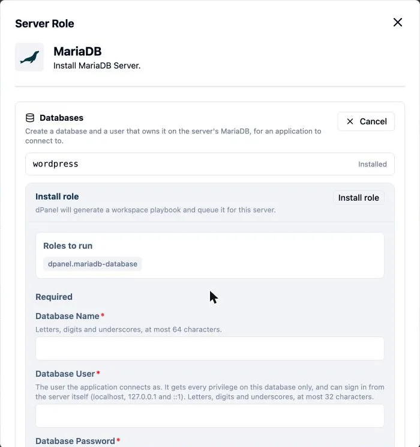

Tutorial ini membawa Anda dari akun dPanel yang masih kosong sampai situs WordPress yang menjawab di domain Anda sendiri dengan HTTPS. Anda meluncurkan server Ubuntu, memasang MariaDB, PHP, dan FrankenPHP di sana, membuat basis data untuk WordPress, merilis repositori [dPanel-ID/wordpress-example](https://github.com/dPanel-ID/wordpress-example), lalu memasang load balancer di depannya.

Waktunya sekitar 40 menit, sebagian besar untuk menunggu server dan pemasangan. Semua langkah dilakukan di aplikasi web dPanel; Anda tidak perlu SSH.

:::tip[Baru mengenal server?]
Baca [Cara situs web berjalan di server Anda](./how-a-website-runs.md) terlebih dulu. Halaman itu menjelaskan setiap istilah di sini, seperti modul, build, port, dan load balancer, dalam beberapa menit. Istilah lainnya ada di [Glosarium](../getting-started/glossary.md).
:::

## Yang perlu disiapkan

- Akun dPanel yang sudah masuk, di workspace yang ingin Anda pakai. Lihat [Masuk](../getting-started/sign-in.md).
- GitHub sudah terhubung dan punya akses ke repositori yang akan dirilis. Agar sama persis dengan tutorial ini, fork **dPanel-ID/wordpress-example** ke akun Anda. Lihat [Hubungkan GitHub](../getting-started/connect-github.md).
- Sebuah server: akun cloud di dPanel untuk meluncurkannya, atau server milik Anda sendiri (VPS dengan IP publik, agar pengunjung bisa menjangkaunya) yang dihubungkan dengan [agen dPanel](../servers/register-a-private-machine.md). Lihat [Sebelum memulai](../servers/before-you-start.md).
- Domain di **Domain & DNS**, supaya dPanel bisa membuat record DNS-nya. Lihat [Domain dan DNS](../networking/domains-and-dns.md).

## Langkah 1: Luncurkan server

1. Buka **Server**, tekan **Buat Server**, lalu **Luncurkan server**.
2. Pilih **Provider** dan **Cloud project**.
3. Pilih **Region** yang dekat dengan pengunjung Anda. Di **Cara dPanel terhubung**, biarkan **Agen dPanel** terpilih dan **Beri VM IP publik** menyala: situsnya butuh IP publik.
4. Isi **Server name**, misalnya `wordpress-1`, biarkan **Ubuntu release** 24.04 LTS, lalu geser slider ke minimal **2 vCPU** dan RAM **4 GB**. Storage 30 GB sudah cukup.
5. Saat panel Review bertuliskan **Ready to launch**, tekan **Launch server**.


Server muncul di daftar. Tunggu sampai statusnya **Ready**, biasanya 10 sampai 20 menit. Formulir lengkapnya dijelaskan di [Membuat server cloud](../servers/cloud-providers/create-a-cloud-server.md). Sudah punya mesin sendiri? [Hubungkan dengan agen dPanel](../servers/register-a-private-machine.md) saja, lalu lewati langkah ini.

**Yang seharusnya Anda lihat:** server muncul di **Server** dengan status **Ready**.

## Langkah 2: Pasang MariaDB, PHP, dan FrankenPHP

WordPress butuh basis data (MariaDB), bahasa PHP, dan web server yang menjalankan PHP (FrankenPHP).

1. Buka server, lalu tab **Modul**. Tekan **Add module**.
2. Tekan **Install** pada **MariaDB**. Isi **Root Password** minimal 8 karakter lalu simpan di tempat aman, karena dPanel tidak menampilkannya lagi. Atur **Bind Address** ke `127.0.0.1` agar basis data hanya bisa dijangkau dari server ini. Tekan **Install role** dan konfirmasi.
3. Tunggu sampai MariaDB berstatus **Terpasang**. Lalu pasang **PHP** dengan **PHP Version** `8.5`.
4. Setelah PHP terpasang, pasang **FrankenPHP**.


Pasang satu modul setiap kali dan biarkan selesai: dPanel mengantrekan pemasangan, dan tab **Modul** menampilkan tiap modul dari proses pemasangan sampai **Terpasang**. Lihat [Pasang perangkat lunak](../servers/install-software.md).

**Yang seharusnya Anda lihat:** MariaDB, PHP, dan FrankenPHP di tab **Modul**, masing-masing berstatus **Terpasang**.

## Langkah 3: Buat basis data WordPress

1. Di tab **Modul**, tekan **Add module**, lalu **Manage** pada **MariaDB**.
2. Di bagian **Databases**, tekan **Create database**.
3. Isi **Database Name** `wordpress`, **Database User** `wp`, dan **Database Password** minimal 8 karakter. Salin kata sandinya: Anda membutuhkannya di langkah 4.
4. Tekan **Install role**.



Setelah selesai, `wordpress` tampil di **Databases**. Pengguna `wp` hanya bisa menjangkau basis data ini, dari server itu sendiri, yaitu cara WordPress terhubung.

**Yang seharusnya Anda lihat:** `wordpress` tampil di **Databases**, dan kata sandinya sudah tersimpan di tempat aman.

## Langkah 4: Buat dan rilis aplikasi

1. Buka **Aplikasi**, lalu tekan **Buat Aplikasi**.
2. **Repositori**: pilih akun GitHub Anda, cari `wordpress-example`, pilih repositorinya, biarkan branch **main**, lalu tekan **Lanjut**.
3. **Server & modul**: pilih server Anda. Di **Terinstal di server terpilih**, pilih **PHP** dan **FrankenPHP** agar dipakai ulang, bukan dipasang lagi. Tekan **Lanjut**.
4. **Setup aplikasi**:
   - **Nama aplikasi**: `WordPress` (huruf, angka, dan spasi saja).
   - **Binary yang dibutuhkan**: **php 8.5**.
   - **Langkah build**: `./scripts/build.sh`.
   - **Perintah runtime**: `./scripts/start.sh`.
   - **Port aplikasi**: biarkan port kosong yang disarankan dPanel.
5. **Environment**: di **Variabel runtime**, tempel daftar di bawah. Ganti kata sandinya dengan yang dari langkah 3, dan alamatnya dengan domain yang akan Anda publikasikan di langkah 5.

   ```text
   WORDPRESS_DB_HOST=127.0.0.1:3306
   WORDPRESS_DB_NAME=wordpress
   WORDPRESS_DB_USER=wp
   WORDPRESS_DB_PASSWORD=kata-sandi-dari-langkah-3
   WORDPRESS_TABLE_PREFIX=wp_
   WORDPRESS_HOME=https://blog.example.com
   WORDPRESS_SITEURL=https://blog.example.com
   WORDPRESS_MEMORY_LIMIT=256M
   ```

6. **Pratinjau**: periksa ringkasannya, lalu tekan **Rilis aplikasi**.


dPanel meng-clone repositori di server, menjalankan build, dan menjalankan WordPress sebagai layanan. Buka aplikasinya untuk memantau build; statusnya **Running** saat rilis sudah aktif, biasanya 2 sampai 5 menit. Lihat [Membuat aplikasi](../applications/create-an-application.md) dan [Variabel environment](../applications/environment-variables.md).

**Yang seharusnya Anda lihat:** aplikasi berstatus **Running**. Aplikasi belum ada di internet: itu langkah berikutnya.

## Langkah 5: Publikasikan di domain Anda dengan HTTPS

1. Buka **Load Balancer**, lalu tekan **Buat load balancer**. Formulirnya punya empat langkah: **Gateway**, **Domain**, **Routing**, dan **Review**.
2. **Gateway**: di **Server gateway**, pilih server yang sama. Di **Engine web server**, pilih **Caddy Server**, lalu tekan **Instal** kalau belum terpasang.
3. **Domain**: di **Nama Domain**, pilih **Terkelola**, ketik **Subdomain** (misalnya `blog`), lalu **Pilih domain**. Kalau DNS domain Anda tidak berada di Cloudflare atau DigitalOcean, pilih **Eksternal**, ketik hostname Anda, dan tambahkan record yang ditampilkan formulir di penyedia DNS Anda.
4. **Routing**: biarkan **L7** di **Mode routing**, serta **HTTP / HTTPS** dengan **HTTPS** menyala di **Protokol dan HTTPS**. Di aturan pertama, atur **Tipe** ke **Aplikasi**, **Pola Jalur URL** ke `/*`, lalu pilih aplikasi **WordPress**.
5. **Review**: saat panel tinjauan bertuliskan **Siap dibuat**, tekan **Buat load balancer**.


dPanel membuat record DNS, menyiapkan gateway, dan meminta sertifikat Let's Encrypt gratis. Setelah satu atau dua menit, buka `https://blog.example.com/wp-admin/install.php`: penginstal WordPress muncul. Pilih bahasa, judul situs, dan akun admin Anda, dan situs Anda aktif. Lihat [Load balancer](../networking/load-balancers.md).

## Unggahan, plugin, dan tema Anda

WordPress menyimpan dua jenis berkas, dan rilis baru memperlakukannya secara berbeda:

- **Berkas yang ada di repositori Anda** kembali ke versi repositori pada setiap rilis dan rollback. Suntingan di editor tema wp-admin akan hilang kalau berkas itu ada di repositori, jadi lakukan perubahannya di repositori Anda.
- **Berkas yang tidak ada di repositori Anda**, seperti `wp-content/uploads`, atau plugin dan tema yang Anda pasang dari wp-admin, tetap di tempatnya. Rilis atau rollback tidak menyentuhnya.

Pos dan pengaturan Anda ada di basis data, yang juga tidak disentuh oleh rilis. Menghapus aplikasi akan menghapus foldernya beserta seluruh isinya, jadi cadangkan dulu `wp-content` dan basis datanya.

## Kalau ada yang tidak berjalan

| Yang Anda lihat                                  | Yang perlu diperiksa                                                                                                                                                                    |
| ------------------------------------------------ | --------------------------------------------------------------------------------------------------------------------------------------------------------------------------------------- |
| Modul tidak kunjung selesai dipasang, atau gagal | Buka **Log** server, atau tanyakan ke asisten kenapa job-nya gagal. Pasang ulang modulnya setelah penyebabnya diperbaiki.                                                               |
| Build gagal                                      | Buka aplikasinya dan baca log build dari rilis yang gagal. Lihat [Log aplikasi](../applications/application-logs.md).                                                                   |
| "Error establishing a database connection"       | Keempat variabel `WORDPRESS_DB_*` harus cocok dengan basis data dari langkah 3. Perbaiki di pengaturan aplikasi, lalu rilis lagi: perubahan berlaku mulai rilis berikutnya.             |
| Domain tidak menjawab                            | Tunggu beberapa menit untuk DNS dan sertifikat. Periksa halaman detail load balancer dan log-nya. Banner merah **Perubahan load balancer gagal** punya tombol **Lihat penyebab gagal**. |
| Masalah lain                                     | Lihat [Masalah umum dan solusinya](../troubleshooting/faq.md).                                                                                                                          |

## Lebih suka mengobrol? Lakukan hal yang sama dengan Ask dPanel

[Ask dPanel](../ai/overview.md), asisten di kanan bawah setiap halaman, bisa menyiapkan setiap langkah di atas untuk Anda setujui, misalnya:

> Di server wordpress-1, buat basis data MariaDB bernama wordpress dengan pengguna bernama wp.

Asisten membuatkan kata sandi basis data dan menampilkannya sekali, di kartu persetujuan. Saat membuat aplikasi, asisten meminta `WORDPRESS_DB_PASSWORD` sebagai kolom di kartu persetujuan, jadi kata sandinya tidak pernah masuk ke percakapan. Contoh permintaan lain ada di [Prompt cookbook](../ai/prompt-cookbook.md).

## Membersihkan

Untuk menghapus demo, hapus dengan urutan ini: load balancer, aplikasi, lalu server. Lihat [Load balancer](../networking/load-balancers.md#menghapus-load-balancer), [Mengubah atau menghapus aplikasi](../applications/update-or-delete.md), dan [Menghapus server](../servers/delete-a-server.md). Menghapus server cloud juga menghentikan biayanya di penyedia.

## Pertanyaan yang sering diajukan

### Bisakah saya memakai repositori WordPress sendiri, bukan contoh ini?

Bisa, asalkan repositorinya punya skrip build dan skrip start yang menjalankan WordPress di port yang diberikan dPanel. Folder `scripts/` di repositori contoh menunjukkan apa yang dibutuhkan dPanel.

### Apakah saya perlu domain untuk mencobanya?

Domain dibutuhkan di langkah 5, saat load balancer memublikasikan situs dengan HTTPS. Langkah 1 sampai 4 bisa dikerjakan tanpa domain.

### Mengapa modul dipasang satu per satu?

dPanel mengantrekan pemasangan di sebuah server dan menjalankannya bergantian. Dengan menunggu setiap modul berstatus **Terpasang**, Anda mudah melihat mana yang gagal, kalau ada.
