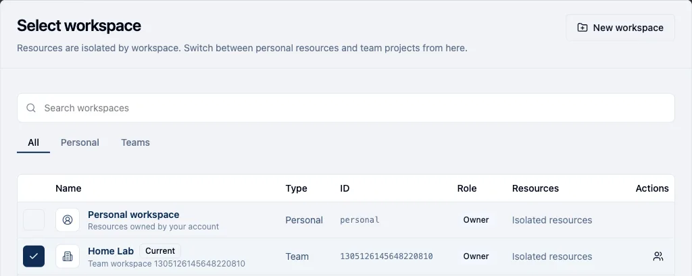
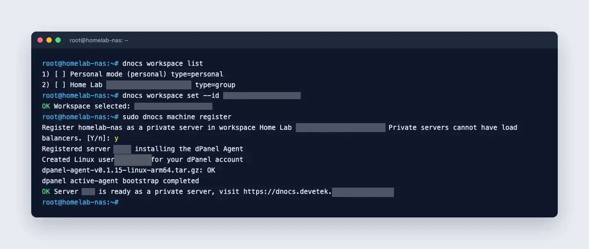
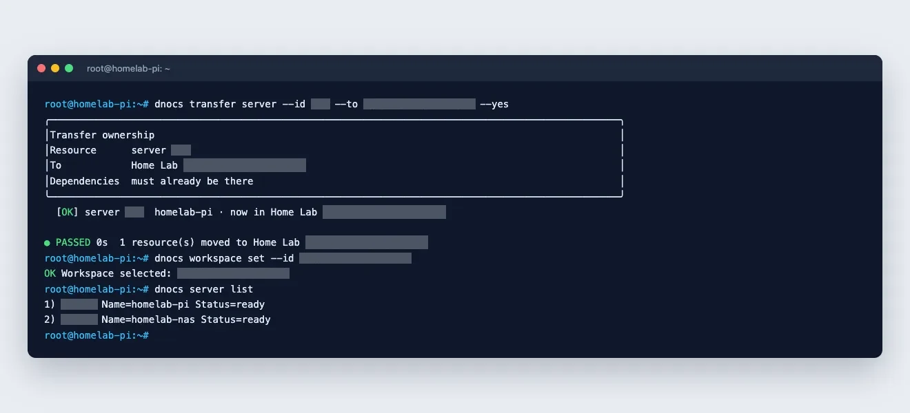
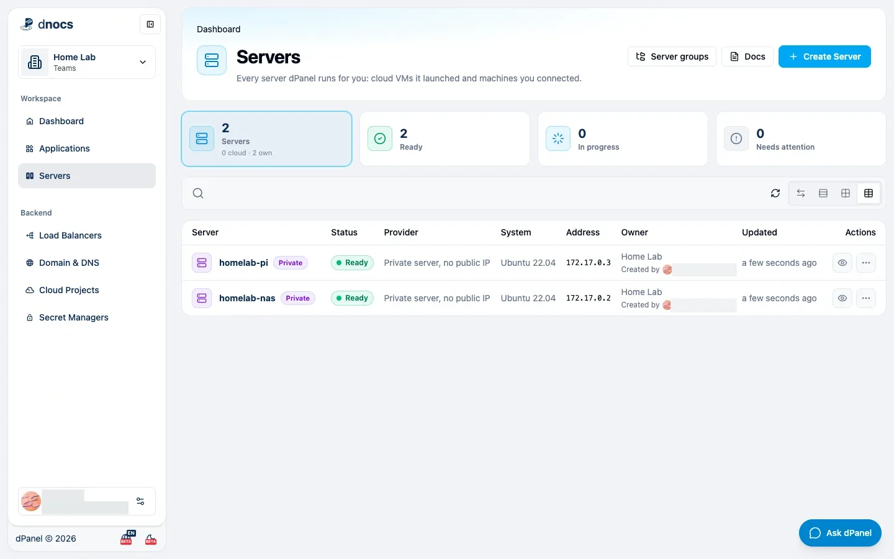
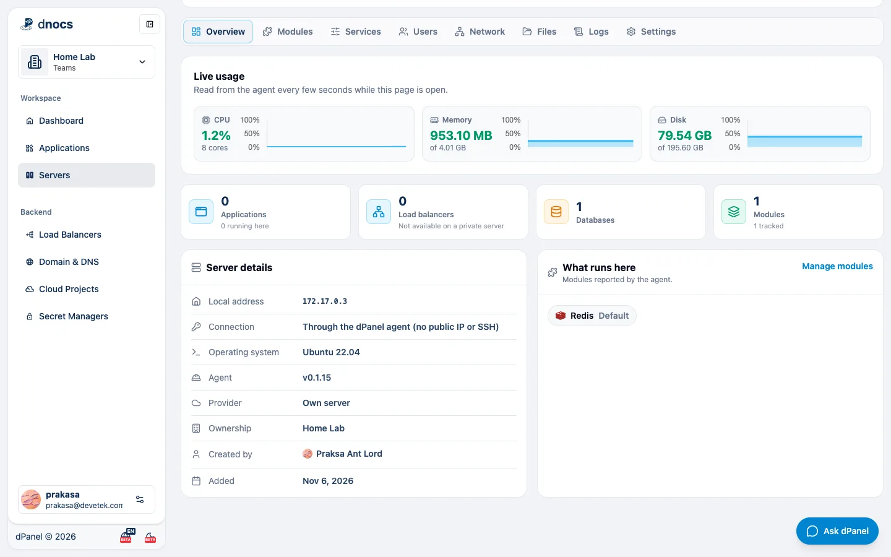
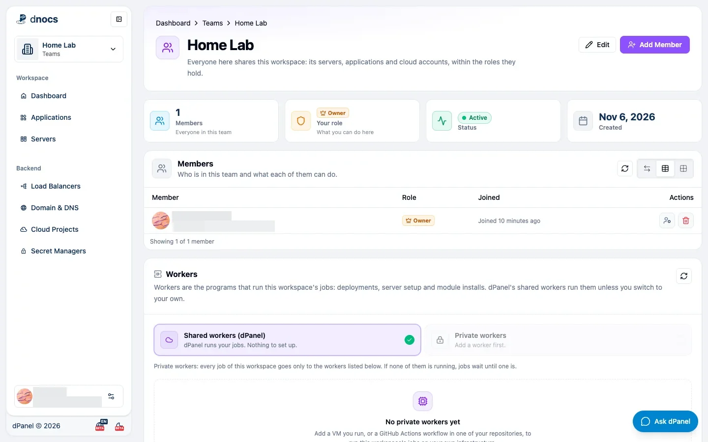
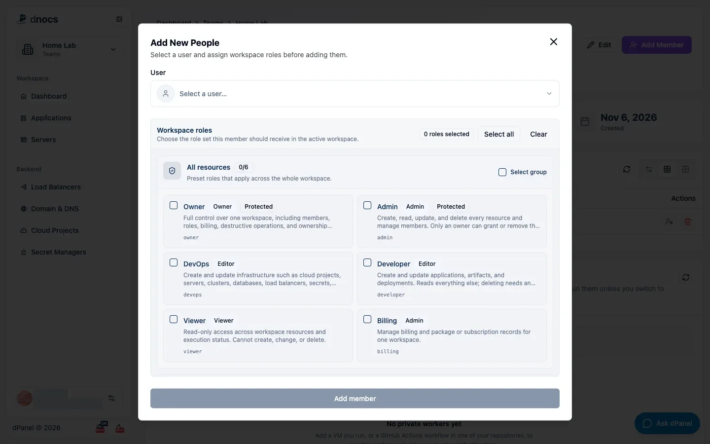

Mesin homelab bergabung ke dPanel dengan agen dPanel: Anda menjalankan satu perintah di setiap mesin, lalu agen menyambung keluar ke dPanel. Anda tidak perlu SSH, IP publik, atau port forwarding di router. Belum pernah menghubungkan mesin? Ikuti dulu [Hubungkan server dengan agen dPanel](../servers/register-a-private-machine.md); panduan itu menjelaskan setiap langkah untuk satu mesin.

Mesin yang Anda hubungkan masuk ke ruang kerja yang Anda pilih: ruang kerja yang sedang dipilih di dPanel saat Anda memilih **Ambil perintah pemasangan**, atau ruang kerja yang dipilih di dnocs saat Anda memakai `sudo dnocs machine register`. Jika itu ruang kerja personal, hanya Anda yang bisa melihatnya. Tutorial ini menaruh mesin homelab di **ruang kerja tim**, sehingga seluruh tim berbagi mesin yang sama: setiap anggota membuka server yang sama, memasang perangkat lunak, dan men-deploy aplikasi, sesuai peran yang Anda berikan.

Kami memakai ruang kerja bernama **Home Lab** dengan dua mesin:

- `homelab-nas`, dihubungkan langsung ke ruang kerja (Bagian 2).
- `homelab-pi`, yang sudah terhubung di ruang kerja personal lalu dipindahkan ke ruang kerja tim (Bagian 3).

Keduanya tidak punya IP publik maupun port yang terbuka. Mereka terhubung ke dPanel lewat agen, seperti dijelaskan di [Hubungkan server dengan agen dPanel](../servers/register-a-private-machine.md).

## Yang perlu disiapkan

- Ruang kerja tim, dan peran yang boleh menambah server ke ruang kerja itu: Owner, Admin, atau DevOps. Buat ruang kerja dari pemilih ruang kerja dengan **New workspace** (lihat [Ruang kerja](../getting-started/workspaces.md)).
- ID ruang kerja. Anda bisa melihatnya di pemilih ruang kerja, atau dengan `dnocs workspace list`.
- Di setiap mesin: Linux dengan systemd di Intel/AMD (`amd64`) atau ARM (`arm64`), `sudo`, dan akses internet. dnocs hanya dibutuhkan untuk cara baris perintah dan untuk memindahkan mesin (Bagian 3): [Memasang dnocs](../ai/ai-in-the-terminal.md#memasang-dnocs).

## Bagian 1: Pilih ruang kerja tim

Di dPanel, buka pemilih ruang kerja di kiri atas. Sumber daya personal dan ruang kerja tim dipisahkan; kolom ID menampilkan ID setiap ruang kerja.



## Bagian 2: Hubungkan mesin langsung ke ruang kerja

Dari situs web:

1. Pindahkan dPanel ke ruang kerja **Home Lab** di pemilih ruang kerja.
2. Buka **Server**, lalu **Buat Server**.
3. Di kartu **Hubungkan server dengan agen dPanel**, ketik `homelab-nas` sebagai nama server lalu pilih **Ambil perintah pemasangan**.
4. Pilih **Salin**, lalu tempel perintahnya di terminal mesin itu dan jalankan. Perintah ini meminta `sudo`.
5. Kartu menampilkan **Terhubung!** begitu agen terhubung, biasanya kurang dari satu menit. Server dibuat di ruang kerja Home Lab.

Perintahnya hanya bisa dipakai sekali, selama 2 jam; ambil perintah baru untuk setiap mesin. Mesin tidak butuh dnocs dan tidak perlu masuk akun.

**Lebih suka baris perintah?** Di mesin itu, masuk sebagai pengguna biasa, arahkan dnocs ke ruang kerja tim, lalu hubungkan mesinnya:

```bash
dnocs auth login -u <username Anda>
dnocs workspace set --id <ID ruang kerja>
sudo dnocs machine register
```

dnocs menyebut nama ruang kerja dalam pertanyaannya, jadi Anda bisa memastikan pilihan Anda benar sebelum mengonfirmasi. Setelah itu dnocs membuat user Linux untuk akun dPanel Anda, memasang agen, dan menunggu sampai server siap, biasanya kurang dari satu menit. Server dibuat di ruang kerja itu. Untuk membaca skrip pemasangannya sebelum dijalankan, pakai `sudo dnocs machine register --print-only`.



## Bagian 3: Pindahkan mesin dari ruang kerja personal

Mesin yang sebelumnya Anda hubungkan di ruang kerja personal bisa dipindahkan ke tim dengan `dnocs transfer`. Mesin itu tetap memakai ID server, agen, perangkat lunak yang terpasang, dan aplikasinya:

```bash
dnocs transfer server --id <ID server> --to "<nama atau ID ruang kerja>"
```

dnocs menampilkan apa yang dipindahkan dan meminta konfirmasi (`--yes` melewati pertanyaan itu). Pemindahan hanya satu arah: setelah server berada di sebuah ruang kerja, server itu tidak bisa kembali ke ruang kerja personal atau pindah lagi ke ruang kerja lain.



Menjalankan `sudo dnocs machine register` lagi di mesin yang sudah dipindahkan hanya berhasil dari ruang kerja tempat mesin itu sekarang berada; dari ruang kerja personal dnocs menolaknya, sehingga mesin tidak bisa keluar dari tim secara tidak sengaja.

## Bagian 4: Periksa server di ruang kerja

Pindahkan dPanel ke ruang kerja tim lalu buka **Servers**. Kedua mesin ada di sana dengan lencana **Private**, dimiliki oleh ruang kerja, beserta siapa yang menambahkannya.



Setiap halaman server menampilkan ruang kerja sebagai **Ownership**-nya. Semua yang ada di [panduan agen dPanel](../servers/register-a-private-machine.md) bekerja sama persis di sini: modul, aplikasi, terminal, file, log, pengelola database, dan load balancer. Pekerjaan untuk server ini tetap berjalan di mesin itu sendiri, apa pun worker yang dipakai ruang kerja.



## Bagian 5: Undang tim Anda

Buka **Teams**, lalu ruang kerjanya, untuk melihat anggota dan worker ruang kerja itu.



Pilih **Add Member**, pilih orangnya dan peran yang ia dapat. Peran menentukan apa yang bisa ia lakukan dengan homelab:



| Peran | Terhadap server homelab |
| --- | --- |
| Owner, Admin | Semuanya, termasuk menambah dan menghapus server serta anggota |
| DevOps | Menambah dan mengelola server, memasang modul, membuka terminal dan database; tidak bisa menghapus |
| Developer | Men-deploy dan mengelola aplikasi di server; melihat server tetapi tidak bisa mengubahnya atau membuka terminalnya; tidak bisa menghapus |
| Viewer | Hanya melihat: server, pemakaian, log, dan pekerjaan |

Lihat [Anggota dan peran](../teams/members-and-roles.md) untuk rincian setiap peran.

## Perlu diketahui

- Satu ruang kerja bisa menghubungkan hingga 10 mesin dengan cara ini (server cloud yang dibuat dPanel tidak dihitung), dan satu mesin hanya berada di satu ruang kerja pada satu waktu.
- Untuk menerbitkan situs dari mesin homelab, tambahkan load balancer dan teruskan (forward) port 80 dan 443 di router Anda ke mesin itu. Lihat [Pasang load balancer di server ini](../servers/register-a-private-machine.md#pasang-load-balancer-di-server-ini).
- Mengeluarkan seseorang dari ruang kerja langsung mencabut aksesnya ke server-server itu; mesinnya tetap berjalan.
- Menghapus server di dPanel langsung menghapusnya dan mencabut kredensial agennya. Setelah itu hentikan agen di mesin dengan `sudo systemctl disable --now dpanel-agent`.
